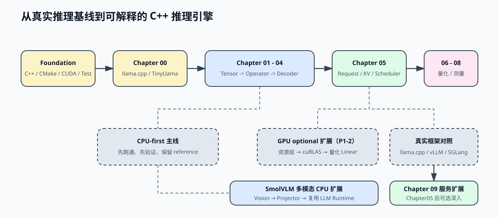
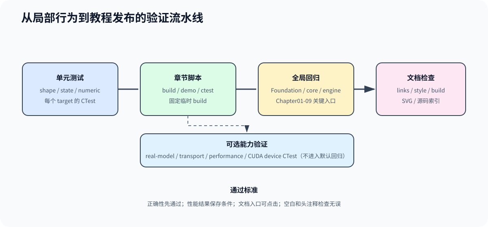

# cpp-llm-engine

用 C++ 构建 LLM 推理引擎

_A Practical Tutorial for Building a C++ LLM Inference Engine_

[](https://github.com/lynnyulinlin-debug/cpp-llm-engine/actions/workflows/ci.yml)

这是一套中文优先、以 C++ 为实现主线、CPU 可完整学习、GPU 可选加速的推理引擎工程教程。目标是从真实模型基线出发，逐步构建可以自行修改和验证的推理服务框架。

主图从上到下展示学习阶段、代码骨架和能力扩展。CPU 主线负责形成完整推理服务，CUDA 替换执行后端，多模态扩展输入路径，成熟框架用于核对工程策略。



## 开始学习

默认从 [`chapter00_quickstart`](source/chapter00_quickstart/intro.md) 跑通一次 TinyLlama 真实推理，再按 Chapter 01 到 Chapter 09 顺序学习。C++ 或 CMake 基础不足时，先按需完成 [`foundation`](source/foundation/README.md)；需要比较 `llama.cpp`、vLLM、SGLang 和 TensorRT-LLM 时，再查阅 [`reference/ecosystem`](source/reference/ecosystem/README.md)。

第一期 CPU v1 已形成可运行的教学型推理服务闭环。希望按阶段产物复现时，使用 [`第一期 CPU 学习计划`](source/guides/phase1_cpu_learning_plan.md)；维护者可用 `bash scripts/run_cpu_v1_acceptance.sh` 统一验收六个必做任务，任务 7 再可选体验 GPU。

Foundation 负责补工具链和语言能力，Chapter 00 负责建立真实推理基线。Chapter 09 接收 Chapter 05 的服务化扩展，当前已完成 C++ Service Core、metrics、真实模型 HTTP/SSE completion 和可选 cpp-httplib loopback transport。

## 项目定位

学习路径遵循同一条证据链：真实模型基线、算法与数据契约、最小 C++ 实现、测试或 benchmark、成熟框架工程坐标。完成主线后，学习者应能连接权重加载、Tensor、Operator、Decoder、Generation Runtime 和 ServiceCore，并能判断一次实现或优化是否有可复现证据。

Python 用于解释复杂算法并提供独立数值参考，不形成第二套运行时。`llama.cpp`、Tiny-VLLM、nano-vLLM、vLLM、SGLang、TensorRT-LLM 和 DeepInfer 用于回答不同工程问题，不替代本教程的稳定 C++ 主线。

主线覆盖单机 CPU 推理服务和可选的单消费级 NVIDIA GPU backend，并以多模态作为复用现有 Runtime 的扩展方向。多 GPU、模型并行、分离式部署、集群 KV 存储和生产级多租户属于进阶设计参照，不作为当前可运行能力承诺。

## 教程特点

本教程的核心组合是“C++ 可运行实现 + 可复现验证证据 + 成熟框架工程对照”。章节代码负责把概念变成可观察对象，测试和 golden 负责判断结果是否成立，框架对照卡负责把教学对象放回真实系统，而不是用框架名称装饰正文。

每章导读中的框架对照卡统一回答五个问题：本章实现什么、主要对照哪些框架、成熟系统还增加了什么、教学实现与生产实现差在哪里、下一步从哪个源码入口继续阅读。详细且容易随版本变化的源码坐标集中维护在 [`reference/ecosystem`](source/reference/ecosystem/README.md)，章节只保留稳定概念和入口。

| 教程特点 | 学习者获得什么 | 可信度约束 |
| --- | --- | --- |
| 真实模型纵向闭环 | 从 GGUF、Tokenizer、Embedding、Decoder 到 Runtime 和 ServiceCore | smoke、真实模型和服务能力分别说明，不互相替代 |
| C++ 主线、CPU 可完整学习 | 无 GPU 也能理解并运行完整引擎主线，CUDA 和多模态复用上层契约 | 可选能力使用独立构建和验证入口 |
| Correctness-first | 每项实现附带单测、golden、benchmark 或 profiling 证据 | 正确性失败时不讨论性能收益 |
| **章节级框架对照卡** | 把本章对象映射到 `llama.cpp`、vLLM、SGLang、TensorRT-LLM 等真实工程 | 区分概念相似、接口映射和实现等价，不宣称未验证能力 |
| 教学与生产分层 | 识别“已实现”“教学设计”“生产级参照”三种深度 | 生产组件只给约束与源码坐标，不写成仓库现成功能 |

## 为什么选择这些基线资产

教程选择模型时优先考虑单机可运行、结构具有代表性、外部实现可对照和结果容易复现，而不是追求排行榜能力。TinyLlama 和 SmolVLM 是首条纵向路径的固定基线，不会写进通用 Tensor、Runtime 或 ServiceCore 接口；后续更换模型时，应复用这些契约并重新生成对应 golden。

当前没有引入训练数据集或大规模质量评测集。`Hello TinyLlama`、`Hi`、固定 Apollo 11 图片、2×2 PPM 和合成小 Tensor 属于测试 fixture：它们用于核对 token、shape、checksum、状态和资源释放。模型质量、任务准确率和跨数据分布泛化需要另一套评测设计，不能从这些 fixture 推导。

| 资产 | 选择理由 | 在教程中的责任 | 不用于证明 |
| --- | --- | --- | --- |
| TinyLlama 1.1B Chat Q4_K_M | 约 638 MiB，CPU 可运行；保留 22 层 Llama、RMSNorm、RoPE、GQA、SwiGLU 和量化权重 | GGUF、Tokenizer、Decoder、Runtime、HTTP/SSE 的完整语言主线 | 大模型能力或生产吞吐 |
| SmolVLM 500M Instruct Q8_0 + mmproj | 规模适合单机；IDEFICS3 明确暴露动态切图、Vision Encoder、Projector 和图文 embedding 交接 | 多模态输入扩展，并复用既有 LLM Runtime | 通用视觉模型支持或多模态质量排名 |
| `llama.cpp` | 同时支持 GGUF、CPU、CUDA 和 mtmd 多模态路径 | 提供独立外部 baseline，避免自研实现自己证明自己 | 本教程自研 Engine 的替代品 |
| 固定 prompt、图片和合成输入 | 输入小、hash 可固定、错误容易定位 | 默认 CTest、真实 golden、跨实现数值与生命周期回归 | 训练语料覆盖率或统计显著性 |

## 哪些复用，哪些自行实现

教程不以“所有组件都从零实现”为目标，而是把实现精力放在推理引擎的执行、状态和资源边界。模型专属且容易因细节产生不兼容的真实分词复用 `llama.cpp`；GGUF 对象化、量化 Embedding、Decoder、Runtime、Serving 和多模态执行由教程代码完成。外部实现和 NumPy 镜像只提供独立证据，不进入默认 C++ 主线。

| 能力 | 当前来源 | 选择原因 | 教程验证方式 |
| --- | --- | --- | --- |
| Toy Tokenizer | 自行实现的字符映射 | 快速测试接口和错误输入，不冒充真实 BPE | 默认无模型 CTest |
| 真实 Tokenizer | `llama.cpp` vocabulary API 的 C++ adapter | 保持模型词表、Unicode 和特殊 token 行为一致 | 固定 prompt 的 token ID 与 detokenize 对照 |
| GGUF Reader 与模型配置 | 自行实现 | 学习 metadata、tensor index、payload 和对象生命周期 | schema、offset、shape、dtype 与真实文件检查 |
| 文本 Embedding | 自行读取 `token_embd.weight` 并解码 Q4_K/Q8_0 | 量化布局和 lookup 属于模型执行核心 | CPU/NumPy checksum、logits 和 token golden |
| Decoder、Runtime、ServiceCore | 自行实现 | 覆盖 Attention/FFN、KV、调度、生成和资源释放 | 单测、真实模型 golden、HTTP/SSE 与 benchmark |
| Vision Encoder、Projector 与图文组装 | 自行实现 | 展示多模态输入怎样进入已有 LLM Runtime | C++/NumPy、`llama.cpp` mtmd 和阶段指标 |
| `llama.cpp` / NumPy | 外部 baseline 与 reference | 提供独立结果，避免实现与验收使用同一代码 | hash、shape、checksum、top-k 和输出序列 |

## GPU 定位与显存口径

GPU 阶段面向单机、单张 NVIDIA 消费级显卡，CPU 路径始终保留为正确性基线和无 GPU 环境下的完整学习入口。首期使用 TinyLlama 1.1B Q4_K_M，不建设多 GPU、模型并行或分布式调度。

`8 GB` 是首期端到端实现的设计验证目标，不是已经实测出的最低显存；`12 GB` 只代表扩展长上下文、更多请求或更大模型时有更多余量，不作为学习门槛。当前量化模型文件约 638 MiB；按 22 层、K/V width 256、FP16、2048 context 估算，单请求 KV Cache 约 44 MiB。最终支持范围必须在 CUDA 路径完成后记录权重、KV Cache、workspace、CUDA runtime 和 peak allocated，再用实测结果发布。

| 口径 | 当前结论 |
| --- | --- |
| 支持形态 | 单机、单张 NVIDIA 消费级显卡，CPU 可独立完成主线 |
| 模型基线 | TinyLlama 1.1B Q4_K_M，量化权重保持量化表示 |
| 8 GB | 首期设计和验证目标，不等于最低要求 |
| 12 GB | 扩展配置，不是推荐门槛 |
| 最低显存 | 尚未确定，等待 4/6/8 GB 限额或设备实测 |
| 发布证据 | 模型、context、并发数、权重、KV、workspace、runtime 和峰值显存 |

## 章节入口

主线顺序固定为：

```text
Foundation -> Chapter00 -> Chapter01 -> Chapter02 -> Chapter03 -> Chapter04
    -> Chapter05 -> Chapter06 -> Chapter07 -> Chapter08 -> Chapter09
```

Chapter09 虽然放在总主线末尾，但服务化专题可以在完成 Chapter05 后提前阅读。

| 模块 | 定位 | 主要内容 | 完成后的产物 |
| --- | --- | --- | --- |
| [`foundation`](source/foundation/README.md) | 前置准备 | C++、构建、CUDA、调试、测试基础 | 基础练习和最小工程 |
| [`chapter00_quickstart`](source/chapter00_quickstart/intro.md) | 起跑线 | 第一次真实推理 | llama.cpp + TinyLlama CPU 输出 |
| [`chapter01_tensor_loader`](source/chapter01_tensor_loader/intro.md) | 输入层 | 权重加载、`Tensor` 与真实 Model 构建 | 可检查的 tokenizer、metadata、权重和 Model |
| [`chapter02_tensor_ops`](source/chapter02_tensor_ops/intro.md) | 张量语义层 | 视图语义、共享存储、`reshape`、`slice` | 共享 Storage 的 Tensor view |
| [`chapter03_matmul`](source/chapter03_matmul/intro.md) | 算子边界层 | `MatMul`、后端拆分、参考实现 | 可验证的 CPU MatMul backend |
| [`chapter04_attention`](source/chapter04_attention/intro.md) | 结构层 | Attention、FFN、DecoderLayer | 可测试的单层 Decoder |
| [`chapter05_generation`](source/chapter05_generation/intro.md) | Generation Runtime | Prefill / Decode、Request、KV Cache、Scheduler、Streaming | 可推进单请求和多请求的 CPU Runtime |
| [`chapter06_quantization`](source/chapter06_quantization/intro.md) | 表示与成本层 | 量化路径和精度权衡 | Q4_K/Q6_K Linear 正确性与性能对照 |
| [`chapter07_benchmark`](source/chapter07_benchmark/intro.md) | 验证层 | 正确性验证和性能比较 | 可复现的 benchmark JSON |
| [`chapter08_profiling`](source/chapter08_profiling/intro.md) | 归因与优化层 | Profiling 证据和 A/B 对比 | 阶段、trace、hotspot 和优化决策 |
| [`chapter09_serving`](source/chapter09_serving/intro.md) | 服务扩展层 | C++ Service Core、动态 batch、Block KV、HTTP/SSE | 可测试的最小 CPU 推理服务 |
| [`code/cuda`](code/cuda/README.md) | GPU 执行扩展 | 设备资源、量化 Linear、RoPE、连续 KV、GQA、合成 Decoder | CPU/CUDA 数值对照与设备 CTest |
| [`code/multimodal`](code/multimodal/README.md) | 多模态输入扩展 | 动态切图、Vision Encoder、Projector、embedding 拼接 | SmolVLM CPU Decoder、ServiceCore 与 profiling golden |
| [`guides`](source/guides/README.md) | 工程参考层 | 构建、环境、迁移和工程方法 | 按需使用的操作指南 |
| [`reference`](source/reference/README.md) | 解释层 | 术语、生态对照、概念映射 | 跨章节查询入口 |

## 使用文档

如果你要选择学习路线和运行代码，阅读 [USAGE.md](USAGE.md)；准备修改和提交时阅读 [CONTRIBUTING.md](CONTRIBUTING.md)；搭建环境或查看 CPU / GPU 分界线时阅读 [docs/guide.md](docs/guide.md)。完整代码架构图也放在阅读指南中，不在 README 重复展开。

## 进阶优化路线

这条路线面向已经读完主线、想继续深入推理优化的读者。它不是主线替代，而是主线之后的专题延伸。

| Task | 专题方向 | 关注点 |
| --- | --- | --- |
| 1 | 推理结构地基 | `MHA` / `GQA`、`LLaMA3 Block` |
| 2 | Attention 访存瓶颈与 FlashAttention | 访存模型、`SRAM` 优化、`FlashAttention` |
| 3 | 解码算法 | `Decoding Strategies`、`Speculative Decoding`、`Multi-Token Decoding`、`Decode Scheduling` |
| 4 | `KV Cache` 与推理服务内存管理 | `PagedAttention`、`RadixAttention`、`Prefix Caching`、`Chunked Prefill`、`KV Cache Scheduling` |
| 5 | 量化推理与部署 | `INT4 / INT8`、`W8A16`、`GPTQ / AWQ`、`FP8`、`KV Cache Quantization` |
| 6 | 扩展选读与专题复盘 | `Inference Performance Comparison` |

这条路线适合在 `chapter07` 之后继续看，也适合把主线中的 `attention`、`generation`、`quantization` 和 `benchmark` 再往优化视角拉深。

## 相关入口

- [USAGE.md](USAGE.md)
- [CONTRIBUTING.md](CONTRIBUTING.md)
- [docs/README.md](docs/README.md)
- [docs/README.en.md](docs/README.en.md)
- [docs/guide.md](docs/guide.md)
- [docs/index.md](docs/index.md)
- [source/reference/README.md](source/reference/README.md)
- [source/reference/chapter_assets.md](source/reference/chapter_assets.md)
- [source/reference/experiment_assets.md](source/reference/experiment_assets.md)
- [source/reference/formulas.md](source/reference/formulas.md)
- [source/reference/glossary.md](source/reference/glossary.md)
- [source/reference/ecosystem/README.md](source/reference/ecosystem/README.md)

## 验证闭环

默认 CPU 回归负责无模型、无网络、无 GPU 环境下的主线稳定性；真实模型、transport、性能、CUDA 和多模态实验使用各自入口补充证据。验证从局部数值与状态开始，逐步收口到章节脚本、全局回归和文档发布检查。



## 构建与检查

```bash
npm install
npm run docs:check-structure
npm run docs:check-links
npm run code:check-headers
npm run docs:build
npm run docs:preview
npm run test:regression
```

`test:regression` 是不依赖 GGUF、网络下载或 GPU 的默认 CPU 回归。真实模型、cpp-httplib transport、性能实验和现有 CUDA 设备测试使用各自的可选验证入口，不包含在这条命令中。

GitHub Actions 会在 `main` push 和 pull request 上执行文档风格、链接构建与默认 CPU 回归。真实模型、GPU 和 socket 验证继续使用各自的本地入口。

如果你的环境需要指定镜像：

```bash
npm install --registry=https://registry.npmjs.org
```
