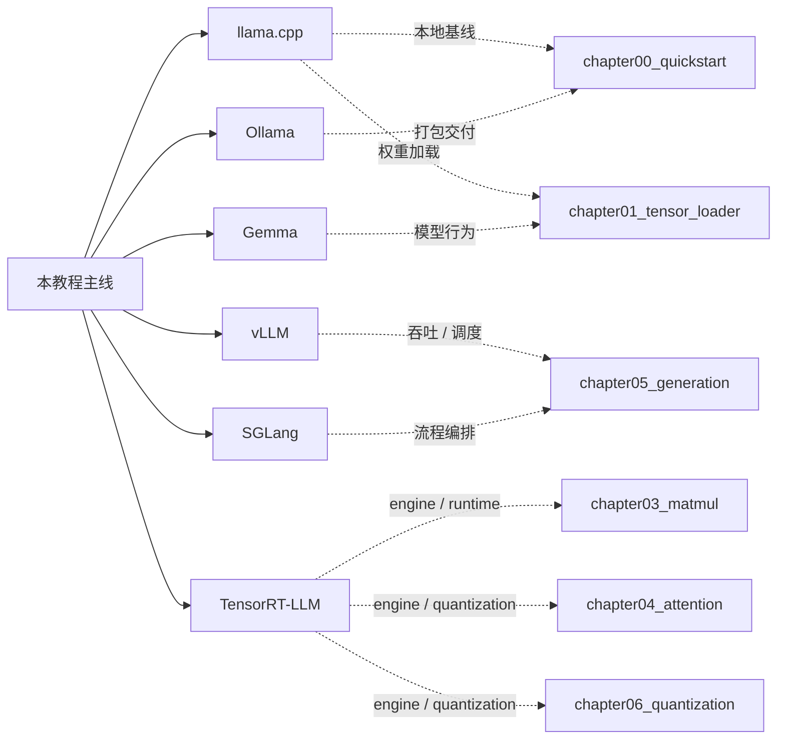
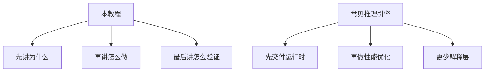

# cpp-llm-engine

用 C++ 构建 LLM 推理引擎

_A Practical Tutorial for Building a C++ LLM Inference Engine_

这是一个面向中文学习者优先的工程教程仓库。  
主教程入口在 [docs/README.md](docs/README.md)，英文入口在 [docs/README.en.md](docs/README.en.md) 和 [/en/README](/en/README)。如果你想先知道怎么读，先看 [USAGE.md](USAGE.md)。

## 这套教程的定位

这不是“讲概念最多”的资料集，而是一条可顺着读、顺着跑、顺着改的工程路径。

- 从 `foundation` 补基础底座
- 从 `chapter00_quickstart` 跑通真实基线
- 从 `Tensor`、`MatMul`、`Attention` 走到 `Generation`
- 再用 `Quantization` 和 `Benchmark` 收口
- `foundation` 统一使用 `Fxx` 编号，`guides` / `reference` / `maintenance` 分别承担开发参考、设计参考和维护文档

## 英文覆盖状态

| 页面 | 状态 | 路由 |
| --- | --- | --- |
| 首页 | 已完成 | `/en/` |
| 项目说明 | 已完成 | `/en/README` |
| 阅读指南 | 已完成 | `/en/guide` |
| Foundation 入口与正文 | 已完成 | `/en/foundation/README`、`/en/foundation/*` |
| Reference 关键页 | 已完成 | `/en/reference/glossary`、`/en/reference/faq`、`/en/reference/framework_comparison` |
| 各章导读 / 收尾 | 已完成 | `/en/chapterXX/intro`、`/en/chapterXX/summary` |

```mermaid
flowchart LR
    F[Fxx foundation] --> C0[chapter00_quickstart]
    C0 --> C1[chapter01_tensor_loader]
    C1 --> C2[chapter02_tensor_ops]
    C2 --> C3[chapter03_matmul]
    C3 --> C4[chapter04_attention]
    C4 --> C5[chapter05_generation]
    C5 --> C6[chapter06_quantization]
    C6 --> C7[chapter07_benchmark]
    C7 --> G[guides / reference / maintenance]
```



## 本教程的特色

| 维度 | 本教程 | 典型推理引擎项目 |
| --- | --- | --- |
| 目标 | 讲清楚从零实现一条可验证的推理主线 | 直接交付可用 runtime / serving |
| 读者 | 中文优先，零基础到工程入门 | 默认读者已有较强工程背景 |
| 组织方式 | 章节化、分层、每章有导入和收口 | 更偏模块化或代码仓库结构 |
| 验证方式 | smoke test、assert、e2e、benchmark 分层推进 | 多数只强调最终运行结果 |
| 教学重点 | 原理、边界、实现、验证、迁移 | 性能、部署、工程集成 |
| 外部参考 | `llama.cpp`、`vLLM`、`SGLang`、`TensorRT-LLM`、`Ollama` | 只看单个引擎自身设计 |

## 和常见推理引擎的对照

| 对象 | 强项 | 适合拿来学什么 | 本教程对应章节 |
| --- | --- | --- | --- |
| `llama.cpp` | 小、轻、可移植，适合先跑起来 | 最小本地基线、权重加载、首次推理 | `chapter00_quickstart`、`chapter01_tensor_loader` |
| `vLLM` | 高吞吐 serving、调度和 KV cache | batching、scheduler、cache 管理 | `chapter05_generation`、`chapter07_benchmark` |
| `SGLang` | 结构化 serving 和应用编排 | 多步流程组织、上层 workflow | `chapter05_generation`、`chapter07_benchmark` |
| `TensorRT-LLM` | GPU engine、runtime 分层和部署优化 | engine build、kernel、量化部署 | `chapter03_matmul`、`chapter04_attention`、`chapter06_quantization`、`chapter07_benchmark` |
| `Ollama` | 本地交付、打包、易用性 | 如何把推理能力包装成产品 | `chapter00_quickstart`、`chapter05_generation` |
| `Gemma` | 具体模型家族参考 | 兼容性、验证对象、模型行为 | `chapter01_tensor_loader`、`chapter04_attention`、`chapter06_quantization`、`chapter07_benchmark` |





## 章节总览

| 顺序 | 模块 | 入口 | 主要内容 |
| --- | --- | --- | --- |
| 0 | `foundation` | [source/foundation/README.md](source/foundation/README.md) | C++、构建、CUDA、调试与测试基础 |
| 1 | `chapter00_quickstart` | [source/chapter00_quickstart/intro.md](source/chapter00_quickstart/intro.md) | 先跑通第一次真实推理 |
| 2 | `chapter01_tensor_loader` | [source/chapter01_tensor_loader/intro.md](source/chapter01_tensor_loader/intro.md) | 权重加载与 `Tensor` 抽象 |
| 3 | `chapter02_tensor_ops` | [source/chapter02_tensor_ops/intro.md](source/chapter02_tensor_ops/intro.md) | 视图语义、共享存储、`reshape`、`slice` |
| 4 | `chapter03_matmul` | [source/chapter03_matmul/intro.md](source/chapter03_matmul/intro.md) | `MatMul` 算子、后端拆分、参考实现 |
| 5 | `chapter04_attention` | [source/chapter04_attention/intro.md](source/chapter04_attention/intro.md) | attention、FFN、decoder layer |
| 6 | `chapter05_generation` | [source/chapter05_generation/intro.md](source/chapter05_generation/intro.md) | token-by-token generation、KV cache、sampler |
| 7 | `chapter06_quantization` | [source/chapter06_quantization/intro.md](source/chapter06_quantization/intro.md) | 量化推理路径和精度权衡 |
| 8 | `chapter07_benchmark` | [source/chapter07_benchmark/intro.md](source/chapter07_benchmark/intro.md) | 正确性验证、性能比较、证据收口 |
| 9 | `guides` | [source/guides/README.md](source/guides/README.md) | 开发参考、构建、环境、迁移 |
| 10 | `reference` | [source/reference/README.md](source/reference/README.md) | 设计参考、术语、生态对照 |
| 11 | `maintenance` | [source/maintenance/README.md](source/maintenance/README.md) | 教程维护、写作规范、模板 |

## 这套教程适合谁

- 想从零看懂 C++ 推理引擎的人
- 想把“能跑”继续推进到“能解释、能验证、能扩展”的人
- 想对比 `llama.cpp`、`vLLM`、`SGLang`、`TensorRT-LLM`、`Ollama` 的工程思路的人

## 读法建议

1. 先看 [USAGE.md](USAGE.md)
2. 再看 [docs/README.md](docs/README.md)
3. 基础薄弱就先看 [source/foundation/README.md](source/foundation/README.md)
4. 想先跑结果就从 `chapter00_quickstart` 开始
5. 想做工程判断就重点看 `chapter05_generation` 和 `chapter07_benchmark`

## 本地预览

先安装依赖，再构建或预览：

```bash
npm install
npm run docs:build
npm run docs:preview
```

本地开发预览：

```bash
npm run docs:dev
```

如果你的环境需要指定镜像：

```bash
npm install --registry=https://registry.npmjs.org
```

## 相关入口

- [docs/README.md](docs/README.md)：站点中文主入口
- [docs/README.en.md](docs/README.en.md)：站点英文入口
- [docs/guide.md](docs/guide.md)：阅读指南
- [source/guides/README.md](source/guides/README.md)：开发参考入口
- [source/reference/README.md](source/reference/README.md)：设计参考入口
- [source/maintenance/README.md](source/maintenance/README.md)：维护文档入口
