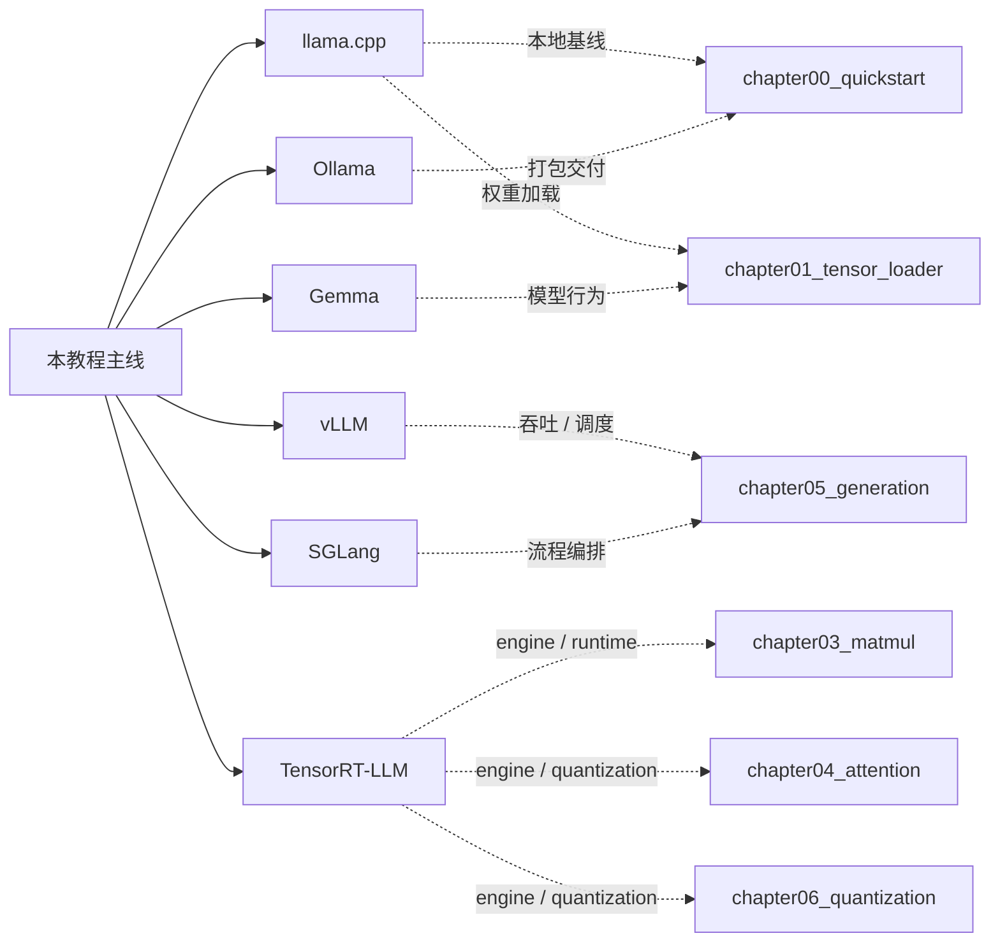
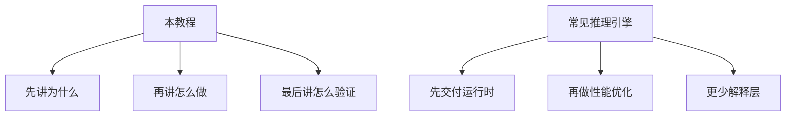

# cpp-llm-engine

用 C++ 构建 LLM 推理引擎

_A Practical Tutorial for Building a C++ LLM Inference Engine_

这是一个面向中文学习者优先的工程教程仓库。  
主教程入口在 [docs/README.md](docs/README.md)，英文入口在 [docs/README.en.md](docs/README.en.md) 和 [/en/README](/en/README)。如果你想先知道怎么读，先看 [USAGE.md](USAGE.md)。

## 这套教程的定位

这不是“讲概念最多”的资料集，而是一条可顺着读、顺着跑、顺着改的工程路径。它面向的是想从零看懂 C++ 推理引擎、并把“能跑”继续推进到“能解释、能验证、能扩展”的读者。

中文主线已经完成一轮收口，当前重点放在英文正文、少量残余句式清理，以及参考层和维护层的持续补齐。

- 从 `foundation` 补基础底座
- 从 `chapter00_quickstart` 跑通真实基线
- 从 `Tensor`、`MatMul`、`Attention` 走到 `Generation`
- 再用 `Quantization` 和 `Benchmark` 收口
- 主线中文正文已收束到“导读 / 机制 / 收口”三层，代码直达也已统一到具体实现文件
- 以 `foundation`、主线章节、`guides` / `reference` / `maintenance` 三层结构组织内容
- 用章节导读、代码索引和收口页把“读文档”和“看代码”连起来
- 保持中文优先，同时保留英文入口和逐步扩展能力
- 允许 CPU-first 学习路径先跑通，再在需要时接入 CUDA / GPU 后端

## 教程主线

这套教程不是按“主题合集”组织的，而是按一条推理引擎主线往前推进。

| 阶段 | 主要职责 | 读完后你应该能理解什么 |
| --- | --- | --- |
| `chapter01` - `chapter03` | 输入、张量语义、算子边界 | 权重怎样进入程序，张量怎样表达视图，计算怎样变成稳定边界 |
| `chapter04` - `chapter05` | 结构与运行时 | 单层 decoder 怎样站稳，decoder 怎样进入生成 runtime |
| `chapter06` | 表示与成本 | 量化怎样降低资源成本，同时保住可接受精度 |
| `chapter07` | 验证与证据 | 正确性、性能和 benchmark 结果怎样被系统地验证和比较 |

`chapter07` 之后，主线不再继续扩成新的教学章节，而是转入解释层和工程层：

- `reference` 负责概念解释、术语和生态对照
- `guides` 负责构建、环境、迁移和工程方法
- `maintenance` 负责站点维护、写作规范和长期收口

如果你先想把 Python 推理框架和 C++ 推理引擎的分工讲清楚，先看 [training vs inference frameworks](/reference/framework_comparison)。

这意味着这套教程的收束方式很明确：先把一个推理引擎做出来，再把它验证清楚，最后把它放回真实生态里对照和维护。

## 和常见推理引擎的对照

| 对象 | 强项 | 硬件平台适配进展 | 适合拿来学什么 | 本教程对应章节 |
| --- | --- | --- | --- | --- |
| `llama.cpp` | 小、轻、可移植，适合先跑起来 | CPU 优先；CUDA 路径可选 | 最小本地基线、权重加载、首次推理 | `chapter00_quickstart`、`chapter01_tensor_loader` |
| `vLLM` | 高吞吐 serving、调度和 KV cache | 以 NVIDIA GPU 为主，CPU 不是主路径 | batching、scheduler、cache 管理 | `chapter05_generation`、`chapter07_benchmark` |
| `SGLang` | 结构化 serving 和应用编排 | 以 GPU serving 场景为主 | 多步流程组织、上层 workflow | `chapter05_generation`、`chapter07_benchmark` |
| `TensorRT-LLM` | GPU engine、runtime 分层和部署优化 | NVIDIA GPU 优先；CUDA 生态绑定最强 | engine build、kernel、量化部署 | `chapter03_matmul`、`chapter04_attention`、`chapter06_quantization`、`chapter07_benchmark` |
| `Ollama` | 本地交付、打包、易用性 | CPU 本地交付友好；GPU 适配依赖后端实现 | 如何把推理能力包装成产品 | `chapter00_quickstart`、`chapter05_generation` |
| `Gemma` | 具体模型家族参考 | 模型本身与平台无关；执行取决于所选引擎 | 兼容性、验证对象、模型行为 | `chapter01_tensor_loader`、`chapter04_attention`、`chapter06_quantization`、`chapter07_benchmark` |





## 章节总览

| 顺序 | 模块 | 主要内容 | 英文覆盖状态 |
| --- | --- | --- | --- |
| 0 | [`foundation`](source/foundation/README.md) | C++、构建、CUDA、调试与测试基础 | 英文正文已覆盖 |
| 1 | [`chapter00_quickstart`](source/chapter00_quickstart/intro.md) | 先跑通第一次真实推理 | 英文导读 / 收口已覆盖 |
| 2 | [`chapter01_tensor_loader`](source/chapter01_tensor_loader/intro.md) | 权重加载与 `Tensor` 抽象 | 英文导读 / 收口已覆盖 |
| 3 | [`chapter02_tensor_ops`](source/chapter02_tensor_ops/intro.md) | 视图语义、共享存储、`reshape`、`slice` | 英文导读 / 收口已覆盖 |
| 4 | [`chapter03_matmul`](source/chapter03_matmul/intro.md) | `MatMul` 算子、后端拆分、参考实现 | 英文导读 / 收口已覆盖 |
| 5 | [`chapter04_attention`](source/chapter04_attention/intro.md) | attention、FFN、decoder layer | 英文导读 / 收口已覆盖 |
| 6 | [`chapter05_generation`](source/chapter05_generation/intro.md) | token-by-token generation、KV cache、sampler | 英文导读 / 收口已覆盖 |
| 7 | [`chapter06_quantization`](source/chapter06_quantization/intro.md) | 量化推理路径和精度权衡 | 英文导读 / 收口已覆盖 |
| 8 | [`chapter07_benchmark`](source/chapter07_benchmark/intro.md) | 正确性验证、性能比较、证据收口 | 英文导读 / 收口已覆盖 |
| 9 | [`guides`](source/guides/README.md) | 开发参考、构建、环境、迁移 | 英文入口已覆盖 |
| 10 | [`reference`](source/reference/README.md) | 设计参考、术语、生态对照 | 部分完成 |
| 11 | [`maintenance`](source/maintenance/README.md) | 教程维护、写作规范、模板 | 部分完成 |

## 读法建议

1. 先看 [USAGE.md](USAGE.md)
2. 再看 [docs/README.md](docs/README.md)
3. 基础薄弱就先看 [source/foundation/README.md](source/foundation/README.md)
4. 想先跑结果就从 `chapter00_quickstart` 开始
5. 想做工程判断就重点看 `chapter05_generation` 和 `chapter07_benchmark`

## 本地预览

先安装依赖，再构建或预览：

```bash
npm install
npm run docs:check-links
npm run docs:build
npm run docs:preview
```

本地开发预览：

```bash
npm run docs:dev
```

如果你的环境需要指定镜像：

```bash
npm install --registry=https://registry.npmjs.org
```

## 相关入口

- [docs/README.md](docs/README.md)：站点中文主入口
- [docs/README.en.md](docs/README.en.md)：站点英文入口
- [docs/guide.md](docs/guide.md)：阅读指南
- [source/guides/README.md](source/guides/README.md)：开发参考入口
- [source/reference/README.md](source/reference/README.md)：设计参考入口
- [source/maintenance/README.md](source/maintenance/README.md)：维护文档入口
