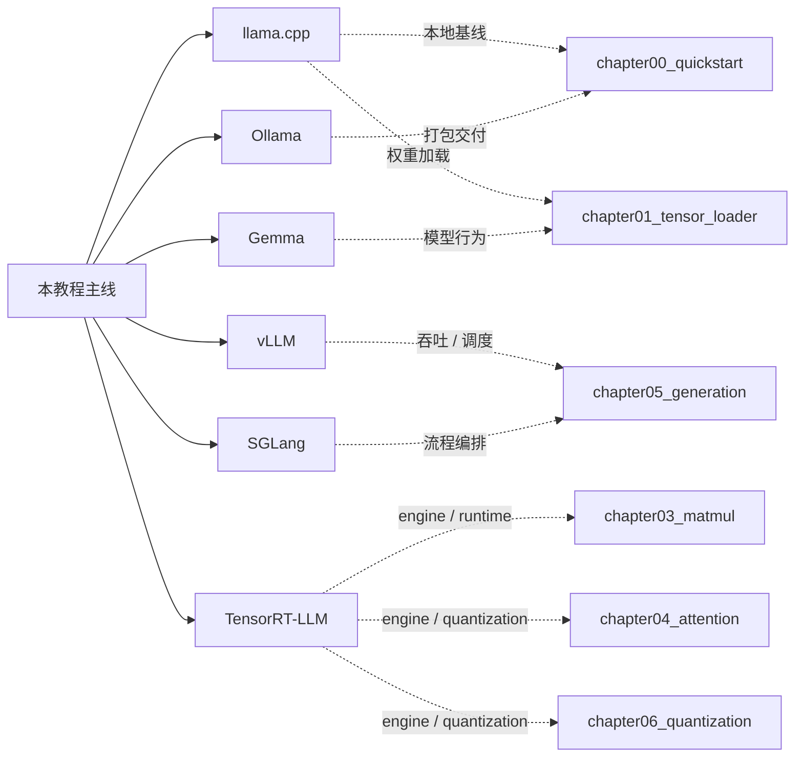
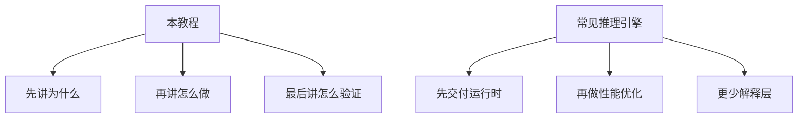

# 用 C++ 构建 LLM 推理引擎

_A Practical Tutorial for Building a C++ LLM Inference Engine_

这是整套教程给学习者看的中文主入口。若你更习惯英文导航，可以先看 [English entry](/en/README)。

## 这套教程的定位

这不是“讲概念最多”的资料集，而是一条可顺着读、顺着跑、顺着改的工程路径。它面向的是想从零看懂 C++ 推理引擎、并把“能跑”继续推进到“能解释、能验证、能扩展”的读者。

- 从 `foundation` 补基础底座
- 从 `chapter00_quickstart` 跑通真实基线
- 从 `Tensor`、`MatMul`、`Attention` 走到 `Generation`
- 再用 `Quantization` 和 `Benchmark` 收口
- 以 `foundation`、主线章节、`guides` / `reference` / `maintenance` 三层结构组织内容
- 用章节导读、代码索引和收口页把“读文档”和“看代码”连起来
- 保持中文优先，同时保留英文入口和逐步扩展能力
- 允许 CPU-first 学习路径先跑通，再在需要时接入 CUDA / GPU 后端

## 本教程的特色

| 维度 | 本教程 | 典型推理引擎项目 |
| --- | --- | --- |
| 目标 | 讲清楚从零实现一条可验证的推理主线 | 直接交付可用 runtime / serving |
| 读者 | 中文优先，零基础到工程入门 | 默认读者已有较强工程背景 |
| 组织方式 | 章节化、分层、每章有导入和收口 | 更偏模块化或代码仓库结构 |
| 验证方式 | smoke test、assert、e2e、benchmark 分层推进 | 多数只强调最终运行结果 |
| 教学重点 | 原理、边界、实现、验证、迁移 | 性能、部署、工程集成 |
| 外部参考 | `llama.cpp`、`vLLM`、`SGLang`、`TensorRT-LLM`、`Ollama` | 只看单个引擎自身设计 |

## 和常见推理引擎的对照

| 对象 | 强项 | 硬件平台适配进展 | 适合拿来学什么 | 本教程对应章节 |
| --- | --- | --- | --- | --- |
| `llama.cpp` | 小、轻、可移植，适合先跑起来 | CPU 优先；CUDA 路径可选 | 最小本地基线、权重加载、首次推理 | `chapter00_quickstart`、`chapter01_tensor_loader` |
| `vLLM` | 高吞吐 serving、调度和 KV cache | 以 NVIDIA GPU 为主，CPU 不是主路径 | batching、scheduler、cache 管理 | `chapter05_generation`、`chapter07_benchmark` |
| `SGLang` | 结构化 serving 和应用编排 | 以 GPU serving 场景为主 | 多步流程组织、上层 workflow | `chapter05_generation`、`chapter07_benchmark` |
| `TensorRT-LLM` | GPU engine、runtime 分层和部署优化 | NVIDIA GPU 优先；CUDA 生态绑定最强 | engine build、kernel、量化部署 | `chapter03_matmul`、`chapter04_attention`、`chapter06_quantization`、`chapter07_benchmark` |
| `Ollama` | 本地交付、打包、易用性 | CPU 本地交付友好；GPU 适配依赖后端实现 | 如何把推理能力包装成产品 | `chapter00_quickstart`、`chapter05_generation` |
| `Gemma` | 具体模型家族参考 | 模型本身与平台无关；执行取决于所选引擎 | 兼容性、验证对象、模型行为 | `chapter01_tensor_loader`、`chapter04_attention`、`chapter06_quantization`、`chapter07_benchmark` |





## 章节总览

| 顺序 | 模块 | 主要内容 | 英文覆盖状态 |
| --- | --- | --- | --- |
| 0 | [`foundation`](/foundation/README) | C++、构建、CUDA、调试与测试基础 | 英文正文已覆盖 |
| 1 | [`chapter00_quickstart`](/chapter00_quickstart/intro) | 先跑通第一次真实推理 | 英文导读 / 收口已覆盖 |
| 2 | [`chapter01_tensor_loader`](/chapter01_tensor_loader/intro) | 权重加载与 `Tensor` 抽象 | 英文导读 / 收口已覆盖 |
| 3 | [`chapter02_tensor_ops`](/chapter02_tensor_ops/intro) | 视图语义、共享存储、`reshape`、`slice` | 英文导读 / 收口已覆盖 |
| 4 | [`chapter03_matmul`](/chapter03_matmul/intro) | `MatMul` 算子、后端拆分、参考实现 | 英文导读 / 收口已覆盖 |
| 5 | [`chapter04_attention`](/chapter04_attention/intro) | attention、FFN、decoder layer | 英文导读 / 收口已覆盖 |
| 6 | [`chapter05_generation`](/chapter05_generation/intro) | token-by-token generation、KV cache、sampler | 英文导读 / 收口已覆盖 |
| 7 | [`chapter06_quantization`](/chapter06_quantization/intro) | 量化推理路径和精度权衡 | 英文导读 / 收口已覆盖 |
| 8 | [`chapter07_benchmark`](/chapter07_benchmark/intro) | 正确性验证、性能比较、证据收口 | 英文导读 / 收口已覆盖 |
| 9 | [`guides`](/guides/README) | 开发参考、构建、环境、迁移 | 英文入口已覆盖 |
| 10 | [`reference`](/reference/README) | 设计参考、术语、生态对照 | 部分完成 |
| 11 | [`maintenance`](/maintenance/README) | 教程维护、写作规范、模板 | 部分完成 |

## 适合谁

- 想从零看懂 C++ 推理引擎的人
- 想把“能跑”继续推进到“能解释、能验证、能扩展”的人
- 想对比 `llama.cpp`、`vLLM`、`SGLang`、`TensorRT-LLM`、`Ollama` 的工程思路的人

## 读法建议

1. 先看 [USAGE.md](/guide)
2. 再看 [docs/README.md](/README)
3. 基础薄弱就先看 [source/foundation/README.md](/foundation/README)
4. 想先跑结果就从 `chapter00_quickstart` 开始
5. 想做工程判断就重点看 `chapter05_generation` 和 `chapter07_benchmark`

## CPU / GPU 分界线

- `chapter00`、`chapter01`、`chapter02`：先用 CPU 路径就能学和验证
- `chapter03_matmul`：开始把 GPU 作为明确后端引入主线
- 第一处具体 GPU 实现：[`chapter03_matmul/04_cublas_implement.md`](/chapter03_matmul/04_cublas_implement)
- 开发参考入口：[`guides/README.md`](/guides/README)
- 设计参考入口：[`reference/README.md`](/reference/README)
- 维护文档入口：[`maintenance/README.md`](/maintenance/README)

## 本地预览

先安装依赖，再构建或预览：

```bash
npm install
npm run docs:build
npm run docs:preview
```

本地开发预览：

```bash
npm run docs:dev
```

如果你的环境需要指定镜像：

```bash
npm install --registry=https://registry.npmjs.org
```

## 相关入口

- [docs/README.md](/README)：站点中文主入口
- [docs/README.en.md](/en/README)：站点英文入口
- [docs/guide.md](/guide)：阅读指南
- [source/guides/README.md](/guides/README)：开发参考入口
- [source/reference/README.md](/reference/README)：设计参考入口
- [source/maintenance/README.md](/maintenance/README)：维护文档入口
## English coverage status

| Page | Status | Route |
| --- | --- | --- |
| `docs/index.md` | done | `/en/` |
| `docs/README.md` | done | `/en/README` |
| `docs/guide.md` | done | `/en/guide` |
| `source/foundation/README.md` and foundation pages | done | `/en/foundation/README` and `/en/foundation/*` |
| chapter intro / summary pages | done | `/en/chapterXX/intro` and `/en/chapterXX/summary` |
| `guides` / `reference` / `maintenance` entry pages | done | `/en/guides/README`, `/en/reference/README`, `/en/maintenance/README` |
