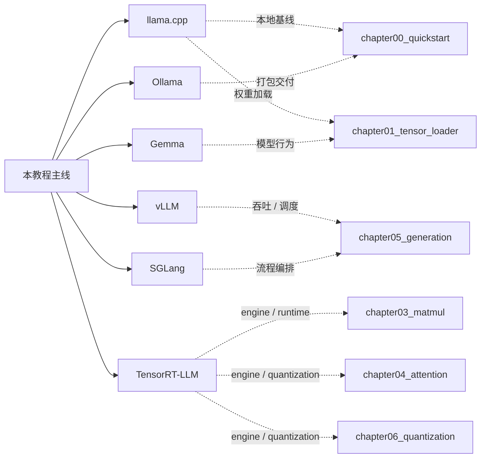
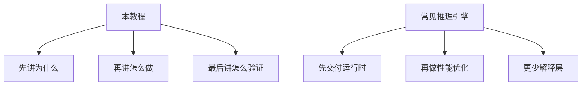

# 用 C++ 构建 LLM 推理引擎

_A Practical Tutorial for Building a C++ LLM Inference Engine_

这是整套教程给学习者看的中文主入口。若你更习惯英文导航，可以先看 [English entry](/en/README)。

## 这套教程的定位

这不是“讲概念最多”的资料集，而是一条可顺着读、顺着跑、顺着改的工程路径。

- 从 `foundation` 补基础底座
- 从 `chapter00_quickstart` 跑通真实基线
- 从 `Tensor`、`MatMul`、`Attention` 走到 `Generation`
- 再用 `Quantization` 和 `Benchmark` 收口
- `foundation` 统一使用 `Fxx` 编号，`guides` / `reference` / `maintenance` 分别承担开发参考、设计参考和维护文档

```mermaid
flowchart LR
    F[Fxx foundation] --> C0[chapter00_quickstart]
    C0 --> C1[chapter01_tensor_loader]
    C1 --> C2[chapter02_tensor_ops]
    C2 --> C3[chapter03_matmul]
    C3 --> C4[chapter04_attention]
    C4 --> C5[chapter05_generation]
    C5 --> C6[chapter06_quantization]
    C6 --> C7[chapter07_benchmark]
    C7 --> G[guides / reference / maintenance]
```



## 本教程的特色

| 维度 | 本教程 | 典型推理引擎项目 |
| --- | --- | --- |
| 目标 | 讲清楚从零实现一条可验证的推理主线 | 直接交付可用 runtime / serving |
| 读者 | 中文优先，零基础到工程入门 | 默认读者已有较强工程背景 |
| 组织方式 | 章节化、分层、每章有导入和收口 | 更偏模块化或代码仓库结构 |
| 验证方式 | smoke test、assert、e2e、benchmark 分层推进 | 多数只强调最终运行结果 |
| 教学重点 | 原理、边界、实现、验证、迁移 | 性能、部署、工程集成 |
| 外部参考 | `llama.cpp`、`vLLM`、`SGLang`、`TensorRT-LLM`、`Ollama` | 只看单个引擎自身设计 |

## 和常见推理引擎的对照

| 对象 | 强项 | 适合拿来学什么 | 本教程对应章节 |
| --- | --- | --- | --- |
| `llama.cpp` | 小、轻、可移植，适合先跑起来 | 最小本地基线、权重加载、首次推理 | `chapter00_quickstart`、`chapter01_tensor_loader` |
| `vLLM` | 高吞吐 serving、调度和 KV cache | batching、scheduler、cache 管理 | `chapter05_generation`、`chapter07_benchmark` |
| `SGLang` | 结构化 serving 和应用编排 | 多步流程组织、上层 workflow | `chapter05_generation`、`chapter07_benchmark` |
| `TensorRT-LLM` | GPU engine、runtime 分层和部署优化 | engine build、kernel、量化部署 | `chapter03_matmul`、`chapter04_attention`、`chapter06_quantization`、`chapter07_benchmark` |
| `Ollama` | 本地交付、打包、易用性 | 如何把推理能力包装成产品 | `chapter00_quickstart`、`chapter05_generation` |
| `Gemma` | 具体模型家族参考 | 兼容性、验证对象、模型行为 | `chapter01_tensor_loader`、`chapter04_attention`、`chapter06_quantization`、`chapter07_benchmark` |





## 章节总览

| 顺序 | 模块 | 入口 | 主要内容 |
| --- | --- | --- | --- |
| 0 | `foundation` | [foundation/README.md](/foundation/README) | C++、构建、CUDA、调试与测试基础 |
| 1 | `chapter00_quickstart` | [chapter00_quickstart/intro.md](/chapter00_quickstart/intro) | 先跑通第一次真实推理 |
| 2 | `chapter01_tensor_loader` | [chapter01_tensor_loader/intro.md](/chapter01_tensor_loader/intro) | 权重加载与 `Tensor` 抽象 |
| 3 | `chapter02_tensor_ops` | [chapter02_tensor_ops/intro.md](/chapter02_tensor_ops/intro) | 视图语义、共享存储、`reshape`、`slice` |
| 4 | `chapter03_matmul` | [chapter03_matmul/intro.md](/chapter03_matmul/intro) | `MatMul` 算子、后端拆分、参考实现 |
| 5 | `chapter04_attention` | [chapter04_attention/intro.md](/chapter04_attention/intro) | attention、FFN、decoder layer |
| 6 | `chapter05_generation` | [chapter05_generation/intro.md](/chapter05_generation/intro) | token-by-token generation、KV cache、sampler |
| 7 | `chapter06_quantization` | [chapter06_quantization/intro.md](/chapter06_quantization/intro) | 量化推理路径和精度权衡 |
| 8 | `chapter07_benchmark` | [chapter07_benchmark/intro.md](/chapter07_benchmark/intro) | 正确性验证、性能比较、证据收口 |
| 9 | `guides` | [guides/README.md](/guides/README) | 开发参考、构建、环境、迁移 |
| 10 | `reference` | [reference/README.md](/reference/README) | 设计参考、术语、生态对照 |
| 11 | `maintenance` | [maintenance/README.md](/maintenance/README) | 教程维护、写作规范、模板 |

## 适合谁

- 想从零看懂 C++ 推理引擎的人
- 想把“能跑”继续推进到“能解释、能验证、能扩展”的人
- 想对比 `llama.cpp`、`vLLM`、`SGLang`、`TensorRT-LLM`、`Ollama` 的工程思路的人

## 读法建议

1. 先看 [使用文档](guide.md)
2. 再看本页，确认主线和对照层
3. 基础薄弱就先看 [foundation/README.md](/foundation/README)
4. 想先跑结果就从 `chapter00_quickstart` 开始
5. 想做工程判断就重点看 `chapter05_generation` 和 `chapter07_benchmark`

## CPU / GPU 分界线

- `chapter00`、`chapter01`、`chapter02`：先用 CPU 路径就能学和验证
- `chapter03_matmul`：开始把 GPU 作为明确后端引入主线
- 第一处具体 GPU 实现：[`chapter03_matmul/04_cublas_implement.md`](/chapter03_matmul/04_cublas_implement)
- 开发参考入口：[`guides/README.md`](/guides/README)
- 设计参考入口：[`reference/README.md`](/reference/README)
- 维护文档入口：[`maintenance/README.md`](/maintenance/README)

## 本地预览

先安装依赖，再构建或预览：

```bash
npm install
npm run docs:build
npm run docs:preview
```

本地开发预览：

```bash
npm run docs:dev
```

如果你的环境需要指定镜像：

```bash
npm install --registry=https://registry.npmjs.org
```

## 相关入口

- [阅读指南](guide.md)
- [英文入口](/en/README)
- [开发参考](guides/README.md)
- [设计参考](reference/README.md)
- [维护文档](maintenance/README.md)

## English coverage status

| Page | Status | Route |
| --- | --- | --- |
| `docs/index.md` | done | `/en/` |
| `docs/README.md` | done | `/en/README` |
| `docs/guide.md` | done | `/en/guide` |
| `source/foundation/README.md` and foundation pages | done | `/en/foundation/README` and `/en/foundation/*` |
| chapter intro / summary pages | done | `/en/chapterXX/intro` and `/en/chapterXX/summary` |
| `guides` / `reference` / `maintenance` entry pages | done | `/en/guides/README`, `/en/reference/README`, `/en/maintenance/README` |
