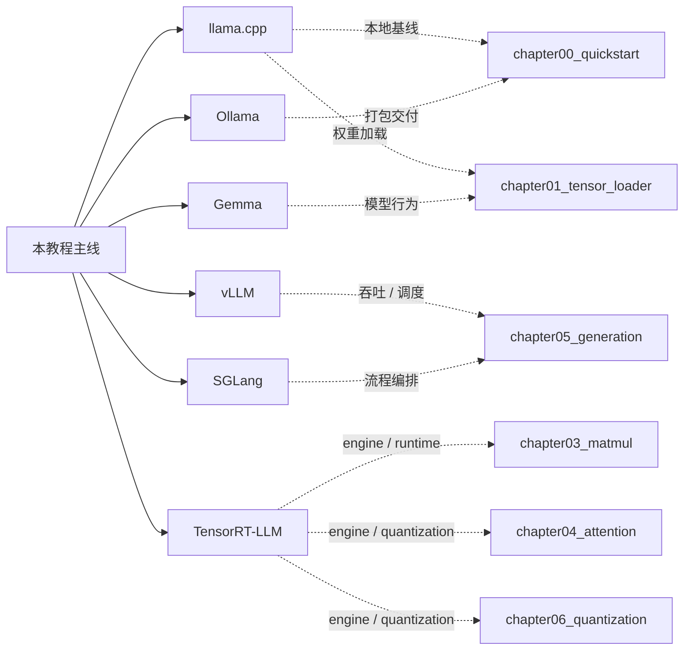

# 用 C++ 构建 LLM 推理引擎

_A Practical Tutorial for Building a C++ LLM Inference Engine_

这是整套教程给学习者看的中文主入口。若你更习惯英文导航，可以先看 [English entry](/en/README)。

## 这套教程的定位

这不是“讲概念最多”的资料集，而是一条可顺着读、顺着跑、顺着改的工程路径。它面向的是想从零看懂 C++ 推理引擎、并把“能跑”继续推进到“能解释、能验证、能扩展”的读者。

- 从 `foundation` 补基础底座
- 从 `chapter00_quickstart` 跑通真实基线
- 从 `Tensor`、`MatMul`、`Attention` 走到 `Generation`
- 再用 `Quantization`、`Benchmark` 和 `Profiling` 收口
- Chapter 05 之后可选进入 Chapter 09，补服务化扩展，而不是把服务内容全部塞入 Runtime 主线
- 以 `foundation`、主线章节、`guides` 和 `reference` 组织内容
- 用章节导读、代码索引和验证结果把“读文档”和“看代码”连起来
- 保持中文优先，同时保留英文入口和逐步扩展能力
- 允许 CPU-first 学习路径先跑通，再在需要时接入 CUDA / GPU 后端

## 教程主线

这套教程不是按“主题合集”组织的，而是按一条推理引擎主线往前推进。

| 阶段 | 主要职责 | 读完后你应该能理解什么 |
| --- | --- | --- |
| `chapter01` - `chapter03` | 输入、张量语义、算子边界 | 权重怎样进入程序，张量怎样表达视图，计算怎样变成稳定边界 |
| `chapter04` - `chapter05` | 结构与运行时 | 单层 decoder 怎样站稳，decoder 怎样进入 Generation Runtime |
| `chapter06` | 表示与成本 | 量化怎样降低资源成本，同时保住可接受精度 |
| `chapter07` | 验证与证据 | 正确性、性能和 benchmark 结果怎样被系统地验证和比较 |
| `chapter09` | 服务化扩展 | C++ Service Core、Admission、队列、取消/超时和资源管理怎样接到 Runtime |

Chapter09 作为 Chapter05 之后可提前进入的服务化扩展，负责把 Runtime 接到服务系统：

- `chapter09` 提供 C++ Service Core、HTTP 映射、SSE contract 和可选 cpp-httplib loopback
- `reference` 负责概念解释、术语和生态对照
- `guides` 负责构建、环境、迁移和工程方法

如果你想先把“指挥台 / 发动机”这层关系讲清楚，先看 [training vs inference frameworks](/reference/framework_comparison)。这页会把 Python 框架、C++ 引擎、以及它们在系统里的地位和结构组成放在一张图里看。

推荐顺序是：先构建推理引擎，再验证正确性和性能，最后与真实框架对照。

## 进阶优化路线

如果你已经读完主线，下面这条路线适合继续往推理优化专题深入。它不是主线替代，而是主线之后的专题扩展。

| Task | 专题方向 | 关注点 |
| --- | --- | --- |
| 1 | 推理结构地基 | `MHA` / `GQA`、`LLaMA3 Block` |
| 2 | Attention 访存瓶颈与 FlashAttention | 访存模型、`SRAM` 优化、`FlashAttention` |
| 3 | 解码算法 | `Decoding Strategies`、`Speculative Decoding`、`Multi-Token Decoding`、`Decode Scheduling` |
| 4 | `KV Cache` 与推理服务内存管理 | `PagedAttention`、`RadixAttention`、`Prefix Caching`、`Chunked Prefill`、`KV Cache Scheduling` |
| 5 | 量化推理与部署 | `INT4 / INT8`、`W8A16`、`GPTQ / AWQ`、`FP8`、`KV Cache Quantization` |
| 6 | 扩展选读与专题复盘 | `Inference Performance Comparison` |

这条路线更适合已经理解主线章节、并希望把 attention、generation、quantization 和 benchmark 再往优化视角拉深的读者。

## 和常见推理引擎的对照

- `llama.cpp`：本地基线，适合先跑起来，对应 `chapter00_quickstart` 和 `chapter01_tensor_loader`
- `vLLM`：serving、调度和 KV cache，对应 `chapter05_generation` 和 `chapter07_benchmark`
- `TensorRT-LLM`：GPU engine、runtime 和量化部署，对应 `chapter03_matmul`、`chapter04_attention`、`chapter06_quantization`
- `Ollama`：本地交付和打包，对应 `chapter00_quickstart` 和 `chapter05_generation`
- `Gemma`：模型家族参考和验证对象，对应 `chapter01_tensor_loader`、`chapter04_attention`、`chapter06_quantization`、`chapter07_benchmark`
- `SGLang`：结构化 serving 和流程编排，对应 `chapter05_generation` 和 `chapter07_benchmark`

## 章节总览

| 顺序 | 模块 | 主要内容 | 完成后的产物 |
| --- | --- | --- | --- |
| 0 | [`foundation`](/foundation/README) | C++、构建、CUDA、调试与测试基础 | 基础练习和最小工程 |
| 1 | [`chapter00_quickstart`](/chapter00_quickstart/intro) | 先跑通第一次真实推理 | TinyLlama CPU 输出 |
| 2 | [`chapter01_tensor_loader`](/chapter01_tensor_loader/intro) | 权重加载与 `Tensor` 抽象 | 可检查的模型输入对象 |
| 3 | [`chapter02_tensor_ops`](/chapter02_tensor_ops/intro) | 视图语义、共享存储、`reshape`、`slice` | 共享 Storage 的 Tensor view |
| 4 | [`chapter03_matmul`](/chapter03_matmul/intro) | `MatMul` 算子、后端拆分、参考实现 | CPU MatMul backend |
| 5 | [`chapter04_attention`](/chapter04_attention/intro) | Attention、FFN、DecoderLayer | 可测试的单层 Decoder |
| 6 | [`chapter05_generation`](/chapter05_generation/intro) | token-by-token generation、KV Cache、Sampler | CPU Generation Runtime |
| 7 | [`chapter06_quantization`](/chapter06_quantization/intro) | 量化推理路径和精度权衡 | 量化 Linear 对照结果 |
| 8 | [`chapter07_benchmark`](/chapter07_benchmark/intro) | 正确性验证、性能比较、证据收口 | 可复现 benchmark JSON |
| 9 | [`chapter08_profiling`](/chapter08_profiling/intro) | Profiling 证据、A/B 对比、优化闭环 | 热点证据和优化决策 |
| 10 | [`chapter09_serving`](/chapter09_serving/intro) | C++ Service Core、HTTP 映射、streaming 和 transport | 最小 CPU 推理服务 |
| 11 | [`guides`](/guides/README) | 开发参考、构建、环境、迁移 | 按需使用的操作指南 |
| 12 | [`reference`](/reference/README) | 设计参考、术语、生态对照 | 跨章节查询入口 |

## 适合谁

- 想从零看懂 C++ 推理引擎的人
- 想把“能跑”继续推进到“能解释、能验证、能扩展”的人
- 想对比 `llama.cpp`、`vLLM`、`SGLang`、`TensorRT-LLM`、`Ollama` 的工程思路的人

## 读法建议

1. 先看 [USAGE.md](/guide)
2. 再看 [docs/README.md](/README)
3. 基础薄弱就先看 [source/foundation/README.md](/foundation/README)
4. 想先跑结果就从 `chapter00_quickstart` 开始
5. 想做工程判断就重点看 `chapter05_generation`、`chapter07_benchmark` 和 `chapter08_profiling`

## CPU / GPU 分界线

- `chapter00`、`chapter01`、`chapter02`：先用 CPU 路径就能学和验证
- `chapter03_matmul`：CPU backend 已实现，并固定未来 GPU backend 的接入契约
- 更具体的硬件和 CUDA 建议，统一看 [阅读指南](/guide)
- GPU 接入设计入口：[`chapter03_matmul/04_cublas_implement.md`](/chapter03_matmul/04_cublas_implement)；当前尚无可构建 CUDA target
- 开发参考入口：[`guides/README.md`](/guides/README)
- 设计参考入口：[`reference/README.md`](/reference/README)
