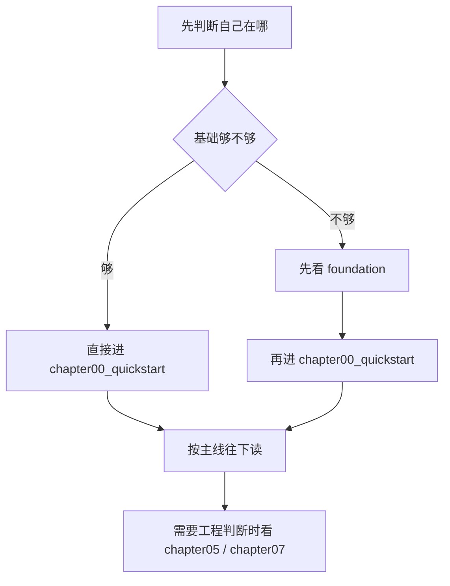

# 阅读指南

这个页面只回答一件事：怎么读这套教程。

## 三条先记住

- `foundation` 是预备区，先补基础。
- `chapter00_quickstart` 是起跑线，先跑通第一次推理。
- `chapter01` 到 `chapter07` 是主线正文。

## 推荐顺序

1. 先看 [教程主入口](/README)
2. 再看本页，确认自己从哪一章开始
3. 如果基础不稳，先回到 `foundation`
4. 如果想先看到结果，先看 `chapter00_quickstart`
5. 如果要做工程判断，再看 `chapter05_generation` 和 `chapter07_benchmark`
6. 如果你需要英文导航，先看 [English entry](/en/README)

## 运行入口

- 本地构建和预览：见根目录 `README.md`
- 术语统一：见 [术语表](/reference/glossary)
- 维护规则：见 [维护文档](/maintenance/tutorial_maintenance)

## 环境选择

- 只是先看内容：在线阅读
- 想先跑通基线：`chapter00_quickstart`
- 想理解 runtime：`chapter05_generation`
- 想看验证收口：`chapter07_benchmark`

## CPU / GPU 分界线

- `foundation`、`chapter00`、`chapter01`、`chapter02`：CPU-first 就够
- `chapter03_matmul`：开始把 GPU 作为明确后端进入主线
- `chapter03_matmul/04_cublas_implement.md`：第一处具体 GPU 实现
- 软件环境说明：看 [CUDA 安装与配置](/guides/setup_cuda)

## 一眼看路径

| 你的状态 | 建议入口 | 目的 |
| --- | --- | --- |
| 基础不稳 | `foundation` | 先补 C++、构建、CUDA、调试测试 |
| 想先看到结果 | `chapter00_quickstart` | 先跑通第一次真实推理 |
| 想理解 runtime | `chapter05_generation` | 看生成状态机、KV Cache 和调度 |
| 想看证据链 | `chapter07_benchmark` | 看正确性和性能怎么收口 |
