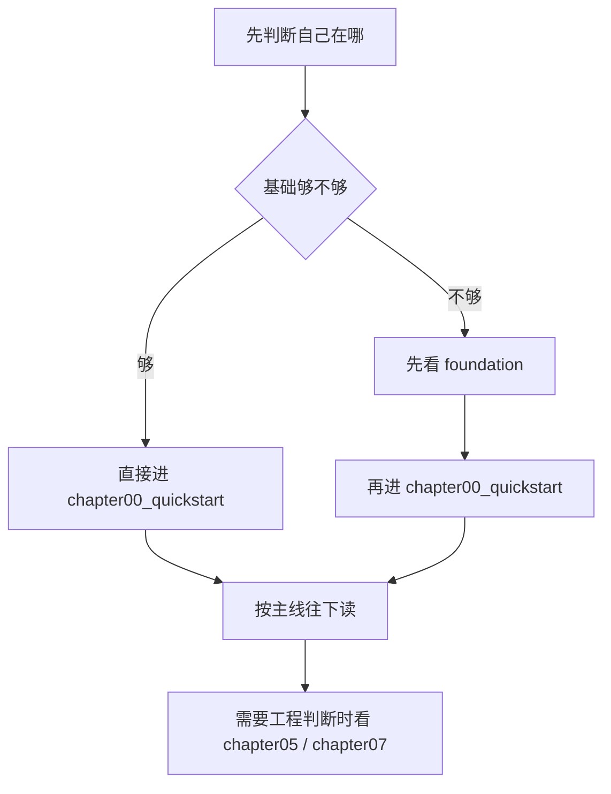

# 阅读指南

这个页面只回答一件事：怎么读这套教程。

中文主线已经完成收口，当前这页继续保留阅读路径和分层规则，正文更新重点转向英文正文与残余清理。

## 教程主线

这套教程按一条推理引擎主线往前推进，不是按主题合集散着读。

| 阶段 | 主要职责 |
| --- | --- |
| `chapter01` - `chapter03` | 输入、张量语义、算子边界 |
| `chapter04` - `chapter05` | 结构与运行时 |
| `chapter06` | 表示与成本 |
| `chapter07` | 验证与证据 |

`chapter07` 之后，主线转入 `reference`、`guides` 和 `maintenance`：

- `reference`：概念解释、术语和生态对照
- `guides`：构建、环境、迁移和工程方法
- `maintenance`：站点维护、写作规范和长期收口

如果你想先把“指挥台 / 发动机”这层关系讲清楚，先看 [training vs inference frameworks](/reference/framework_comparison)。

如果你只想知道整套教程怎么分层，这一页就够了。
如果你想知道具体每章讲什么，再回到 [教程主入口](/README) 和 [站点首页](/).



## 三个入口怎么分工

- `foundation`：补主线前的基础认知
- `chapter00_quickstart`：尽快跑通第一个可执行基线
- `USAGE.md`：告诉你从哪条路径开始读、怎么继续读

`USAGE.md` 负责路线图，`chapter00_quickstart` 负责起跑线。前者告诉你先看什么、后看什么；后者带你把第一条真实推理链路跑通。

如果你不确定自己该从哪里开始，先看这里：

- 先读 `USAGE.md`，确定阅读路径
- 再按需要进入 `foundation`
- 最后进入 `chapter00_quickstart` 和后续主线章节

## 从这里开始

1. 先看 [docs/README.md](/README) 了解教程总图
2. 如果你更习惯英文导航，可以看 [docs/README.en.md](/en/README)
3. 需要 C++、构建工具或 CUDA 背景时，先看 `foundation`
4. 想先跑出第一个可执行基线时，先看 `chapter00_quickstart`
5. 然后按照 `chapter01` 到 `chapter07` 的主线往下读
6. 到 `chapter07` 收口后，再看 `reference`、`guides` 和 `maintenance`

## 如何运行代码

优先使用各章节目录下的脚本：

- `bash code/chapter00_quickstart/run.sh`
- `bash code/chapter02_tensor_ops/scripts/run.sh`
- `bash code/chapter03_matmul/scripts/run.sh`
- `bash code/chapter04_attention/scripts/run.sh`
- `bash code/chapter05_generation/scripts/run.sh`
- `bash code/chapter06_quantization/scripts/run.sh`
- `bash code/chapter07_benchmark/scripts/run.sh`

对于 `chapter01_tensor_loader`，使用本地 CMake 构建：

```bash
cmake -S code/chapter01_tensor_loader -B code/chapter01_tensor_loader/build
cmake --build code/chapter01_tensor_loader/build
ctest --test-dir code/chapter01_tensor_loader/build --output-on-failure
```

## 环境选择

- 只是先看内容：在线阅读
- 想先跑通基线：`chapter00_quickstart`
- 想理解 runtime：`chapter05_generation`
- 想看验证收口：`chapter07_benchmark`

## CPU / GPU 分界线

- `foundation`、`chapter00`、`chapter01`、`chapter02`：CPU-first 就够
- `chapter03_matmul`：开始把 GPU 作为明确后端进入主线
- `chapter03_matmul/04_cublas_implement.md`：第一处具体 GPU 实现
- 软件环境说明：看 [CUDA 安装与配置](/guides/setup_cuda)

## 阅读路径

- 入门路径：`foundation` -> `chapter00` -> `chapter01` -> `chapter02` -> `chapter03` -> `chapter04` -> `chapter05` -> `chapter06` -> `chapter07`
- 工程路径：`chapter00` -> `chapter01` -> `chapter02` -> `chapter03` -> `chapter04` -> `chapter05` -> `chapter07`
- 性能路径：`chapter02` -> `chapter03` -> `chapter04` -> `chapter05` -> `chapter07`
- 部署路径：`chapter06` -> `chapter07`
- 收口路径：`chapter07` -> `reference` -> `guides` -> `maintenance`

## 日常检查

如果你在改文档或链接，先跑：

```bash
npm run docs:check-links
```

再跑：

```bash
npm run docs:build
```
