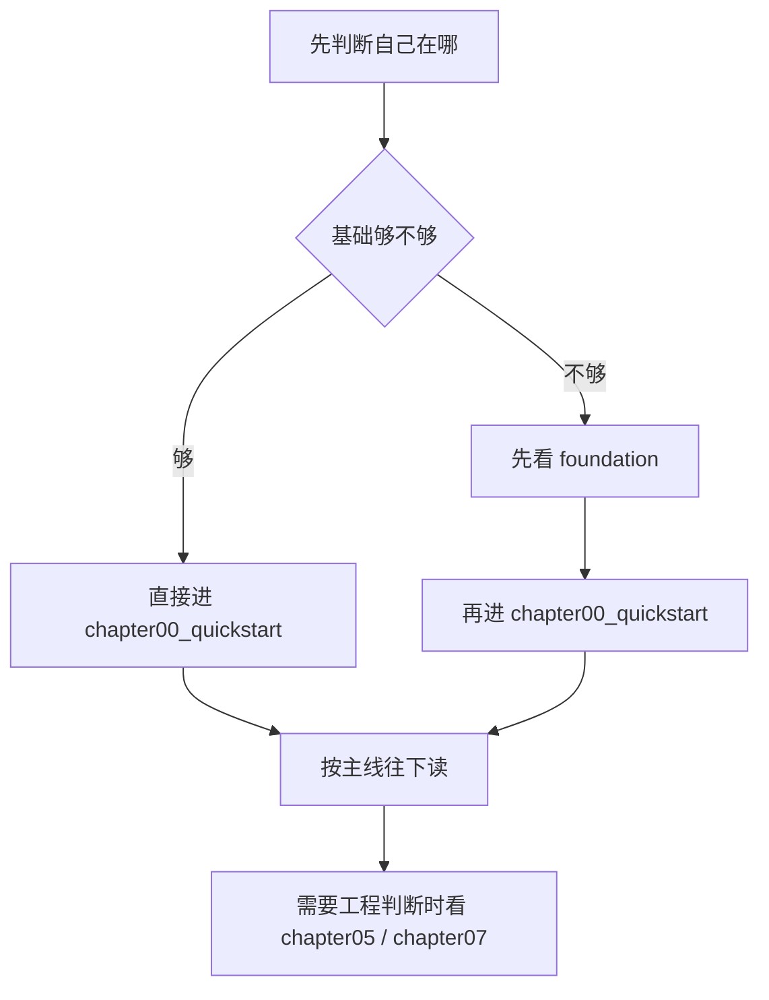

# 阅读指南

这个页面只回答一件事：怎么读这套教程。

中文主线已经完成收口，当前这页继续保留阅读路径和分层规则，正文更新重点转向英文正文与残余清理。

## 教程主线

这套教程按一条推理引擎主线往前推进，不是按主题合集散着读。

| 阶段 | 主要职责 |
| --- | --- |
| `chapter01` - `chapter03` | 输入、张量语义、算子边界 |
| `chapter04` - `chapter05` | 结构与运行时 |
| `chapter06` | 表示与成本 |
| `chapter07` | 验证与证据 |

`chapter07` 之后，主线转入 `reference`、`guides` 和 `maintenance`：

- `reference`：概念解释、术语和生态对照
- `guides`：构建、环境、迁移和工程方法
- `maintenance`：站点维护、写作规范和长期收口

如果你想先把“指挥台 / 发动机”这层关系讲清楚，先看 [training vs inference frameworks](/reference/framework_comparison)。

如果你只想知道整套教程怎么分层，这一页就够了。
如果你想知道具体每章讲什么，再回到 [教程主入口](/README) 和 [站点首页](/).



## 三个入口怎么分工

- `foundation`：补主线前的基础认知
- `chapter00_quickstart`：尽快跑通第一个可执行基线
- `USAGE.md`：告诉你从哪条路径开始读、怎么继续读

`USAGE.md` 负责路线图，`chapter00_quickstart` 负责起跑线。前者告诉你先看什么、后看什么；后者带你把第一条真实推理链路跑通。

如果你不确定自己该从哪里开始，先看这里：

- 先读 `USAGE.md`，确定阅读路径
- 再按需要进入 `foundation`
- 最后进入 `chapter00_quickstart` 和后续主线章节

## 从这里开始

1. 先看 [docs/README.md](/README) 了解教程总图
2. 如果你更习惯英文导航，可以看 [docs/README.en.md](/en/README)
3. 需要 C++、构建工具或 CUDA 背景时，先看 `foundation`
4. 想先跑出第一个可执行基线时，先看 `chapter00_quickstart`
5. 然后按照 `chapter01` 到 `chapter07` 的主线往下读
6. 到 `chapter07` 收口后，再看 `reference`、`guides` 和 `maintenance`

## 如何运行代码

优先使用各章节目录下的脚本：

- `bash code/chapter00_quickstart/run.sh`
- `bash code/chapter02_tensor_ops/scripts/run.sh`
- `bash code/chapter03_matmul/scripts/run.sh`
- `bash code/chapter04_attention/scripts/run.sh`
- `bash code/chapter05_generation/scripts/run.sh`
- `bash code/chapter06_quantization/scripts/run.sh`
- `bash code/chapter07_benchmark/scripts/run.sh`

对于 `chapter01_tensor_loader`，使用本地 CMake 构建：

```bash
cmake -S code/chapter01_tensor_loader -B code/chapter01_tensor_loader/build
cmake --build code/chapter01_tensor_loader/build
ctest --test-dir code/chapter01_tensor_loader/build --output-on-failure
```

## 环境选择

- 只是先看内容：在线阅读
- 想先跑通基线：`chapter00_quickstart`
- 想理解 runtime：`chapter05_generation`
- 想看验证收口：`chapter07_benchmark`
- 想看性能归因和优化闭环：`chapter08_profiling`

## 硬件与环境

这套教程是 `CPU-first` 设计，默认不要求一开始就有 GPU。学习者可以按下面三档准备环境。

### 1. 本地 CPU 学习环境

适合先把主线跑通，覆盖 `foundation`、`chapter00`、`chapter01`、`chapter02`。

建议配置：

- 4 核以上 CPU
- 16 GB 内存
- 20 GB 以上可用磁盘
- Linux 环境，优先 Ubuntu 22.04
- `CMake`、`g++` 或 `clang++`、`git`
- `Node.js + npm`

### 2. 本地带 GPU 的学习环境

适合继续到 `chapter03` 之后的 CUDA / backend 对照。

建议配置：

- NVIDIA GPU，8 GB VRAM 起步
- 12 GB VRAM 更舒服
- 16 GB 及以上更适合后面的性能对照
- 16 GB 以上内存更稳
- SSD
- NVIDIA Driver + CUDA Toolkit
- `nvcc`、`nvidia-smi` 可用

具体的 CUDA 安装与验证步骤，见 [CUDA 安装与配置](/guides/setup_cuda)。

### 3. 云端环境

适合本地没有合适 GPU，或者只想把 `chapter03` 之后的 GPU 对照和 benchmark 放到云上跑。

建议做法：

- 选 Linux 镜像，优先 Ubuntu 22.04
- 选带 NVIDIA GPU 的实例
- 先确认 `nvidia-smi`
- 再确认 `nvcc --version`
- 再装 `cmake`、`g++`、`git`、`node`
- 用持久盘保存仓库和模型文件

### 最小建议顺序

1. 先装基础工具链
2. 先跑 CPU 路径
3. 需要 GPU 时再补本地 CUDA 或云端 GPU
4. 用 `nvidia-smi`、`nvcc --version`、`cmake --version` 做最小验证

## CPU / GPU 分界线

- `foundation`、`chapter00`、`chapter01`、`chapter02`：CPU-first 就够
- `chapter03_matmul`：开始把 GPU 作为明确后端进入主线
- `chapter03_matmul/04_cublas_implement.md`：第一处具体 GPU 实现
- 软件环境说明：看 [CUDA 安装与配置](/guides/setup_cuda)

## 三条推荐路径

### 初学者路径

- 前置条件：能使用终端，尚未稳定使用 C++/CMake。
- 顺序：`foundation` -> `chapter00` -> `chapter01` -> `chapter02`。
- 产物：完成基础题库中至少 4 道题，并跑通第一次真实推理。
- 验证：`npm run test:regression`。

### C++ 工程路径

- 前置条件：能读写基本 C++，但希望建立 Tensor、算子和 runtime 的工程边界。
- 顺序：Foundation 题库 -> `chapter01` -> `chapter03` -> `chapter05` -> `chapter07`。
- 产物：完成一个可构建、可测试的 Tensor/算子/runtime 路径。
- 验证：对应章节 `run.sh`，最后执行 `npm run test:regression`。

### 推理引擎进阶路径

- 前置条件：已有 C++、GPU 或推理系统经验。
- 顺序：`chapter05` -> `reference` -> `chapter07` -> `chapter08`。
- 产物：能解释 Request、Scheduler、KV Cache、内存、回归和 profiling 之间的证据链。
- 验证：Chapter 05/07 脚本、`npm run test:regression` 和文档链接检查。

三条路径都默认 CPU-first。只有 `chapter03` 的 CUDA 后端和 FQ10 的 CUDA starter 需要 GPU 环境。

## 开源项目怎么配合读

这套教程不是要替代开源项目，而是先把引擎原理和最小实现讲清楚，再把真实项目作为对照坐标。

建议按章节配合这些项目阅读：

- `chapter00`、`chapter01`：先看 `llama.cpp`，建立最小本地推理直觉
- `chapter02`、`chapter03`：再看 `gemma.cpp` 和 `TensorRT-LLM`，理解对象、算子和后端分层
- `chapter04`、`chapter05`：再看 `vLLM`、`SGLang`，理解 runtime、调度和 serving 组织方式
- `chapter06`：再看 `TensorRT-LLM`，理解量化和部署如何接到 GPU engine
- `chapter07`：再看 `vLLM`、`SGLang`、`Ollama`，理解 benchmark、验证和交付怎么落到真实系统

如果你想先看总览，直接进 [生态对照](/reference/ecosystem/README)。

## 日常检查

如果你在改文档或链接，先跑：

```bash
npm run docs:check-links
```

再跑：

```bash
npm run docs:build
npm run test:regression
```
