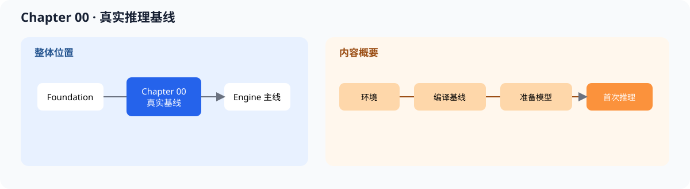

# 00.0 Get Started with a Real Baseline 验证本地推理基线

## 1. 本章位置与成功标准

本章先验证本地 quickstart 入口，再用 `llama.cpp` 加载 TinyLlama GGUF 完成一次真实推理。它不实现教程自己的 Tensor、Runtime 或服务。

```bash
bash code/chapter00_quickstart/run.sh
```

这条命令只验证仓库内的 quickstart smoke executable。真实模型推理按 [`00.4 First Inference`](./04_first_inference.md) 的 `llama-simple` 命令执行。没有 GPU 也可以完成本章；CUDA 编译和 vLLM serving 是可选体验。



本章位于基础准备和自研 C++ 引擎之间，产物是一个可运行、可观察的真实推理起点。

## 2. 内容地图

完成本章后，可以：

- 准备 C++、CMake、模型文件和运行环境
- 编译 `llama.cpp` 并加载 TinyLlama 1.1B GGUF
- 区分真实 tokenizer 与后续教学 runtime 使用的 toy tokenizer
- 用一次真实输出确认环境、模型格式和 CPU 推理路径成立

本章先建立真实推理基线，再从 Chapter 01 开始拆解自研实现。框架对照只用于识别后续要重建的组件。

| 对照项 | 内容 |
| --- | --- |
| 本章教学对象 | 环境、模型文件、真实 tokenizer 和一次完整推理 |
| 主对照框架 | `llama.cpp`；可选体验 vLLM 服务入口 |
| 成熟组件 | GGUF loader、模型执行、采样循环、命令行或 HTTP 入口 |
| 重点差异 | 本章直接运行成熟实现，不把它当作教程自研引擎 |
| 深入入口 | [`00.4 First Inference`](./04_first_inference.md)、[`00.6 Deploy vLLM`](./06_deploy_vllm.md)、[生态对照](../reference/framework_comparison.md) |

## 3. 阅读与源码顺序

| 顺序 | 页面 | 读完后应看到什么 |
| --- | --- | --- |
| 1 | [`00.1 Environment Setup`](./01_environment_setup.md) | 工具链和 CPU 运行条件 |
| 2 | [`00.2 Clone and Build`](./02_clone_and_build_llamacpp.md) | 可执行的 `llama.cpp` |
| 3 | [`00.3 Download TinyLlama`](./03_download_tinyllama.md) | 本地 GGUF 模型文件 |
| 4 | [`00.4 First Inference`](./04_first_inference.md) | 第一次真实输出 |
| 5 | [`00.5 Troubleshooting`](./05_troubleshooting.md) | 常见路径和构建错误的排查顺序 |
| 6 | [`00.6 Deploy vLLM`](./06_deploy_vllm.md) | 可选 serving baseline |

前置阅读是 [`foundation`](../foundation/README.md)。源码入口是 <a href="../_code/chapter00_quickstart/main_quick.cpp"><code>main_quick.cpp</code></a>、<a href="../_code/chapter00_quickstart/run.sh"><code>run.sh</code></a> 和 <a href="../_code/chapter00_quickstart/CMakeLists.txt"><code>CMakeLists.txt</code></a>。

## 4. 验证

本章分两步检查可见结果：

1. quickstart smoke executable 编译成功并正常退出
2. `llama.cpp` 编译成功，TinyLlama GGUF 文件存在并能被加载，真实 tokenizer 能处理 prompt，CPU 推理生成非空文本并正常退出

Chapter 00 的详细命令和故障排查在正文页；不要用本章的成功结果推断教程自己的 Tensor 或 Runtime 已经完成。

**下一章：**本章确认外部环境和真实模型都能工作，Chapter 01 开始建立可替换的 `Tensor`、`ModelLoader`、metadata adapter 和 tokenizer contract。
