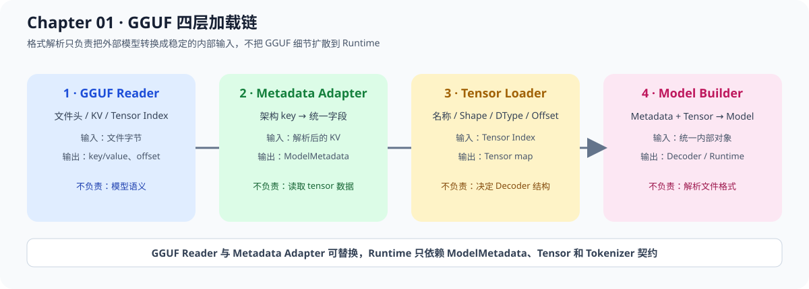
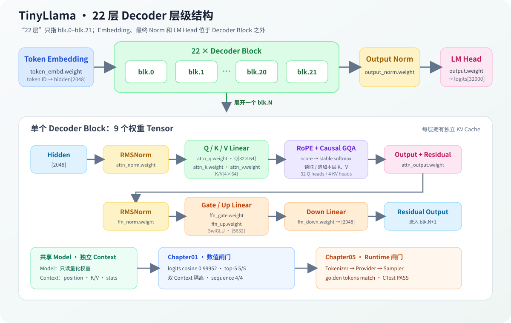

# 01.5 Model Metadata and GGUF 模型元数据与 GGUF

## 加载链

真实模型文件不只包含 tensor，还包含模型架构、词表、上下文长度、special tokens 和隐藏维度等 metadata。

本节先实现 GGUF metadata 到内部配置的最小转换：外部格式解析器读取 metadata，Chapter 01 将其归一化为 `ModelMetadata` 和 `ModelConfig`，后续 runtime 消费内部配置。

**外部格式与内部配置**

```text
GGUF / HuggingFace config / other format
              -> format adapter
              -> ModelMetadata
              -> ModelConfig
              -> Tokenizer / Tensor / Decoder
```

**四层加载链**



四个对象分别回答文件怎么读、metadata 怎么解释、权重数据怎么取、模型对象怎么组装，使错误能够在对应阶段被发现。

| 层 | 主要输入 | 主要输出 | 职责 | 教程实现 |
| --- | --- | --- | --- | --- |
| GGUF Reader | 文件字节 | header、KV、tensor index、offset | 解析 GGUF 二进制结构 | 已支持只读索引；权重 payload 由后续量化章节处理 |
| Metadata Adapter | 已解析的 key/value | `ModelMetadata` | 把 `llama.*` 等外部 key 归一化 | 已接入 Reader fixture 测试 |
| Tensor Loader | tensor index 和数据区 | `Tensor` map | 按名称、shape、dtype、offset 读取权重 | 已支持 F32/F16/I8/Q4_K/Q6_K 原始 payload；量化解码后续处理 |
| Model Builder | `ModelMetadata` + `Tensor` map + Tokenizer | `LoadedModel` + `DecoderInput` | 校验配置、绑定 Llama layer mapping 并组装 Decoder 输入对象 | 已支持最小 metadata/tokenizer/embedding 校验和真实 TinyLlama schema mapping |

Tokenizer 也从同一份 GGUF metadata 中读取，但保持独立契约：`TokenizerMetadataAdapter` 当前接收 vocabulary、scores、token types、BOS/EOS 和可选 chat template；它只描述 tokenizer 数据，不在本步实现 BPE/SentencePiece 编码器。

**四个对象如何协作**

1. `GGUF Reader` 解析文件结构，输出 metadata 和 tensor index。
2. `Metadata Adapter` 把外部 key 映射成内部字段。
3. `Tensor Loader` 根据索引恢复稳定的 Tensor 对象。
4. `Model Builder` 消费统一对象，校验模型结构并完成装配。

因此后续替换模型格式时，理想变化是：

```text
GGUF Reader       -> GGUF Metadata Adapter
Safetensors Reader -> HuggingFace Config Adapter
TensorRT Engine   -> Engine Metadata Adapter
```

下游的 `ModelConfig`、Decoder、Runtime 和服务层尽量不变。

这样做有两个好处：

- GGUF 的 key 名称和版本变化不会扩散到 Decoder、Runtime；
- vLLM、llama.cpp 或 TensorRT-LLM 的外部格式差异可以停留在 adapter 层。

## 内部对象

代码入口：`code/chapter01_tensor_loader/src/model_metadata.h`、`code/chapter01_tensor_loader/src/model_metadata_adapter.h`、`code/chapter01_tensor_loader/src/model_builder.h`

当前统一字段包括：

| 字段 | 作用 |
| --- | --- |
| `architecture` | 区分 Llama、Gemma 或其他模型族 |
| `vocab_size` | 校验 tokenizer 和 embedding 规模 |
| `hidden_size` | 校验 embedding、Linear 和 Decoder shape |
| `max_position` | 限制 prompt 和 KV Cache 上下文长度 |
| `layer_count` | 构造 Decoder 层数 |
| `bos_token_id` / `eos_token_id` | 固定生成起止语义 |

`ModelMetadata::valid()` 只检查字段是否足够构成一个模型配置，不负责理解具体 GGUF key。

`ModelMetadataAdapter::from_gguf()` 接收一个已经由文件 reader 解析出的 key/value map，当前覆盖 TinyLlama/Llama 风格的最小字段：`general.architecture`、`<architecture>.embedding_length`、`<architecture>.context_length`、`<architecture>.block_count` 以及 BOS/EOS token ID。vocab size 优先读取显式字段，缺少时从 `tokenizer.ggml.tokens` 数组推导；它不负责读取文件字节，也不负责实现 tokenizer 编码。

**TinyLlama 真实模型基线**

本教程先以 TinyLlama 1.1B 作为真实模型基线。它用于固定第一条可复现的 GGUF、Llama 风格 metadata 和真实 tokenizer 路径，但内部接口不命名为 `TinyLlamaConfig`：

```text
TinyLlama GGUF
      -> Llama2-like metadata adapter
      -> ModelMetadata
      -> ModelConfig
      -> Decoder / Runtime
```

这样既能让初学者用较小模型完成验证，又能让后续的 Llama 2 或其他 Llama-family 模型复用同一套边界。模型族之间的 tokenizer、special tokens 和配置字段不能只凭名称假定兼容，必须以具体模型文件提供的信息为准。

**TinyLlama Decoder 层级**

TinyLlama metadata 中的 `block_count=22` 对应 `blk.0` 到 `blk.21` 共 22 个重复 Decoder Block。每个 Block 包含 Attention 和 FFN 的九个权重 Tensor；`token_embd.weight`、`output_norm.weight` 和 `output.weight` 位于 Block 堆栈之外，不计入这 22 层。



**格式解析与模型构建的分工**

文件解析器把 tensor 内容转换成 Tensor 对象，metadata adapter 把外部配置转换成统一字段。两类结果来自同一个文件，再由模型构造阶段检查是否匹配：

```text
metadata adapter -> ModelMetadata -> ModelConfig
tensor loader    -> Tensor map
```

## 关系与验证

Chapter 00 使用 `llama.cpp` 直接处理 TinyLlama GGUF 和真实 tokenizer。本节把同一类外部信息转换为教程自己的内部对象，完整 GGUF parser 仍由 `llama.cpp` 提供。

当前已实现只读 GGUF Reader、metadata adapter、tokenizer metadata adapter、Llama tensor schema/layout validator、`DecoderInput` mapping 和基础 tensor payload loader；真实 TinyLlama 的 22 层 tensor index 已通过 schema 校验。Chapter01 loader 当前能保留 Q4_K/Q6_K raw payload，量化 payload 解码继续由 Chapter06 负责。

`RealLlamaLayerLoader` 可以按需加载任意 decoder layer；`RealLlamaCpuModel` 持有 `blk.0` 到 `blk.21`、Final RMSNorm 与 Q6_K LM Head 的只读权重。每个 `RealLlamaCpuContext` 独立持有 position、attention 统计和各层增量 K/V，并通过 `prefill()` / `decode()` 执行模型。`gguf_decoder_multilayer` 与 Chapter05 Engine 共用这套实现。

Chapter 01 现在提供 `gguf_inspect` 示例，可以对 Chapter 00 下载的 TinyLlama GGUF 做真实的 header、metadata、tokenizer metadata 和 tensor index 检查。先验证真实文件的索引信息，再在 Chapter 06 解码量化 payload。

**llama.cpp logits 对照**

完整 22 层 smoke 使用同一组 6 个 token 分别运行自研 CPU 路径和 llama.cpp。llama.cpp reference 关闭 Flash Attention，并把 K/V Cache 设为 F32，使两边的 Attention 精度设置更接近。22 层累积后的单点最大误差容易受矩阵乘加顺序影响，因此验收同时检查整体方向、平均误差和候选排序；当前门槛是 cosine 不低于 `0.999`、mean absolute error 不高于 `0.15`、RMSE 不高于 `0.20`、top-5 至少重合 `4/5`。

| 指标 | 当前结果 | 验收含义 |
| --- | --- | --- |
| cosine similarity | `0.99952` | 整体 logits 方向一致 |
| mean absolute error | `0.117456` | 全词表平均偏差在门槛内 |
| RMSE | `0.148398` | 较大偏差没有主导整体结果 |
| top-1 | token `29892`，双方一致 | greedy 候选一致 |
| top-5 overlap | `5/5` | 高概率候选集合一致 |
| 4-token greedy sequence | `29892 306 29915 29885`，双方一致 | 连续 decode 没有立即发生候选漂移 |
| 最终判定 | `PASS` | 可以进入采样和生成循环接入 |

**Model 与 Context 的所有权**

权重只加载一次，请求状态按请求创建。Context 通过共享的只读模型数据保持权重存活，因此销毁请求只释放该请求的 K/V，不会卸载模型，也不会影响其他 Context。

| 对象 | 保存内容 | 生命周期 | 可变性 |
| --- | --- | --- | --- |
| `RealLlamaCpuModel` | metadata、embedding、22 层量化权重、Final Norm、LM Head | 模型加载到服务卸载 | 推理期间只读，可被多个 Context 共享 |
| `RealLlamaCpuContext` | position、每层 K/V、attention score 统计 | 单个请求或单条序列 | 只由所属请求修改，可独立 reset / 释放 |
| Chapter05 `Request` | prompt token、生成 token、状态、停止原因 | admission 到 terminal cleanup | 由 Runtime / Scheduler 推进 |

**一套执行实现，两级验证**

模型数学只保留在 `RealLlamaCpuModel` / `RealLlamaCpuContext`。Chapter01 固定 token IDs，检查两个 Context 的隔离、logits 误差与 llama.cpp greedy 序列；Engine 使用真实 tokenizer 和 Chapter05 Runtime，检查文本输入、Request、EOS/token budget、采样与 detokenize 的完整闭环。

| 验证入口 | 固定输入 | 主要断言 | 是否进入默认快速回归 |
| --- | --- | --- | --- |
| `gguf_decoder_multilayer` | 6 个固定 token ID | 双 Context 隔离、22 层统计、32000 维 logits、4-token llama.cpp 对照 | 否，需要 GGUF 和 llama.cpp |
| `real_tinyllama_generation_test` | `Hello TinyLlama`，连续运行两次 | token `29892 306 29915 29885`、Request 完成、两次 Context 输出一致 | 否，通过 `CPP_LLM_ENGINE_REAL_MODEL` 显式启用 |
| 默认 Chapter01/Engine CTest | fixture / toy input | 格式契约、状态机和轻量集成 | 是 |

**验证结果**

当前测试验证：

- GGUF Reader 能读取 magic、version、标量 metadata、tensor shape/type/offset 和对齐后的 data offset；
- GGUF Tensor Loader 能按 offset 读取 F32/F16/I8/Q4_K payload，并对 Q4_K 的 256 值/144 字节 block 做边界检查；
- Model Builder 能校验 tokenizer vocab、完整 Llama tensor layout 和 payload，再生成包含 `DecoderInput` 的 `LoadedModel`。`DecoderInput` 只保存稳定的 tensor 名称映射，不拥有 payload；payload 仍由 `LoadedModel.tensors` 持有。
- Reader 输出的 metadata 能继续进入 `ModelMetadataAdapter`，不让下游依赖 GGUF 文件结构；
- metadata 能转换为 ModelConfig；
- GGUF 风格 key/value 能转换为 ModelMetadata；
- architecture、vocab、hidden size 和 special tokens 不丢失；
- ModelConfig 可以继续校验 Tokenizer 和关键 Tensor shape。

完整 GGUF 兼容性应增加 golden metadata fixture，不能只靠一个构造函数测试。
