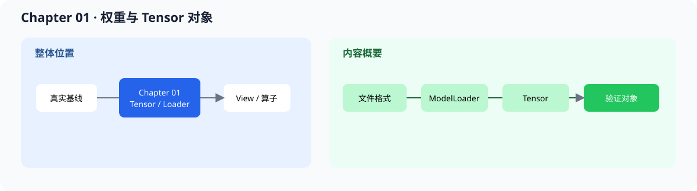
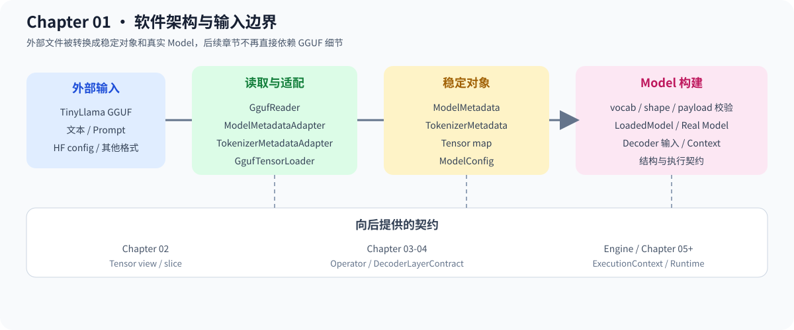

# 01.0 Model Weights and Tensor Objects 加载模型权重并统一表示

## 1. 本章位置与成功标准

本章把模型文件和用户文本送入 C++ 程序：`ModelLoader` 产生 `Tensor`，`Tokenizer` 产生 token IDs，metadata adapter 产生可校验的模型配置。

```bash
bash code/chapter01_tensor_loader/run.sh
```

成功标准：Chapter 01 测试通过，加载后的 tensor 名称、shape 和 dtype 可检查；如果提供 Chapter 00 下载的 GGUF 文件，额外运行 `gguf_inspect` 检查 metadata、tensor index 和 `DecoderInput` mapping，并可运行 TinyLlama 22 层 token-to-logits CPU smoke。循环采样和文本生成仍由 Chapter 05 Runtime 承担。



本章把静态权重转换成后续 view、算子和 runtime 可以消费的对象。



读取链从外部格式开始，经过 adapter 和校验，最后得到内部对象；文本输入和权重加载在 Chapter 05 的 Request 中汇合。

## 2. 内容地图

完成本章后，可以：

- 用 `Tensor` 表达 shape、dtype、storage 和基本 ownership
- 用 `ModelLoader` 从文件恢复 tensor 名称、shape 和 payload
- 用 tokenizer contract 把文本转换成 token IDs
- 用 metadata adapter 把 GGUF / HuggingFace 信息归一化为 `ModelMetadata` / `ModelConfig`
- 用 `ModelBuilder` 生成包含 Llama layer mapping 的 `DecoderInput`
- 用真实 TinyLlama 的 Q4_K/Q6_K 权重贯通 22 层 Decoder、Final RMSNorm 和 LM Head，得到 32000 维 logits
- 用公共 Decoder 契约把真实 Model/Context 交给 Engine，而不泄漏 GGUF 细节

本章只保留一张输入链表：

| 输入 | 本章代码 | 输出 |
| --- | --- | --- |
| GGUF、配置文件、文本 prompt | `GgufReader`、metadata/tokenizer adapter、`GgufTensorLoader` | metadata、tokenizer metadata、Tensor |
| 已解析对象 | `ModelBuilder` / `LoadedModel` | Decoder 输入和 Llama layer mapping |
| 真实权重和模型配置 | `RealLlamaCpuModel` / `RealLlamaCpuContext` | `DecoderModelContract` 和请求级执行 Context |

成熟框架会把相同输入职责拆到格式解析、权重装载、模型配置和执行对象中。本章对照这些职责，不照搬框架规模。

| 对照项 | 内容 |
| --- | --- |
| 本章教学对象 | GGUF metadata、权重 Tensor、Tokenizer、ModelConfig 和 Model/Context |
| 主对照框架 | `llama.cpp` model loader、vLLM model loader |
| 成熟组件 | 分片加载、设备放置、并行权重映射、延迟加载和多模型格式 |
| 重点差异 | 本章以 TinyLlama GGUF 和 CPU 路径固定输入契约，成熟框架还要处理分布式和多后端 |
| 深入入口 | [`01.9 Loader 框架对照`](./09_framework_loader_comparison.md) |

## 3. 阅读与源码顺序

| 顺序 | 页面 | 读完后应看到什么 |
| --- | --- | --- |
| 1 | [`01.1 Tensor Interface`](./01_tensor_interface.md)、[`01.2 Tensor Implement`](./02_tensor_implement.md) | Tensor 的数据表示和生命周期 |
| 2 | [`01.3 Custom Binary Format`](./03_custom_binary_format.md)、[`01.4 Python Converter`](./04_python_converter.md) | 文件布局和训练侧导出路径 |
| 3 | [`01.5 ModelLoader`](./05_model_loader.md)、[`01.6 Verify and Print`](./06_verify_and_print.md) | 文件如何恢复成可检查的 Tensor |
| 4 | [`01.7 Input Contract and Tokenizer`](./07_input_contract_and_tokenizer.md) | 文本如何变成 token IDs |
| 5 | [`01.8 Model Metadata and GGUF Boundary`](./08_model_metadata_and_gguf_boundary.md) | 外部 metadata 如何进入内部配置 |
| 6 | [`01.9 Loader 框架对照`](./09_framework_loader_comparison.md) | 从教学加载链定位成熟框架源码 |

源码先看 <a href="../_code/chapter01_tensor_loader/src/tensor.h"><code>tensor.h</code></a>、<a href="../_code/chapter01_tensor_loader/src/model_loader.cpp"><code>model_loader.cpp</code></a> 和 <a href="../_code/chapter01_tensor_loader/tests/chapter01_tensor_loader_test.cpp"><code>chapter01_tensor_loader_test.cpp</code></a>。前置阅读是 [`chapter00_quickstart`](../chapter00_quickstart/intro.md)；输入侧扩展见 [`推理引擎输入链路`](../reference/input_pipeline.md)。

## 4. 验证

本章验证以下结果：

1. shape、dtype、storage size 和 offset 不越界
2. loader 能恢复 tensor 名称和 shape
3. tokenizer 输出落在词表范围内，特殊 token 和长度约束可检查
4. GGUF reader 能读取 header、metadata、tensor index 和对齐后的 payload offset
5. 缺失 tensor、错误 shape 或不兼容 metadata 会明确失败
6. 完整 22 层 logits 与 llama.cpp reference 的 cosine、RMSE 和 top-k 对照达到验收门槛
7. 同一 prompt 的 4-token greedy 序列与 llama.cpp 一致，并能通过可选真实模型 CTest 固定结果
8. 同一个只读 Model 创建的两个请求 Context 分别维护 position 和分层 K/V，输出不互相污染
9. 教学 Decoder 与真实 Model 都能输出合法结构契约，真实 Context 能通过公共执行接口完成 prefill/decode

Toy tokenizer 用于验证接口和测试夹具；Chapter 00 的 TinyLlama tokenizer 由 `llama.cpp` 提供，本章同时验证真实 tokenizer adapter 和 layer-0 权重进入 CPU 计算前的契约。

**下一章：**程序已经知道模型里有什么、用户输入是什么；Chapter 02 在不复制 storage 的情况下实现 `reshape` 和 `slice`。
