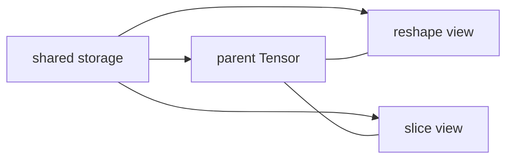

# 02.0 Share Data Instead of Copying 学习视图语义和存储共享

这一章先回答一个视图问题：张量怎样在不拷贝数据的情况下改变形状和局部窗口？

本章会为 `Tensor` 增加 view 语义的基础操作：`reshape` 和 `slice`。

本章的阅读顺序如下：

1. 先弄清底层存储怎么共享
2. 再看 `reshape` 为什么只是改变形状
3. 再看 `slice` 为什么必须带偏移
4. 最后用测试把这两个语义锁住

它不是在加两个小函数，而是在把 `Tensor` 从“数据容器”推进到“数据对象 + 视图对象”的阶段。

这一章的重点不是增加新的计算能力，而是让多个张量对象可以共享同一份底层存储，并在不复制数据的情况下改变视图。

这一章会碰到的 C++ 概念主要是：`shared_ptr` 的共享所有权、复制和移动语义、对象生命周期，以及如何用成员函数表示视图变换。

这里真正重要的，不只是“省一次拷贝”，而是建立一个更接近推理引擎的张量模型：一个对象既可以表示整块数据，也可以表示局部窗口、重排视图和派生结果，而底层存储仍然保持唯一。

这一步不扎实，后续最容易出问题的地方不是 `reshape` 本身，而是缓存、子矩阵、切片访问和 token 级别复用都会变得含糊。

## 1. 本章概览

| 先看什么 | 这一章给什么 | 为什么重要 | 对应小节 |
| --- | --- | --- | --- |
| 为什么要做 view | 共享存储和局部窗口 | 后续算子依赖它 | [`02.3`](#3-背景是什么) / [`02.5`](#5-中间推导是什么) |
| reshape 和 slice 分别做什么 | 不复制数据的视图变换 | 语义边界先固定 | [`02.4`](#4-最小设计是什么) / [`02.6`](#6-本章会产出什么) |
| 怎么验证 view 语义 | 单元测试 | 避免 hidden copy | [`02.9`](#9-怎么验证) / [`02.10`](#10-本章解决了什么) |
| 源码直达 | `tensor.*` / 测试 | 先看视图语义和验证 | [`chapter02_tensor_ops 代码入口`](/code/chapter02_tensor_ops) |
| 下一步接到哪里 | `chapter03_matmul` | 算子输入需要 view-aware Tensor | [`02.11`](#11-下一步是什么) |

## 2. 阅读入口

- 前置阅读：[`chapter01_tensor_loader`](/chapter01_tensor_loader/intro)、[`foundation`](/foundation/README)
- 源码直达：[`chapter02_tensor_ops 代码入口`](/code/chapter02_tensor_ops)、[`tensor.h`](/code/chapter02_tensor_ops)、[`tensor.cpp`](/code/chapter02_tensor_ops)、[`main_tensor_ops.cpp`](/code/chapter02_tensor_ops)、[`chapter02_tensor_ops_test.cpp`](/code/chapter02_tensor_ops)、[`run.sh`](/code/chapter02_tensor_ops)
- 相关阅读：[`02.1 Shared Underlying Storage`](/chapter02_tensor_ops/01_shared_ptr_memory)、[`02.4 Uint Tests`](/chapter02_tensor_ops/04_uint_tests)、[`02.5 本章小结`](/chapter02_tensor_ops/summary)

## 代码直达

- [`include/chapter02_tensor_ops/tensor.h`](/code/chapter02_tensor_ops#tensor-h)
- [`src/tensor.cpp`](/code/chapter02_tensor_ops#tensor-cpp)
- [`examples/main_tensor_ops.cpp`](/code/chapter02_tensor_ops#main-tensor-ops-cpp)
- [`tests/chapter02_tensor_ops_test.cpp`](/code/chapter02_tensor_ops#chapter02-tensor-ops-test-cpp)
- [`scripts/run.sh`](/code/chapter02_tensor_ops#run-sh)

## 生态对照

这一章适合继续看 `Gemma`，并顺手回看 `llama.cpp`。前者会放大“模型家族如何影响视图语义”的细节，后者会提醒你为什么 view-aware Tensor 是真实 runtime 里绕不开的基础。

- 先看 [生态对照总览](/reference/ecosystem/README)
- 对照 [Gemma](/reference/ecosystem/gemma) 看具体模型家族如何影响 shape、窗口和验证
- 对照 [llama.cpp](/reference/ecosystem/llama_cpp) 看 view 语义为什么要服务于本地推理链路

## 3. 背景是什么

共享所有权、引用计数和对象生命周期不熟时，先回看 `foundation/01_cxx_basics.md` 里关于 smart pointer 和 RAII 的部分。

容器和连续存储不熟时，先看 `foundation/06_data_structure_algorithm_basics.md`，再回来读为什么 `Tensor` 的底层存储会选择连续 buffer。

这一章里最常见的障碍不是公式，而是“为什么视图能共享同一份底层数据”。

如果把这一章写深，重点不只是实现 `reshape` 和 `slice`，而是要把共享存储的工程理由讲清楚：

- 为什么 copy-on-access 不适合后续的算子和缓存路径
- 为什么 view 语义能让后面的 `MatMul`、`Attention` 和 `KV cache` 更自然
- 为什么“数据没变、视图变了”是推理引擎里很重要的抽象边界

这一章要让你接受两个看起来反直觉、但工程上很重要的判断：

- 一个新的 `Tensor` 对象不一定意味着新的数据块
- 一个视图变化不一定意味着数据拷贝

这个判断一旦成立，后面的缓存和算子设计就会轻很多。

## 4. 最小设计是什么

最小设计不是把所有 view 语义一次做完，而是先完成两件事：

- 共享底层存储
- 让 `reshape` 和 `slice` 只改变观察方式，不复制数据

## 5. 中间推导是什么

如果从“张量为什么需要 view 语义”倒推，通常会先得到几个约束：

- 后续算子需要复用同一份数据，不能每次都拷贝
- `reshape` 只改变形状，不应该改变底层数据
- `slice` 只应该改变观察窗口，不应该把底层 storage 切断
- 引用计数和所有权必须清楚，否则多个视图之间会互相影响生命周期
- offset 和 stride 必须可解释，否则看起来 shape 对了，实际上视图可能已经错了

把这些约束摆出来后，设计就会自然收敛成“底层 storage + view 对象”的结构。`Tensor` 的对象模型要同时回答两个问题：数据本身存在哪里，当前这个对象又是怎么观察这份数据的。

这一步的关键转折点在于：**把张量从“数据块”提升成“带视图语义的数据对象”**。只有这样，后面的 `MatMul`、`Attention` 和 `KV Cache` 才能在不重复拷贝的前提下继续演进。

这一章的核心不是“写一个 reshape 函数”，而是“把视图和存储的边界钉死”。只要边界清楚，后面增加新视图、新缓存和新算子时，语义不会漂移。

## 6. 本章会产出什么

- 一个支持共享存储的 `Tensor` 设计
- 一个只修改形状的 `reshape`
- 一个返回子视图的 `slice`
- 一组验证 view 语义的小测试

更重要的是，这一章会留下一个可重复的判定标准：以后只要看到一个张量操作，就先问它是在改“形状解释”，还是在改“观察窗口”。如果这个问题答不清楚，通常就意味着实现有风险。

## 7. 实现路径是什么

1. 共享底层存储
2. `reshape`
3. `slice`
4. 单元测试

这个顺序不是随便排的。先共享存储，才能让后面的视图变化复用同一份数据；先做 `reshape`，再做 `slice`，是因为前者只改解释，后者还要处理偏移和窗口，调试更复杂。

## 8. 常见问题是什么

- 以为 `reshape` 会复制数据
- 以为 `slice` 是独立拷贝而不是共享视图
- 以为多个张量对象一定对应多个底层 buffer
- 以为只要 shape 对了，storage 和 offset 就一定没问题

实际里最容易漏掉的是：shape 正常并不代表视图正确。只要 offset、stride 或共享关系有一个错了，后面的 `Attention` 和 `KV Cache` 就会放大这个错误。

## 9. 怎么验证

- `reshape` 只改变 shape，不复制底层数据
- `slice` 只改变窗口和 offset，不切断 storage
- 父张量和子视图共享同一份底层存储
- 单元测试能覆盖共享存储、偏移和窗口边界

如果想把验证做完整一点，通常再补两种检查：

- 结构检查：storage 指针是否一致
- 行为检查：不同视图读到的内容是否符合预期

## 10. 本章解决了什么

这一章把 `Tensor` 从“数据容器”升级成“带语义的视图对象”。后面的算子层、attention 层和 cache 层，都会在正确的 view 模型上继续往下搭。

它真正建立的是一个通用判断标准：以后遇到新的张量操作，先问它有没有破坏共享存储和视图边界。如果破坏了，后面的章节大概率都会受影响。

## 11. 下一步是什么

进入 `chapter03_matmul`，开始把 `Tensor` 用到真正的数值计算中。

也就是说，`chapter02` 把“同一份数据怎么被看”说清楚了，`chapter03` 才开始回答“这份数据怎么参与计算”。

## 12. 回看源码

- 先看 [`chapter02_tensor_ops 代码入口`](/code/chapter02_tensor_ops)
- 先看 [`tensor.h`](/code/chapter02_tensor_ops) 和 [`tensor.cpp`](/code/chapter02_tensor_ops)
- 再看 [`main_tensor_ops.cpp`](/code/chapter02_tensor_ops)
- 最后看 [`chapter02_tensor_ops_test.cpp`](/code/chapter02_tensor_ops)
