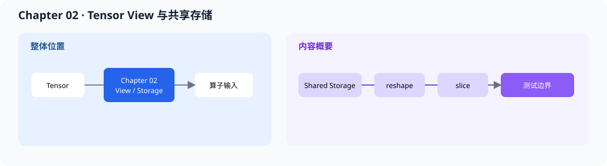

# 02.0 Tensor Views and Shared Storage 学习视图语义和存储共享

## 1. 本章位置与成功标准

本章让 `Tensor` 在不复制数据的情况下改变 shape 和局部窗口。

```bash
bash code/chapter02_tensor_ops/scripts/run.sh
```

成功标准：demo 能完成 `reshape` 和 `slice`，CTest 能证明 view 共享 storage、`TensorContract` 保留 stride/offset，边界错误通过 `Status` 被明确拒绝。



本章位于对象表示和数值计算之间，解决“同一份数据怎样被不同算子观察”的问题。本章不实现 MatMul、Attention 或 KV Cache，只提供它们需要的 view 语义。

## 2. 内容地图

完成本章后，可以：

- 区分改变 shape 与复制数据
- 用共享 storage 表达多个 Tensor view
- 用 `reshape` 改变形状，用 `slice` 改变 offset 和窗口
- 检查 view 的生命周期、范围和底层数据是否仍然一致
- 区分适合入门的便捷 API 与跨 backend 使用的 `contract()` / `try_*` API

成熟框架会在 tensor 图、模型执行和 KV Cache 中反复使用 view 语义。本章先对照 storage、shape、stride 和 offset 四个共同要素。

| 对照项 | 内容 |
| --- | --- |
| 本章教学对象 | 共享 storage、reshape、slice 和 TensorContract |
| 主对照框架 | `llama.cpp` 的 ggml tensor/view；vLLM 的 cache 元数据 |
| 成熟组件 | 非连续 view、设备内存、allocator、页表和异步生命周期 |
| 重点差异 | 本章只实现连续 CPU storage 上的可验证 view，不隐藏复制和跨设备迁移 |
| 深入入口 | [`02.5 Tensor 与 View 框架对照`](./05_framework_tensor_comparison.md) |

## 3. 阅读与源码顺序

| 顺序 | 页面 | 读完后应看到什么 |
| --- | --- | --- |
| 1 | [`02.1 Shared Underlying Storage`](./01_shared_ptr_memory.md) | storage 和 view 的所有权关系 |
| 2 | [`02.2 Reshape`](./02_reshape.md) | 只改 shape、不复制数据 |
| 3 | [`02.3 Slice`](./03_slice.md) | 通过 offset 观察局部窗口 |
| 4 | [`02.4 Unit Tests`](./04_unit_tests.md) | shape、offset、共享 storage 和异常边界 |
| 5 | [`02.5 Tensor 与 View 框架对照`](./05_framework_tensor_comparison.md) | 在 ggml 和 vLLM 中定位对应数据结构 |

源码先看 <a href="../_code/chapter02_tensor_ops/include/chapter02_tensor_ops/tensor.h"><code>tensor.h</code></a>、<a href="../_code/chapter02_tensor_ops/src/tensor.cpp"><code>tensor.cpp</code></a> 和 <a href="../_code/chapter02_tensor_ops/tests/chapter02_tensor_ops_test.cpp"><code>chapter02_tensor_ops_test.cpp</code></a>。前置阅读是 [`chapter01_tensor_loader`](../chapter01_tensor_loader/intro.md)；内存生命周期的扩展说明见 [`推理引擎内存管理`](../reference/memory_management.md)，numel、stride 和 offset 统一写法见 [`F-TENSOR-01/02`](../reference/formulas.md#f-tensor-01)。

## 4. 验证

本章至少检查：

1. `reshape` 只改变 shape
2. `slice` 只改变 offset 和窗口
3. 父张量和子视图指向同一份 storage
4. 越界 shape、offset 和长度会失败
5. `contract()` 的 shape、stride、offset 和 storage bytes 能通过公共范围校验

看到 Tensor API 时，先判断它是在重新分配数据，还是只改变观察方式。这个判断会直接影响 Chapter 03 的算子输入和 Chapter 05 的 KV Cache 成本。

**下一章：**本章固定数据的观察方式，Chapter 03 将 Tensor 接入 MatMul，并把算子语义与 CPU / GPU backend 分开。
