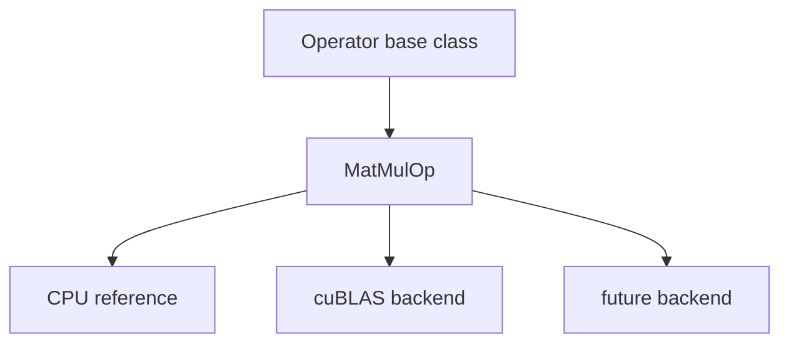
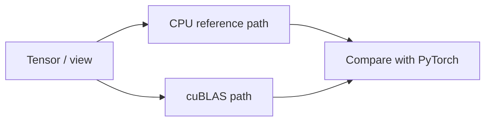

# 03.0 Make MatMul Reliable 构建核心矩阵乘法算子

这一章先回答一个工程问题：推理引擎里最核心的矩阵乘法应该怎样抽象和落地？

本章会把矩阵乘法封装成一个可复用的算子，先实现 CPU 参考版本，再接入 cuBLAS 作为高效实现。

这章的阅读顺序可以理解成：

1. 先弄清为什么 `MatMul` 需要先被抽象成算子
2. 再看接口契约要固定哪些东西
3. 再看 CPU reference 为什么要先于优化实现存在
4. 最后看 cuBLAS 为什么只是后端，而不是上层语义

这样读的好处是，你不会把“能算”直接等同于“算子已经设计好了”。这章真正要解决的是语义边界，而不是先写出一个矩阵乘法循环。

## 1. 本章概览

| 先看什么 | 这一章给什么 | 为什么重要 | 对应小节 |
| --- | --- | --- | --- |
| 矩阵乘法为什么要先抽象 | `MatMulOp` 稳定边界 | 上层可以只关心语义 | [`定位与产出`](#3-本章定位与产出) / [`最小设计`](#4-最小设计是什么) |
| 怎么保证先算对 | CPU reference + PyTorch 对照 | 先把语义和布局讲清楚 | [`最小设计`](#4-最小设计是什么) / [`中间推导`](#5-中间推导是什么) / [`怎么验证`](#7-怎么验证) |
| 怎么再提速 | cuBLAS backend | 高性能实现不破坏接口 | [`最小设计`](#4-最小设计是什么) / [`实现路径`](#6-实现路径是什么) |
| 源码直达 | `operator.h` / `matmul_op.cpp` / `chapter03_matmul_test.cpp` | 先看接口、主实现和验证 | [`operator.h`](/code/chapter03_matmul) / [`matmul_op.cpp`](/code/chapter03_matmul) / [`chapter03_matmul_test.cpp`](/code/chapter03_matmul) |
| 下一步接到哪里 | `chapter04_attention` | attention 和 FFN 都会复用这个边界 | [`下一步`](#9-下一步是什么) |

## 2. 阅读入口

- 前置阅读：`chapter01_tensor_loader`、`chapter02_tensor_ops`
- 源码直达：[`operator.h`](/code/chapter03_matmul)、[`matmul_op.h`](/code/chapter03_matmul)、[`operator.cpp`](/code/chapter03_matmul)、[`matmul_op.cpp`](/code/chapter03_matmul)、[`chapter03_matmul_test.cpp`](/code/chapter03_matmul)
- 相关阅读：[`03.1 Operator Base`](/chapter03_matmul/01_operator_base)、[`03.2 MatMulOp Design`](/chapter03_matmul/02_matmul_design)、[`03.3 CPU Reference`](/chapter03_matmul/03_cpu_reference)、[`03.4 cuBLAS Implementation`](/chapter03_matmul/04_cublas_implement)

## 代码直达

- [`src/operator.cpp`](/code/chapter03_matmul#operator-cpp)
- [`src/matmul_op.cpp`](/code/chapter03_matmul#matmul-op-cpp)
- [`src/matrix.cpp`](/code/chapter03_matmul#matrix-cpp)
- [`tests/chapter03_matmul_test.cpp`](/code/chapter03_matmul#chapter03-matmul-test-cpp)
- [`examples/main_matmul.cpp`](/code/chapter03_matmul#main-matmul-cpp)

## 生态对照

这一章最适合拿 `llama.cpp` 和 `TensorRT-LLM` 一起看：前者提醒你最小运行时怎么先把矩阵乘法跑起来，后者提醒你高性能 GPU engine 是怎么把算子边界和后端实现分开的。

- 先看 [生态对照总览](/reference/ecosystem/README)
- 对照 [llama.cpp](/reference/ecosystem/llama_cpp) 看最小本地运行时如何组织基础算子
- 对照 [TensorRT-LLM](/reference/ecosystem/tensorrt_llm) 看算子边界怎样进入 GPU engine 和 backend 分层
- 把“模型对象如何影响算子输入”也一起看清楚时，可以顺手回看 [Gemma](/reference/ecosystem/gemma)

## 3. 本章定位与产出

推理引擎里的大部分耗时最终都会落到矩阵乘法上。无论是把输入映射到隐藏空间，还是在 attention 和 FFN 里做线性变换，底层都会反复依赖同一类算子。

这一章要做的，不是把矩阵乘法简单写出来，而是把它收束成一个稳定、可替换、可验证的算子边界：

- 上层只依赖 `MatMulOp` 的接口语义
- 下层可以在 CPU reference、cuBLAS 或后续 backend 之间切换
- shape、stride 和 layout contract 先说清楚，再谈性能

如果这一层边界不先固定，后面常见的问题就会变成：

- 上层代码直接依赖某个具体实现
- 布局约定散落在多个地方，排错时没人知道谁说了算
- 参考实现和优化实现都在改接口，最后连正确性基线都没有

这一章的产出是：

- 一个 `Operator` 基类
- 一个 `MatMulOp`
- 一个 CPU 参考实现
- 一个 cuBLAS 实现
- 一组数值对照测试

这一章放在 `Tensor` 和 `Attention` 之间，是因为它正好处在“数据对象”到“模型结构”之间的计算门槛上。没有这一层，后面的 decoder 会直接面对裸数组；有了这一层，模型结构才能依赖一个清晰的数值边界。

`chapter03` 的职责不是“把线性代数讲完”，而是先立住后续章节都会复用的算子边界。只要这个边界清楚，attention、FFN、甚至后面的量化路径，都可以在同一套语义上往前走。

## 4. 最小设计是什么

最小设计不是“把乘法写出来”，而是先定一条稳定的接口契约：

- 上层只看 `MatMulOp`
- 下层可以切换 CPU reference、cuBLAS 或 future backend
- shape、stride 和 layout contract 必须先说清楚

这张图表达的是“接口稳定，后端可替换”。

## 5. 中间推导是什么

如果从问题一步步推下去，设计通常会收敛成下面这个顺序：

- 先有统一的算子语义
- 再有语义清楚的 CPU 参考版本
- 再接入高性能 backend
- 最后用 PyTorch 对照验证数值行为

`MatMul` 是“做什么”，`GEMM` 是“怎么高性能地做”。前者是算子语义，后者是实现范式，所以这章先立接口，再接 cuBLAS。

这个区分很重要，因为它决定了代码组织方式：

- 接口层只描述输入输出、布局和错误边界
- 参考层负责给出最稳定的正确性答案
- 优化层只负责把同样的语义跑得更快

如果把这三层混在一起，后面每次做性能优化都会重新污染语义判断。

这张图把 `chapter03` 的验证路径画出来：同一份输入可以走 CPU reference 或 cuBLAS，然后再和 PyTorch 对照。

它背后的实际工作流通常是：

1. 先用最朴素的 CPU 版本确认 shape 和布局逻辑
2. 再用 PyTorch 当参照，确认数值没有偏离
3. 最后才把 cuBLAS 接进来，检查它是否保持同样的语义

这样做的好处是，任何一层出问题时都比较容易定位。

## 6. 实现路径是什么

1. 算子基类
2. `MatMulOp` 设计
3. CPU 参考实现
4. cuBLAS 实现
5. PyTorch 对照测试
6. 复杂度直觉
7. 接口边界与失败模式

## 7. 怎么验证

- 先确认接口边界稳定
- 再确认 CPU 参考版本的结果正确
- 最后确认 cuBLAS 路径和 PyTorch 对照一致

这一章的重点不是“能不能算出结果”，而是“语义能否和实现解耦”。

所以这章真正要回答的三个问题其实是：

- 上层看到的是不是稳定的 `MatMulOp`
- 下层切换实现时会不会改坏接口
- 数值结果和布局结果能不能用统一标准验证

## 8. 常见问题是什么

- 只看结果数值，不看布局约定，导致 CPU 和 GPU 路径对不上
- 把后端实现直接塞进上层，最后接口和性能实现绑死
- 参考实现被优化实现覆盖，语义边界变模糊
- shape 对了，但 row-major / column-major 处理错了

再往下看，最难排查的其实不是“算错了”，而是“看起来对、实际上每层理解不一致”。这也是为什么这一章必须先把参考实现、布局约定和验证路径一起写清楚。

如果这一章没有先把正确性做稳，后面把 `MatMul` 嵌入 attention 和 FFN 时，定位问题会非常困难。

## 9. 下一步是什么

进入 `chapter04_attention`，把这个算子边界收束进 attention、FFN 和 residual，开始组装真正的模型结构。

一句话概括就是：`chapter03` 解决“MatMul 是否站得住”，`chapter04` 解决“这些算子如何进入 decoder 结构”。
