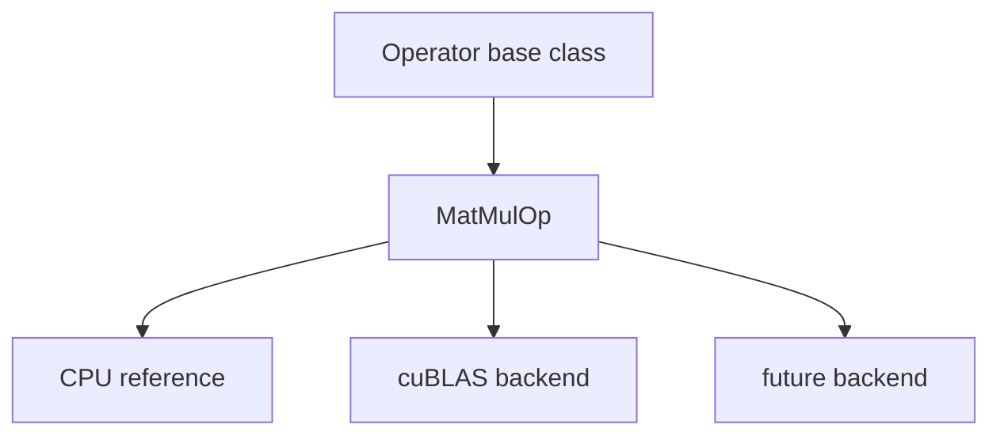
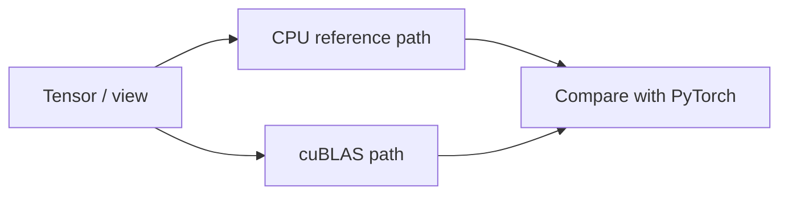

# 03.0 Make MatMul Reliable 构建核心矩阵乘法算子

这一章先回答一个工程问题：推理引擎里最核心的矩阵乘法应该怎样抽象和落地？

本章会把矩阵乘法封装成一个可复用的算子，先实现 CPU 参考版本，再接入 cuBLAS 作为高效实现。

## 1. 本章概览

| 先看什么 | 这一章给什么 | 为什么重要 | 对应小节 |
| --- | --- | --- | --- |
| 矩阵乘法为什么要先抽象 | `MatMulOp` 稳定边界 | 上层可以只关心语义 | [`定位与产出`](#2-本章定位与产出) / [`最小设计`](#3-最小设计是什么) |
| 怎么保证先算对 | CPU reference + PyTorch 对照 | 先把语义和布局讲清楚 | [`最小设计`](#3-最小设计是什么) / [`中间推导`](#4-中间推导是什么) / [`怎么验证`](#6-怎么验证) |
| 怎么再提速 | cuBLAS backend | 高性能实现不破坏接口 | [`最小设计`](#3-最小设计是什么) / [`实现路径`](#5-实现路径是什么) |
| 代码入口 | `站内代码索引` | 先把文档和代码连起来 | [`代码索引`](/code/chapter03_matmul) |
| 下一步接到哪里 | `chapter04_attention` | attention 和 FFN 都会复用这个边界 | [`下一步`](#8-下一步是什么) |

## 2. 本章定位与产出

推理引擎里的大部分耗时最终都会落到矩阵乘法上。无论是把输入映射到隐藏空间，还是在 attention 和 FFN 里做线性变换，底层都会反复依赖同一类算子。

这一章要做的，不是把矩阵乘法简单写出来，而是把它收束成一个稳定、可替换、可验证的算子边界：

- 上层只依赖 `MatMulOp` 的接口语义
- 下层可以在 CPU reference、cuBLAS 或后续 backend 之间切换
- shape、stride 和 layout contract 先说清楚，再谈性能

这一章的产出是：

- 一个 `Operator` 基类
- 一个 `MatMulOp`
- 一个 CPU 参考实现
- 一个 cuBLAS 实现
- 一组数值对照测试

这一章之所以放在 `Tensor` 和 `Attention` 之间，是因为它刚好处在“数据对象”到“模型结构”之间的计算门槛上。没有这一层，后面的 decoder 会直接面对裸数组；有了这一层，模型结构才能依赖一个清晰的数值边界。

## 3. 最小设计是什么

最小设计不是“把乘法写出来”，而是先定一条稳定的接口契约：

- 上层只看 `MatMulOp`
- 下层可以切换 CPU reference、cuBLAS 或 future backend
- shape、stride 和 layout contract 必须先说清楚

这张图表达的是“接口稳定，后端可替换”。

## 4. 中间推导是什么

如果从问题一步步推下去，设计通常会收敛成下面这个顺序：

- 先有统一的算子语义
- 再有语义清楚的 CPU 参考版本
- 再接入高性能 backend
- 最后用 PyTorch 对照验证数值行为

`MatMul` 是“做什么”，`GEMM` 是“怎么高性能地做”。前者是算子语义，后者是实现范式，所以这章先立接口，再接 cuBLAS。

这张图把 chapter03 的验证路径画出来：同一份输入可以走 CPU reference 或 cuBLAS，然后再和 PyTorch 对照。

## 5. 实现路径是什么

1. 算子基类
2. `MatMulOp` 设计
3. CPU 参考实现
4. cuBLAS 实现
5. PyTorch 对照测试
6. 复杂度直觉
7. 接口边界与失败模式

## 6. 怎么验证

- 先确认接口边界稳定
- 再确认 CPU 参考版本的结果正确
- 最后确认 cuBLAS 路径和 PyTorch 对照一致

这一章的重点不是“能不能算出结果”，而是“语义能否和实现解耦”。

## 7. 常见问题是什么

- 只看结果数值，不看布局约定，导致 CPU 和 GPU 路径对不上
- 把后端实现直接塞进上层，最后接口和性能实现绑死
- 参考实现被优化实现覆盖，语义边界变模糊
- shape 对了，但 row-major / column-major 处理错了

如果这一章没有先把正确性做稳，后面把 `MatMul` 嵌入 attention 和 FFN 时，定位问题会非常困难。

## 8. 下一步是什么

进入 `chapter04_attention`，把这个算子边界收束进 attention、FFN 和 residual，开始组装真正的模型结构。

一句话概括就是：`chapter03` 解决“MatMul 是否站得住”，`chapter04` 解决“这些算子如何进入 decoder 结构”。

## 9. 相关阅读

- **前置依赖**：建议先读 [foundation/01 C++ 基础](/foundation/01_cxx_basics) 和 [foundation/02 CMake 和编译基础](/foundation/02_cmake_build_basics)，这样后面的接口、构建和布局约定更稳。
- **后续使用**：`chapter04_attention` 会直接复用这里的 `MatMulOp` 边界；`chapter05_generation` 会在 runtime 中继续复用同一个算子接口。
- **03–06 阅读顺序**：`chapter03_matmul` 先看算子边界和对照验证，`chapter04_attention` 再看结构组装，`chapter05_generation` 进入 runtime，`chapter06_quantization` 再做资源与精度权衡。
- **源码索引**：本章代码先看 `Operator` 基类，再看 CPU reference，最后看 cuBLAS backend；如果你只想快速定位实现，从 [本章代码索引](/code/chapter03_matmul) 进入即可。
