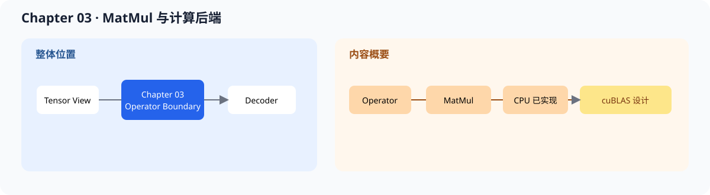
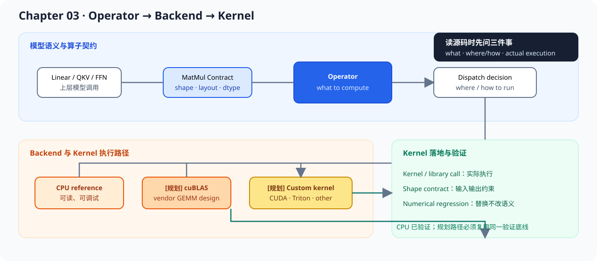

# 03.0 MatMul and Compute Backends 构建核心矩阵乘法算子

## 1. 本章位置与成功标准

本章把矩阵乘法做成可替换、可验证的算子：上层使用 `MatMulOp`，底层先运行 CPU reference，再保留 cuBLAS 和其他 backend 的接入位置。

```bash
bash code/chapter03_matmul/scripts/run.sh
```

成功标准：CPU demo 输出稳定结果，CTest 通过，`Matrix::contract()` 和 `MatMulOp::try_compute()` 把 Tensor 元数据、Operator 与 Backend 的 `Status` 串起来。Chapter03 默认 target 保持 CPU-only；独立的 `code/cuda` 已用同一个 core `MatmulRequest` 完成 cuBLAS target 和 CPU/GPU 数值对照。





阅读源码时沿着 `模型调用 -> MatMulOp -> backend -> kernel / library call -> 数值回归` 走，不先从某个优化库名开始。

## 2. 内容地图

完成本章后，可以：

- 为矩阵乘法固定 shape、layout 和输出契约
- 用 CPU reference 建立可读的正确性基线
- 理解 backend 如何从 CPU reference 扩展到已验证的 cuBLAS 或后续自定义 kernel
- 用测试和 PyTorch 数值对照确认 backend 替换没有改变结果

本章的公共契约如下：

| 接口 | 当前实现 | 后续替换 |
| --- | --- | --- |
| `MatmulRequest` | row-major `lhs[M,K] * rhs[K,N]` | device pointer / stream |
| `MatmulBackend` | `CpuReferenceMatmulBackend` | `code/cuda` cuBLAS、自定义 CUDA kernel |
| `MatMulOp` | 默认调用 CPU reference | 注入其他 backend |

`compute()` 是便捷入口，失败时抛出异常；`try_compute()` 是跨 backend 入口，返回公共 `Status`。两者执行同一个 backend 请求，不维护两套 MatMul 实现。

当前 CPU 调用链是：`MatMulOp -> CpuReferenceMatmulBackend -> cpu_reference_matmul_kernel`。前两层负责 shape、请求和 backend 身份，最后一层只负责 row-major 三重循环；后续 SIMD 或 CUDA 可以替换 kernel/backend，不改变上层算子输入输出。

成熟框架同样要把算子语义与具体 kernel 分开，只是 backend 选择、设备调度和融合范围更大。

| 对照项 | 内容 |
| --- | --- |
| 本章教学对象 | MatMul 契约、Operator、Backend 和 CPU reference kernel |
| 主对照框架 | `llama.cpp` ggml backend、TensorRT-LLM kernels |
| 成熟组件 | GEMM tactic、设备调度、算子融合、workspace 和多精度 kernel |
| 重点差异 | 本章优先保留可读 reference 和可替换接口，不把性能库封装成算法实现 |
| 深入入口 | [`03.7 从 MatMul 到真实推理 backend`](./07_runtime_backend_bridge.md) |

## 3. 阅读与源码顺序

| 顺序 | 页面 | 读完后应看到什么 |
| --- | --- | --- |
| 1 | [`03.1 Operator Base`](./01_operator_base.md)、[`03.2 MatMulOp Design`](./02_matmul_design.md) | 算子接口、shape 和 layout 契约 |
| 2 | [`03.3 CPU Reference`](./03_cpu_reference.md) | 可读、可调试的正确性实现 |
| 3 | [`03.4 cuBLAS Backend Design`](./04_cublas_implement.md) | 同一语义如何规划高性能 backend 接入 |
| 4 | [`03.5 Test with PyTorch`](./05_test_with_pytorch.md)、[`03.6 Complexity Intuition`](./06_complexity_intuition.md) | 数值和复杂度基线 |
| 5 | [`03.7 从 MatMul 到真实推理 backend`](./07_runtime_backend_bridge.md) | 找到 Linear、QKV、FFN 和 kernel 的对应实现 |

源码先看 <a href="../_code/chapter03_matmul/include/chapter03_matmul/operator.h"><code>operator.h</code></a>、<a href="../_code/chapter03_matmul/src/matmul_op.cpp"><code>matmul_op.cpp</code></a> 和 <a href="../_code/chapter03_matmul/src/cpu_backend.cpp"><code>cpu_backend.cpp</code></a>；测试入口是 <a href="../_code/chapter03_matmul/tests/chapter03_matmul_test.cpp"><code>chapter03_matmul_test.cpp</code></a>。CUDA 前置知识见 [`foundation/03_cuda_environment_basics`](../foundation/03_cuda_environment_basics.md)，Linear shape 和复杂度见 [`F-LINEAR-01`](../reference/formulas.md#f-linear-01)。

## 4. 验证

本章按以下顺序验证：

1. CPU reference 的 shape 和数值正确
2. 非法 shape、buffer size、空 buffer 和越界访问会明确失败
3. 独立 cuBLAS target 与 CPU 结果在允许误差内一致，后续 backend 继续复用该门槛
4. backend 名称和设备类型可观察，便于后续 benchmark 区分路径
5. Matrix 的 shape/stride/storage 元数据能通过 core contract 校验

`MatMul` 表示做什么，`GEMM` 或 kernel 表示怎样更快地做。后续优化应先保留 CPU reference，再比较其他 backend。

**下一章：**Chapter 02 提供 Tensor view，Chapter 03 提供 MatMul / Linear 的执行入口；Chapter 04 将把这些算子组合成 Attention、FFN、Residual 和单层 Decoder。
