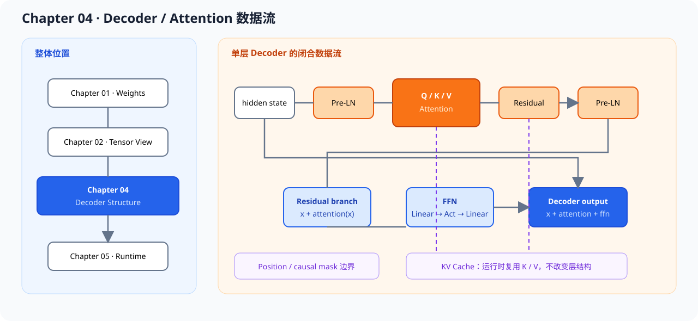

# 04.4 DecoderLayer 解码器层


## 串起单层 Decoder 数据流

把 Pre-LN、Attention、Residual 和 FFN 组合成一个完整的 Transformer decoder layer。

读完后应能做到：

- 理解 DecoderLayer 的标准结构
- 理解残差连接在模块组合中的作用
- 理解模块组合后如何继续保持 shape 一致



## 阅读入口

- 前置阅读：[`04.1 Multi-head Attention`](./01_multihead_attention.md)、[`04.3 Feed Forward Network`](./03_feedforward.md)
- 源码直达：<a href="../_code/chapter04_attention/src/decoder_layer.cpp"><code>decoder_layer.cpp</code></a>、<a href="../_code/chapter04_attention/src/attention.cpp"><code>attention.cpp</code></a>、<a href="../_code/chapter04_attention/tests/chapter04_attention_test.cpp"><code>chapter04_attention_test.cpp</code></a>
- 相关阅读：[`04.5 首层权重加载`](./05_load_first_layer.md)、[`04.6 Decoder 成熟框架对照`](./06_gemma_tensorrt_comparison.md)、[`章节导读`](./intro.md)

## 核心结构

单个模块正确不代表整体正确。DecoderLayer 是各模块真正拼接起来的地方，也是后面多层 Transformer 的最小单元。

它也是 `chapter01` 到 `chapter03` 的结构对照点：

- `chapter01` 提供真实模型 metadata、权重布局和独立 CPU Decoder，用来对照教学层 contract
- `chapter02` 提供的 view / shape 语义，要能支撑 attention 和 residual 的数据流
- `chapter03` 提供的 MatMul / Linear 边界，要能被稳定组合成 attention 和 FFN

Chapter04 的教学 `DecoderLayer` 不直接装载 TinyLlama GGUF 权重，因为两者的 Norm、激活、head 结构和量化格式不同；`DecoderLayerContract` 用于显式比较这些差异。

## 结构契约与执行契约

单层结构和一次请求的执行状态需要分开表示。Chapter04 的 `DecoderLayer` 只回答层内部由哪些组件组成；真实模型 Context 还要保存 position、分层 K/V，并提供 token 级 prefill/decode。把两者塞进同一个接口，会迫使教学层伪造 tokenizer、embedding 和 LM Head。

| 契约 | 回答的问题 | 实现位置 | 使用者 |
| --- | --- | --- | --- |
| `DecoderLayerContract` | 层的 hidden、head、FFN、Norm、RoPE 和 KV 能力是什么 | Chapter04 教学层、Chapter01 真实 Model | 测试、Engine Factory、架构检查 |
| `DecoderExecutionContext` | 当前请求如何 reset、prefill、decode，已经消费多少 token | Chapter01 真实 Context | Engine adapter |
| `RequestModelExecutor` | Runtime 如何按请求取得 logits | Engine adapter | Chapter05 Runtime、Chapter09 ServiceCore |

标准结构：

- Pre-LN
- Attention
- Residual
- FFN
- Residual

这里的重点不是“把模块堆起来”，而是保持各模块之间的 shape、顺序和数据流都一致。只要其中一个环节顺序错了，模型就会看起来能跑，但结果明显不对。

建议把 DecoderLayer 当作一个独立的中间里程碑：它既够小，方便验证；又够完整，足以代表一层 Transformer 的核心行为。

为什么使用 Pre-LN：

Transformer 常见有两种归一化位置：

- Post-LN：`y = LayerNorm(x + sublayer(x))`
- Pre-LN：`y = x + sublayer(LayerNorm(x))`

本教程使用的是 **Pre-LN**，原因是：

1. 训练更稳定，梯度更容易通过残差路径传播
2. 收敛通常更顺滑
3. 现代大模型里 Pre-LN 更常见

对推理实现来说，Pre-LN 也更容易把模块边界画清楚：先归一化，再进入子模块，再做残差加法。

单层参数量的粗略估算：

假设：

- `hidden_dim = D`
- `ffn_dim = 4D`

那么一层 DecoderLayer 的主要参数量可以粗略看成：

- Attention：`4 * D^2`，对应 Q/K/V/O 四个投影矩阵
- FFN：`2 * D * 4D = 8D^2`
- LayerNorm：两个归一化，约 `4D`
- 合计：`≈ 12D^2 + 4D`

如果 `D = 768`，那单层大约就是几百万级参数。这个估算后面在 benchmark 和 quantization 章节会反复用到。

从单层到多层：

完整 Transformer 不是一层 DecoderLayer，而是多层堆叠：

```python
y = x
for i in range(num_layers):
    y = decoder_layer_i(y)
```

每一层的参数独立，但结构相同。层数越多，表达能力越强，代价也越高。

实现建议：

- 先把每个子模块单独验证过
- 再组合成完整层
- 每一步都检查 shape

## 验证与排查

验证时重点看：

- 输入输出 shape 一致
- 残差连接不破坏维度
- 模块顺序符合预期
- 教学层报告 LayerNorm、ReLU、MHA 和无 RoPE/KV；真实 TinyLlama 报告 RMSNorm、SwiGLU、GQA、RoPE 和请求级 KV

如果一层 `DecoderLayer` 的完整数据流图能够和代码一致，单层结构就完成了。

最小伪代码可以写成：

```cpp
Tensor y = x;
y = y + attention(layernorm1(y));
y = y + ffn(layernorm2(y));
```

源码锚点：`code/chapter04_attention/src/decoder_layer.cpp`

这段代码把 Pre-LN、Residual 和两个子模块的组合关系表达得很直接。

常见问题：

- 残差连接的位置错误
- 归一化顺序错误
- 子模块输出 shape 与输入不匹配
- 先 Residual 再 LayerNorm，容易让训练和推理的行为偏离预期
- 模块顺序颠倒时，常见现象是 shape 看起来对，但结果明显不对
