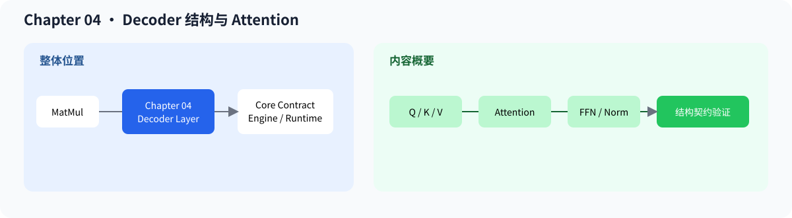

# 04.0 Decoder Structure and Attention 组装 decoder block

## 1. 本章位置与成功标准

本章把 Attention、LayerNorm、FFN 和 Residual 组合成一个可验证的单层 `DecoderLayer`。

```bash
bash code/chapter04_attention/scripts/run.sh
```

成功标准：Attention backend 测试通过，Decoder demo 输出正确 shape 和数值；本章教学代码不实现请求调度或 paged KV Cache。可选 CUDA 公共层已经提供 RoPE、连续 device KV Cache 和 causal GQA Attention 数值基线。




数据流是 `Pre-LN -> Attention -> Residual -> FFN -> Residual`。position、causal mask 和 `query_position_offset` 会影响执行，但不改变单层 Decoder 的输入输出契约。

## 2. 内容地图

完成本章后，可以：

- 根据 Q/K/V、causal mask 和 softmax 执行 Attention
- 把 LayerNorm、激活函数和 FFN 接入 decoder block
- 用 Residual 组合出可单独测试的 `DecoderLayer`
- 用公共 `AttentionRequest` / `AttentionBackend` 保留 CPU reference 和后续 GPU backend 的替换位置
- 用 `DecoderLayerContract` 表达层维度、归一化、激活、位置编码和 KV Cache 能力
- 用真实模型首层权重检查 shape 和输入布局

本章是前三章第一次汇合：Chapter 01 提供权重对象，Chapter 02 提供 view，Chapter 03 提供 MatMul / Linear。vLLM、SGLang 和 TensorRT-LLM 会把类似的 Decoder 继续接入 model runner、attention backend 和 KV Cache；这里先把单层结构跑稳。

当前 Attention 契约如下：

| 组件 | 当前实现 | 后续替换 |
| --- | --- | --- |
| `DecoderLayer` | LayerNorm、MHA、ReLU FFN、Residual | 多层权重和真实模型装配 |
| `AttentionBackend` | CPU row-major、causal mask、stable softmax | FlashAttention、paged KV、CUDA |
| `query_position_offset` | 对齐 decode token 与历史位置 | KV Cache-aware attention |
| `DecoderLayerContract` | 描述教学层的结构能力 | 与真实 Model 的结构契约对照 |
| 可选 CUDA RoPE / KV / GQA | 原地旋转、连续 K/V append、causal prefill/decode | 单层 GPU Decoder 组装 |

CPU 调用链是：`MultiHeadAttention -> CpuReferenceAttentionBackend -> cpu_reference_attention_kernel`。`KvCache` 是经过独立测试的连续 K/V 容器，支持固定容量和 append/clear；教学 `MultiHeadAttention` 尚未持有该容器，带历史 K/V 的 decode 由测试直接构造 `AttentionRequest` 验证。真实 TinyLlama 的分层 K/V 集成位于 `RealLlamaCpuContext`，分页 block ownership 位于 Chapter05。

成熟框架会把同一 Decoder 结构接入模型 runner、attention backend 和分页 KV Cache。本章用单层 CPU 实现固定结构和数值顺序。

| 对照项 | 内容 |
| --- | --- |
| 本章教学对象 | LayerNorm、MHA、ReLU FFN、Residual 和 DecoderLayer |
| 主对照框架 | vLLM Llama model、TensorRT-LLM attention/kernels |
| 成熟组件 | FlashAttention、paged KV、融合算子、张量并行和多模型适配 |
| 重点差异 | 教学层验证单层结构；backend 测试独立验证 mask、position offset 和连续 KV 输入 |
| 深入入口 | [`04.6 Decoder 成熟框架对照`](./06_gemma_tensorrt_comparison.md) |

## 3. 阅读与源码顺序

| 顺序 | 页面 | 读完后应看到什么 |
| --- | --- | --- |
| 1 | [`04.1 Multi-head Attention`](./01_multihead_attention.md) | Q/K/V、score、softmax 和输出合并 |
| 2 | [`04.2 LayerNorm and Activation`](./02_layernorm_and_activation.md)、[`04.3 FeedForward`](./03_feedforward.md) | decoder 的逐 token 组件 |
| 3 | [`04.4 DecoderLayer`](./04_decoder_layer.md) | Attention、FFN 和 Residual 的完整顺序 |
| 4 | [`04.5 Load First Layer`](./05_load_first_layer.md) | 真实权重和 shape 校验 |
| 5 | [`04.6 Decoder 成熟框架对照`](./06_gemma_tensorrt_comparison.md) | 模型结构与真实 backend 的对应关系 |

源码先看 <a href="../_code/chapter04_attention/src/attention.cpp"><code>attention.cpp</code></a>、<a href="../_code/chapter04_attention/src/attention_backend.cpp"><code>attention_backend.cpp</code></a>、<a href="../_code/chapter04_attention/src/decoder_layer.cpp"><code>decoder_layer.cpp</code></a>；测试入口是 <a href="../_code/chapter04_attention/tests/chapter04_attention_test.cpp"><code>chapter04_attention_test.cpp</code></a>。可选 GPU 实现从 <a href="../_code/cuda/src/rope_backend.cu"><code>rope_backend.cu</code></a>、<a href="../_code/cuda/src/cuda_kv_cache.cpp"><code>cuda_kv_cache.cpp</code></a>、<a href="../_code/cuda/src/gqa_attention_backend.cu"><code>gqa_attention_backend.cu</code></a> 及对应测试进入。前置阅读是 [`chapter03_matmul`](../chapter03_matmul/intro.md)；Attention、GQA、RoPE、Norm 和 SwiGLU 的统一符号从 [`F-ATTN-01`](../reference/formulas.md#f-attn-01) 开始查阅。

## 4. 验证

本章按以下顺序验证：

1. Q/K/V 的 shape 和 head layout 正确
2. causal mask 不读取未来 token，decode offset 能读取历史 KV
3. softmax 数值稳定，输出 shape 正确
4. 固定容量 KV Cache 能 append、拒绝溢出并 clear 复用
5. DecoderLayer 的残差和 FFN 顺序正确
6. 首层真实权重能通过 metadata、shape 和独立真实前向校验
7. `DecoderLayer::contract()` 能通过维度和结构一致性校验

排查时先看 shape，再看 Attention backend，最后看 Decoder 组合顺序；不要先从服务吞吐判断结构是否正确。

**下一章：**本章把权重、Tensor view 和计算算子组合成单层 Decoder；Chapter 05 将保存多个请求的生成状态并推进 `prefill -> decode`。
