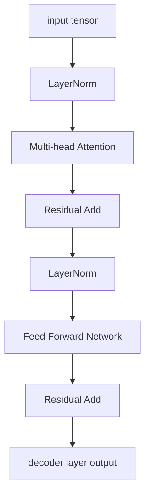
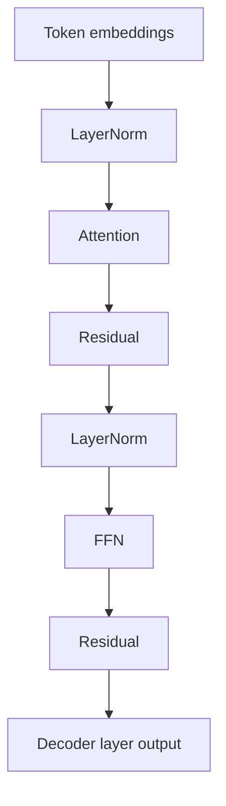
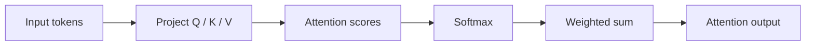

# 04.0 Make a Single Decoder Correct 组装 decoder block

这一章先回答一个结构问题：单层 decoder 要怎样做成一个可验证、可扩展的最小模块？

本章会实现 Transformer decoder 的核心组件：多头注意力、LayerNorm、激活函数、FFN，并把它们组装成一个完整的 DecoderLayer。

## 1. 本章概览

| 先看什么 | 这一章给什么 | 为什么重要 | 对应小节 |
| --- | --- | --- | --- |
| 单层 decoder 为什么先做 | `DecoderLayer` 最小结构 | 多层堆叠要先有稳定单层 | [`04.2`](#2-本章要解决什么) / [`04.4`](#4-最小设计是什么) |
| attention 和 FFN 怎么分工 | Q/K/V 数据流 + residual 结构 | 结构边界比术语更重要 | [`04.3`](#3-背景是什么) / [`04.5`](#5-中间推导是什么) |
| 怎么保证可验证 | shape contract + 前向流程 | 先把单层做对，后面才好扩展 | [`04.5`](#5-中间推导是什么) / [`04.8`](#8-怎么验证) |
| 代码入口 | `站内代码索引` | 先把文档和代码连起来 | [`代码索引`](/code/chapter04_attention) |
| 下一步接到哪里 | `chapter05_generation` | 生成 runtime 建立在这层结构上 | [`04.10`](#10-本章解决了什么) / [`04.11`](#11-下一步是什么) |

## 2. 本章要解决什么

把前面做好的算子组合成一个单层 decoder，让它可以被单独验证、单独排错，也能继续往上扩展。

## 3. 背景是什么

Transformer 的核心不是某一个独立算子，而是几个模块按固定顺序组合后形成的结构。  
对初学者来说，attention、LayerNorm、FFN、Residual 这些名词经常分别出现，但真正难的地方在于：它们为什么要按这一种顺序连接起来。

这一章之所以放在 `MatMul` 之后，是因为到这里为止，算子层已经具备了稳定的数值边界。  
接下来要做的不是再发明新算子，而是把这些算子组织成一个结构上自洽的 decoder layer。

## 4. 最小设计是什么

最小设计不是先追求复杂结构，而是先把单层 decoder 做成一个稳定模块：

- 输入 token embeddings
- 先经过 LayerNorm
- 再进入 Attention
- 再经过 Residual
- 再进入 FFN
- 最后再回到 Residual

这张图把单层 decoder 的主路径画出来：先归一化，再做 attention，再保留 residual 路径，再做 FFN，最后再回到 residual。

## 5. 中间推导是什么

如果从“怎样把基础算子拼成一个可验证的 decoder”倒推，设计通常会先被几个约束收紧：

- 每个 token 都需要先经过归一化，否则数值分布不稳定
- token 之间需要交互，所以 attention 必须先出现
- attention 之后还需要逐 token 的非线性变换，所以 FFN 不能省
- residual 必须保留一条稳定路径，否则多层堆叠会更难训练和验证
- shape contract 必须清楚，否则单层都很难定位错误，更别说生成链路

把这些约束摆出来之后，结构就会自然收敛成 `Pre-LN -> Attention -> Residual -> FFN -> Residual` 这样的顺序。

这张图把 attention 内部的 Q/K/V 数据流单独画出来，帮助读者把“看谁”这件事和外层的 decoder 结构区分开。

## 6. 本章会产出什么

- 多头注意力实现
- LayerNorm 和激活函数实现
- FFN 实现
- 一个完整的 DecoderLayer
- 第一层权重加载与 shape 验证

## 7. 实现路径是什么

1. 多头注意力
2. LayerNorm 和激活函数
3. FFN
4. DecoderLayer
5. 首层权重加载与验证

## 8. 怎么验证

- 先确认每个子模块的输入输出 shape 正确
- 再确认 DecoderLayer 的前向流程可以顺利执行
- 最后确认首层权重能够接入并参与计算

如果单层的 shape、mask、残差和前向顺序都不清楚，多层堆叠只会把问题放大，而不会让问题更容易理解。

## 9. 常见问题是什么

- mask 位置不对，导致注意力看到了不该看的 token
- residual 路径绕错了，数值上看起来能跑，但结构语义已经变形
- Pre-LN 和 Post-LN 的位置弄反，训练和验证行为都不稳定
- shape 对了，但 Q/K/V 的拼接或拆分顺序错了
- 只看 attention，忽略 FFN 和 residual，最后 decoder layer 语义不完整

## 10. 本章解决了什么

这一章把注意力、FFN、LayerNorm 和残差这些结构件稳定地收束成单层 decoder。  
`chapter04` 的结果是一个可以继续堆叠、可以继续验证的结构底座，而不是一组彼此分散的模块。

## 11. 下一步是什么

进入 `chapter05_generation`，把这些 decoder layer 放进一个可重复运行的生成循环里，开始处理 prompt 进入、token 递推、KV Cache 复用和 sampler 输出这些系统层问题。

一句话概括就是：`chapter04` 解决“decoder layer 是否站得住”，`chapter05` 解决“这些 decoder layer 如何进入生成 runtime”。

## 12. English anchors

- `Problem`: make a single decoder layer runnable and checkable
- `Why it matters`: generation runtime needs a stable structural base
- `Minimal design`: Pre-LN, attention, residual, and FFN
- `Verification`: shape checks and first-layer weight wiring
- `Next step`: generation runtime and token-by-token decoding

## 13. 相关阅读

- 前置依赖：建议先读 [chapter03_matmul 导读](/chapter03_matmul/intro) 和 [chapter03_matmul 小结](/chapter03_matmul/summary)，因为本章的 Linear / MatMul 组合直接建立在那一章的算子边界上。
- 后续使用：`chapter05_generation` 会把这一章的 `DecoderLayer` 嵌入 runtime；`chapter06_quantization` 会在同样的结构上替换权重表示。
- 路径说明：如果想先看 03–06 的整体路径，可以直接参考 [chapter03_matmul 导读](/chapter03_matmul/intro)，它已经汇总了从算子到量化的阅读顺序。
