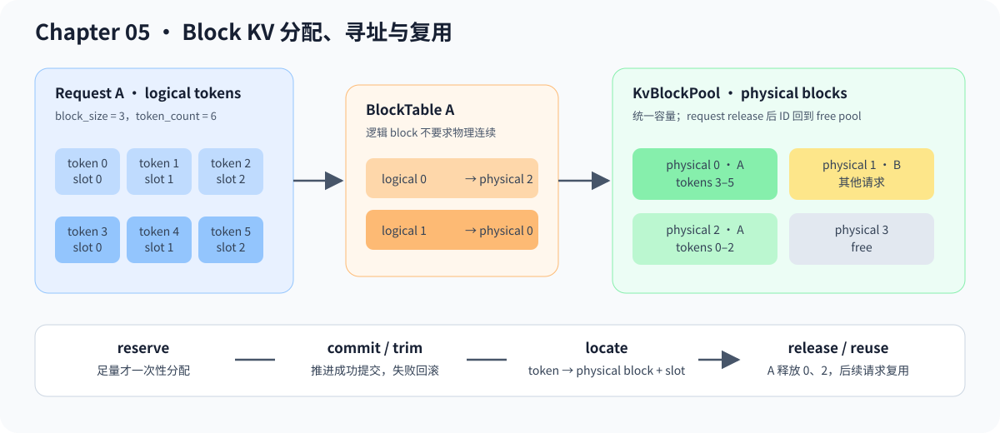

# 05.11 Block KV Cache 与 CPU Allocator

前一节已经区分 Request token history、真实分层 K/V 和 block ownership。本节只处理第三项：把逻辑 token 位置映射到可分配、可回收的物理 block ID。

**阅读入口**

- 前置阅读：[`05.4 KV Cache`](./04_kv_cache.md)、[`05.10 Continuous Batching 入门`](./09_continuous_batching.md)
- 源码直达：<a href="../_code/chapter05_generation/src/kv_cache.cpp"><code>kv_cache.cpp</code></a>、<a href="../_code/chapter05_generation/src/serving_preview.cpp"><code>serving_preview.cpp</code></a>、<a href="../_code/chapter05_generation/tests/serving_preview_test.cpp"><code>serving_preview_test.cpp</code></a>
- 相关阅读：[`05.8 Runtime 框架对照`](./07_vllm_comparison.md)、[`推理引擎运行时系统`](../reference/runtime_systems.md)、[`vLLM`](../reference/ecosystem/vllm.md) 与 [`SGLang`](../reference/ecosystem/sglang.md) 项目卡

## 为什么要 block

连续缓存最容易理解，但它会带来两个问题：

- 请求长度不同，连续分配容易产生浪费或搬迁
- Continuous Batching 需要请求动态进出，cache 必须能被更灵活地分配和释放

Block KV Cache 的思想是把 cache 分成固定大小的块。请求看到的是逻辑 token 序列，runtime 内部用 block table 找到每段 token 对应的物理块。

## 三个执行对象

| 对象 | 作用 |
| --- | --- |
| `KvBlockPool` | 管理固定数量物理 block ID 的空闲、预留、提交和释放 |
| `BlockTable` | 保存一个请求的物理 block ID，并映射逻辑 token 位置 |
| `BlockLocation` | 返回 Attention 需要访问的 `physical block + slot` |



## 分配如何进入一个 step

`ContinuousBatchScheduler` 先根据 candidate 将要消费的 prompt chunk 或 decode token 计算目标容量，再调用 `reserve()`。申请成功后才执行模型；Request 的 `prefill_offset` 或 generated token 实际推进后调用 `commit_tokens()`，未推进则用 `trim_to_tokens()` 撤销多余 block。容量不足的 candidate 计入 `deferred_requests`，不会调用 executor。

`ServingCore` 持有可选的共享 pool。配置 pool 后使用 `dispatch_step()`；`release_completed()` 同时清理 Request cache、Executor/Context 和 block table。旧 `dispatch()` 用于无 block pool 的完整 round-robin 路径。

| 时机 | Pool 动作 | 可观察结果 |
| --- | --- | --- |
| prefill chunk / decode 前 | `reserve(request_id, target_tokens)` | 足量时增加本 step 所需 block；不足时零修改 |
| 模型推进成功 | `commit_tokens()` | token count 可用于 `locate()` |
| 模型未推进 | `trim_to_tokens()` | 撤销本 step 的未提交 block |
| terminal release | `release()` | block ID 回到 free pool，后续请求可复用 |

## 和 PagedAttention 的关系

PagedAttention 可以先按内存管理思想理解：它让 attention 在读取历史 K/V 时，通过 block table 找到实际缓存位置。这样请求不需要占用一整段连续 cache，也更适合 continuous batching 里的动态进出。

CPU allocator 管理物理 block ID、容量和请求 ownership，真实 TinyLlama Context 继续保存各层 K/V tensor。完整 GPU Cache Engine 还需要把 block ID 绑定到 device allocation，并让 Attention kernel 按表读取：

```text
request logical tokens -> block table -> physical KV blocks -> attention reads K/V
```

这条链路对应 vLLM/nano-vLLM 的 block manager、cache engine 和 attention metadata。教程 CPU 路径验证 token 提交与 block table；device K/V block payload 不属于 CPU 路径的验收范围。
