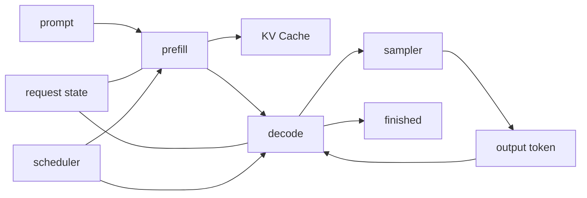

# 05.0 Turn Forward into a Generative Runtime 构建生成运行时

这一章先回答一个系统问题：怎么把 `forward` 变成真正能逐 token 输出的 runtime？

本章沿用本教程一贯的工程写法：先定问题，再拆边界，最后用测试把链路闭起来。先把 runtime 转折点做成一个可验证、可继续演进的最小骨架。

## 1. 本章概览

| 先看什么 | 这一章给什么 | 为什么重要 | 对应小节 |
| --- | --- | --- | --- |
| 生成为什么会变成 runtime 问题 | `prefill / decode` 的状态机 | 这是从结构走向运行时的分界线 | [`05.3`](#3-本章要解决什么) / [`05.5`](#5-最小设计是什么) / [`05.6`](#6-中间推导是什么) |
| runtime 最先要暴露什么 | 请求状态、cache 状态、调度状态 | 没有这三层，后面很难做优化判断 | [`05.5`](#5-最小设计是什么) / [`05.6`](#6-中间推导是什么) |
| 最小实现先解决什么 | naive generation + 最小 scheduler + KV Cache | 先把“能生成”做对，再谈吞吐 | [`05.5`](#5-最小设计是什么) / [`05.7`](#7-本章会产出什么) / [`05.9`](#9-怎么验证) |
| 源码直达 | `chapter05_generation` | 先看核心实现 | [`代码入口`](/code/chapter05_generation) |
| 这一章怎么收口 | 端到端生成测试 + 后续量化 / benchmark 桥接 | 让后续章节继续复用同一条 runtime 主线 | [`05.9`](#9-怎么验证) / [`05.11`](#11-本章解决了什么) / [`05.12`](#12-下一步是什么) |

## 2. 阅读入口

- 前置阅读：[`chapter04_attention`](/chapter04_attention/intro)、[`chapter04 小结`](/chapter04_attention/summary)
- 源码直达：[`chapter05_generation 代码入口`](/code/chapter05_generation)
- 相关阅读：[`05.1 Embedding 与位置编码`](/chapter05_generation/01_embedding_and_position)、[`05.3 Naive Generation`](/chapter05_generation/03_naive_generation)、[`05.4 KV Cache`](/chapter05_generation/04_kv_cache)、[`05.5 Scheduler`](/chapter05_generation/05_scheduler)、[`05.7 端到端生成测试`](/chapter05_generation/06_end_to_end_generation)

## 代码直达

- [`src/request.cpp`](/code/chapter05_generation#request-cpp)
- [`src/runtime.cpp`](/code/chapter05_generation#runtime-cpp)
- [`src/kv_cache.cpp`](/code/chapter05_generation#kv-cache-cpp)
- [`src/scheduler.cpp`](/code/chapter05_generation#scheduler-cpp)
- [`tests/runtime_smoke_test.cpp`](/code/chapter05_generation#runtime-smoke-test-cpp)

## 3. 本章要解决什么

`chapter04` 已经把单层 decoder 做稳了，但还没有把它放进生成循环。这一章要做的，就是把 decoder 接到 runtime 里，做出一条可重复运行的最小生成链路。

一旦进入生成场景，问题就会从“结构是否站得住”变成“结构如何进入 runtime”。后面的量化和 benchmark 只有建立在稳定 runtime 上，才有可比的基线。

## 4. 背景是什么

生成式模型和一次性前向计算最大的区别，不在于“有没有输出”，而在于“输出是不是一 token 一 token 地长出来”。进入生成场景后，系统就会多出三个新问题：请求状态怎么保存、缓存怎么复用、调度怎么推进。

这一章放在 decoder 之后，是因为 decoder 只能说明“单层结构能工作”，还不能说明“多个请求如何在同一 runtime 里被持续服务”。这里开始回答三个以前可以暂时不管、现在必须显式回答的问题：请求怎么进入 runtime、状态怎么保存、新 token 怎么一个个被推进出来的。

## 5. 最小设计是什么

这一章先把最小 runtime 骨架搭出来：请求进入后先走 `prefill`，再进入 `decode`；每个请求都有自己的状态和 cache 视图，调度器只负责决定下一步推进谁。先把这条最小但可观察的生成状态机做稳，后面的扩展才有共同起点。

## 6. 中间推导是什么

如果从“怎样把 `forward` 变成 runtime”倒推，输出必须变成逐 token 的，状态必须显式保存，`prefill` 和 `decode` 必须分开，KV Cache 和调度器也必须显式出现。关键点不是“加更多模块”，而是把生成从一次性函数调用改造成可持续运行的状态流转。

## 7. 本章会产出什么

- embedding 和位置编码模块
- N 层 Transformer 组装
- naive generation 实现
- KV Cache 设计与实现
- Scheduler 调度器
- sampler 和端到端生成测试

这些产出共同服务于一个目标：把“模型前向”变成一条可观察的运行时链路。

## 8. 实现路径是什么

1. Embedding 和位置编码
2. N 层 Transformer 组装
3. naive generation
4. KV Cache
5. Scheduler
6. sampler
7. 端到端生成测试
8. 请求状态机与调度边界

## 9. 怎么验证

- 先确认单条 prompt 能得到稳定输出
- 再确认加入 KV Cache 后输出行为仍然正确
- 最后确认端到端链路能够重复运行并产生日志或文本结果

## 10. 常见问题是什么

- 把 generation 当成一次性 forward，忽略了状态流转
- 只按单请求写代码，结果一旦出现多个请求就互相污染
- `prefill` 和 `decode` 没有分开，导致 cache 边界模糊
- cache 只会增长不会被观察，最后内存压力说不清楚
- scheduler 只是隐式地选一个请求，但没有把推进规则显式化

## 11. 本章解决了什么

这一章把 `chapter04` 已经站稳的单层 decoder 接到生成流程里，做出一条可重复运行的最小 runtime：`prefill` 先建状态，`decode` 再逐 token 推进，`Request`、`KV Cache` 和 `Scheduler` 全部显式化。

如果这一章写得足够扎实，后面无论是做连续批处理、streaming callback，还是更复杂的 backpressure，都会有一个共同的基础，而不是每次从头解释“为什么要有这些状态”。

## 12. 下一步是什么

- `chapter06_quantization`：换掉权重表示和计算路径，但保留 runtime 组织方式
- `chapter07_benchmark`：把 runtime 放到统一测试和性能框架里，验证它是否真的可比较、可回归、可优化

也就是说，`chapter05` 不是终点，它是把模型从“结构正确”推进到“运行时可持续”的那一步。
