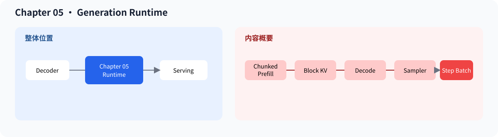
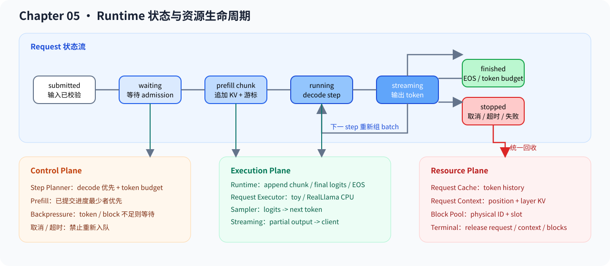

# 05.0 Generation Runtime and Serving Basics 构建生成运行时

## 1. 本章位置与成功标准

`chapter04` 已经能执行单层 decoder；本章把它接到逐 token 生成循环，让一个请求完成 `prefill -> decode -> output`。

```bash
bash code/chapter05_generation/scripts/run.sh
```

成功标准：Chapter 05 的测试通过，generation 和 streaming 演示都能完成，Request 能因 EOS 或 token budget 进入完成状态。仓库级 CPU First Success 还可以运行：

```bash
bash code/engine/scripts/run.sh
```

默认 Engine 把 toy prompt、Request、Decoder、Generation Runtime 和输出串起来；可选的 `real_tinyllama_generation_smoke` 会让同一 Runtime 驱动 TinyLlama 的真实 tokenizer、22 层 CPU Decoder 和 LM Head。本章不实现 GPU kernel 或完整 HTTP 服务。



## 2. 运行时对象

本章位于模型结构和持续服务之间：模型执行器计算 logits，Generation Runtime 保存 Request 状态并推进下一步，Sampler 从 logits 选择 token。模型执行器可以是本章的教学 Transformer，也可以通过每请求 `RequestModelExecutor` 接入真实 TinyLlama CPU Decoder 或预计算 embedding。

图中的 Request Cache 保存教学 Runtime 可见的 token 历史；真实 Model KV 保存各 Decoder 层的 key/value tensor。两者生命周期都跟随请求，但数据布局和所有者不同。更完整的 API、限流和服务资源管理由 Chapter09 的 Service Core 承接。



完成本章后，可以：

- 创建一个 Request，并检查它从排队到完成的状态变化
- 区分 Request token history、真实模型分层 K/V 与 BlockTable
- 用 Sampler 把 logits 接回生成循环，逐 token 产生输出
- 用端到端测试确认多个请求不会互相污染，终态资源能够回收
- 用 token/block budget 组织混合 prefill/decode step，分段推进长 prompt，并观察物理 block 的提交和释放

先用 Generation Core 完成单请求闭环，再根据需要进入 Serving Preview 和框架对照。两个入口分别提供详细页面顺序和验证重点。

| 路线 | 阅读范围 | 完成标志 |
| --- | --- | --- |
| 首轮必读 | [`Generation Core`](./part_a_generation_core.md) 中的 Naive Generation、KV Cache、Scheduler、Sampler、端到端测试和 Request 生命周期 | 能解释并运行 `prefill -> decode -> sample -> terminal` |
| 第二轮进阶 | [`Serving Preview`](./part_b_serving_preview.md) 中的 continuous batching、chunked prefill 和 Block KV | 能解释 token/block budget、回滚与资源释放 |
| 按需选读 | Embedding/教学 Transformer 组装、[`vLLM 对照`](./08_vllm_comparison.md) | 需要研究模型适配或成熟框架时再读 |

## 3. 源码入口

首轮源码看 <a href="../_code/chapter05_generation/src/runtime.cpp"><code>runtime.cpp</code></a>、<a href="../_code/chapter05_generation/src/request.cpp"><code>request.cpp</code></a> 和 <a href="../_code/chapter05_generation/src/sampler.cpp"><code>sampler.cpp</code></a>。进入 Serving Preview 后再看 <a href="../_code/chapter05_generation/src/scheduler.cpp"><code>scheduler.cpp</code></a>、<a href="../_code/chapter05_generation/src/serving_preview.cpp"><code>serving_preview.cpp</code></a> 和 block pool。前置阅读是 [`Chapter04`](../chapter04_attention/intro.md)；KV payload 与 Greedy/Temperature 定义见 [`F-KV-01`](../reference/formulas.md#f-kv-01) 和 [`F-SAMPLE-01`](../reference/formulas.md#f-sample-01)。

## 4. 验证

本章验证以下九件事：

1. 单条 prompt 能完成 `prefill` 和多步 `decode`
2. Request token history 与真实模型分层 K/V 不混用，真实增量执行仍与固定 golden 一致
3. 两个请求交替推进时，Request、Model Context 和 block ownership 不互相覆盖
4. 取消、超时、执行失败和超出 context budget 的请求进入 terminal 状态后不会再次 prefill/decode
5. 每个请求只写入自己的 cache，正常完成和拒绝路径都能检查资源归属
6. 两个 ScheduledRequest 只推进各自的 executor，真实 TinyLlama 路径能完成 tokenizer、22 层 Decoder、greedy sampling 和 detokenize
7. 一个 step 不超过 token budget，decode 与 prefill 可以混合，新加入和终态请求在下一 step 正确进出 batch
8. block 容量不足时不执行请求，终态释放后同一物理 block ID 可以由后续请求复用
9. 长 prompt 能按 budget 分段追加，只有 final chunk 产生 logits；多个长 prompt 不会被固定顺序长期饿死

Chapter 05 脚本会构建并运行 CTest、generation demo 和 streaming demo。真实模型验证命令见 [`05.7 端到端生成测试`](./07_end_to_end_generation.md)。排查时先看 Request 状态迁移，再看 `prefill/decode` 分支，最后分别检查 token 历史与模型分层 K/V；不要先从 benchmark 数字判断生成逻辑是否正确。

**后续：**本章把 `chapter04` 的 decoder 变成可持续推进的 CPU Generation Runtime；Chapter 06 只替换权重表示和 Linear 计算路径，Chapter 07-08 负责测量与归因，Chapter09 再接收 API、限流和服务级多请求扩展。
