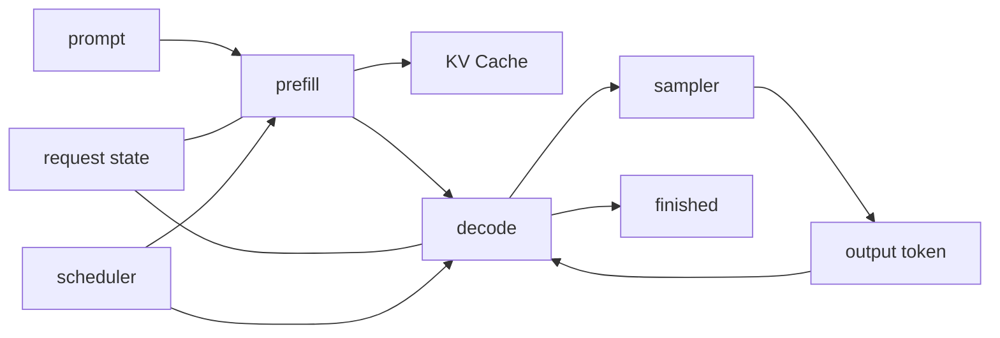

# 05.0 Generation Runtime and Serving Basics 构建生成运行时

这一章先回答一个系统问题：怎么把 `forward` 变成真正能逐 token 输出的 runtime？

本章沿用本教程一贯的工程写法：先定问题，再拆边界，最后用测试把链路闭起来。先把 runtime 转折点做成一个可验证、可继续演进的最小骨架。

## 本章和 vLLM / nano-vLLM 的联系

vLLM 和 nano-vLLM 的核心不是“会调用一次模型”，而是持续管理请求、KV cache、prefill / decode 和调度。本章先做最小 generation runtime，再用 Request 生命周期、Continuous Batching 和 Block KV Cache 三个小节，把读者带到真实 serving 项目的主要工程坐标上。

## 本章概览

| 先看什么 | 这一节讲什么 | 为什么重要 | 对应小节 |
| --- | --- | --- | --- |
| Embedding 怎么进入 runtime | token 到向量、位置编码 | 先把输入接到模型结构 | [`05.1 Embedding 与位置编码`](./01_embedding_and_position.md) |
| 多层 Transformer 怎么组装 | N 层 decoder 串接 | 先把单层结构扩成主干 | [`05.2 N 层 Transformer 组装`](./02_transformer_assembly.md) |
| 朴素生成怎么跑通 | token-by-token 生成循环 | 先把 forward 推成生成流程 | [`05.3 Naive Generation`](./03_naive_generation.md) |
| KV Cache 怎么复用状态 | prefill / decode 的缓存边界 | 先避免每步重复计算历史 token | [`05.4 KV Cache`](./04_kv_cache.md) |
| Scheduler 怎么推进请求 | 请求状态和调度规则 | 先让 runtime 边界显式化 | [`05.5 Scheduler`](./05_scheduler.md) |
| Sampler 怎么产生 token | logits 到下一步 token | 先把模型输出接回生成循环 | [`05.6 Sampler`](./05_sampler.md) |
| 怎么端到端验证 | 完整生成链路测试 | 先确认 runtime 能重复运行 | [`05.7 端到端生成测试`](./06_end_to_end_generation.md) |
| 怎么对照真实 serving | vLLM 的调度和 cache 视角 | 先把最小 runtime 放回工程坐标 | [`05.8 vLLM 对照`](./07_vllm_comparison.md) |
| 请求怎么活在 runtime 里 | request 生命周期和状态迁移 | 先看懂 scheduler 调度的对象 | [`05.9 Request 生命周期`](./08_request_lifecycle.md) |
| 为什么需要连续批处理 | decode step、等待队列和吞吐 | 先理解 vLLM 的 serving 核心动机 | [`05.10 Continuous Batching 入门`](./09_continuous_batching.md) |
| KV Cache 如何工程化 | block table、slot 和 PagedAttention 入口 | 先理解 nano-vLLM / vLLM 的 cache 组织 | [`05.11 Block KV Cache 阅读入口`](./10_block_kv_cache.md) |
| 本章怎么收口 | runtime 边界和下一章入口 | 进入量化前先固定生成链路 | [`05.12 本章小结`](./summary.md) |

## 阅读入口

- 前置阅读：[`chapter04_attention`](../chapter04_attention/intro.md)、[`chapter04 小结`](../chapter04_attention/summary.md)
- 源码直达：<a href="../_code/chapter05_generation/src/runtime.cpp"><code>runtime.cpp</code></a>、<a href="../_code/chapter05_generation/src/scheduler.cpp"><code>scheduler.cpp</code></a>、<a href="../_code/chapter05_generation/src/kv_cache.cpp"><code>kv_cache.cpp</code></a>
- 相关阅读：正文页按上面的 `本章概览` 顺序阅读；扩展系统视角见 [推理引擎输入链路](../reference/input_pipeline.md)、[推理引擎服务化基础](../reference/service_basics.md)

## 这章在解决什么

`chapter04` 已经把单层 decoder 做稳了，但还没有把它放进生成循环。这一章要做的，就是把 decoder 接到 runtime 里，做出一条可重复运行的最小生成链路。

一旦进入生成场景，问题就会从“结构是否站得住”变成“结构如何进入 runtime”。后面的量化和 benchmark 只有建立在稳定 runtime 上，才有可比的基线。

生成式模型和一次性前向计算最大的区别，不在于“有没有输出”，而在于“输出是不是一 token 一 token 地长出来”。进入生成场景后，系统就会多出三个新问题：请求状态怎么保存、缓存怎么复用、调度怎么推进。

`chapter05` 讲的是推理引擎的运行时核心；推理服务会把这层核心组织成持续服务，推理框架再往上封装请求编排和部署能力。

## 这章怎么做

这一章先把最小 runtime 骨架搭出来：请求进入后先走 `prefill`，再进入 `decode`；每个请求都有自己的状态和 cache 视图，调度器只负责决定下一步推进谁。

如果从“怎样把 `forward` 变成 runtime”倒推，输出必须变成逐 token 的，状态必须显式保存，`prefill` 和 `decode` 必须分开，KV Cache 和调度器也必须显式出现。关键点是把一次性函数调用改造成可持续运行的状态流转。

## 收口与下一步

- 先确认单条 prompt 能得到稳定输出
- 再确认加入 KV Cache 后输出行为仍然正确
- 最后确认端到端链路能够重复运行并产生日志或文本结果

这一章把 `chapter04` 已经站稳的单层 decoder 接到生成流程里，做出一条可重复运行的最小 runtime：`prefill` 先建状态，`decode` 再逐 token 推进，`Request`、`KV Cache` 和 `Scheduler` 全部显式化。

常见风险集中在这些边界上：

- 把 generation 当成一次性 forward，忽略了状态流转
- 只按单请求写代码，结果一旦出现多个请求就互相污染
- `prefill` 和 `decode` 没有分开，导致 cache 边界模糊
- cache 只会增长不会被观察，最后内存压力说不清楚
- scheduler 只是隐式地选一个请求，但没有把推进规则显式化

下一步有两条主线：

- `chapter06_quantization`：换掉权重表示和计算路径，但保留 runtime 组织方式
- `chapter07_benchmark`：把 runtime 放到统一测试和性能框架里，验证它是否真的可比较、可回归、可优化
