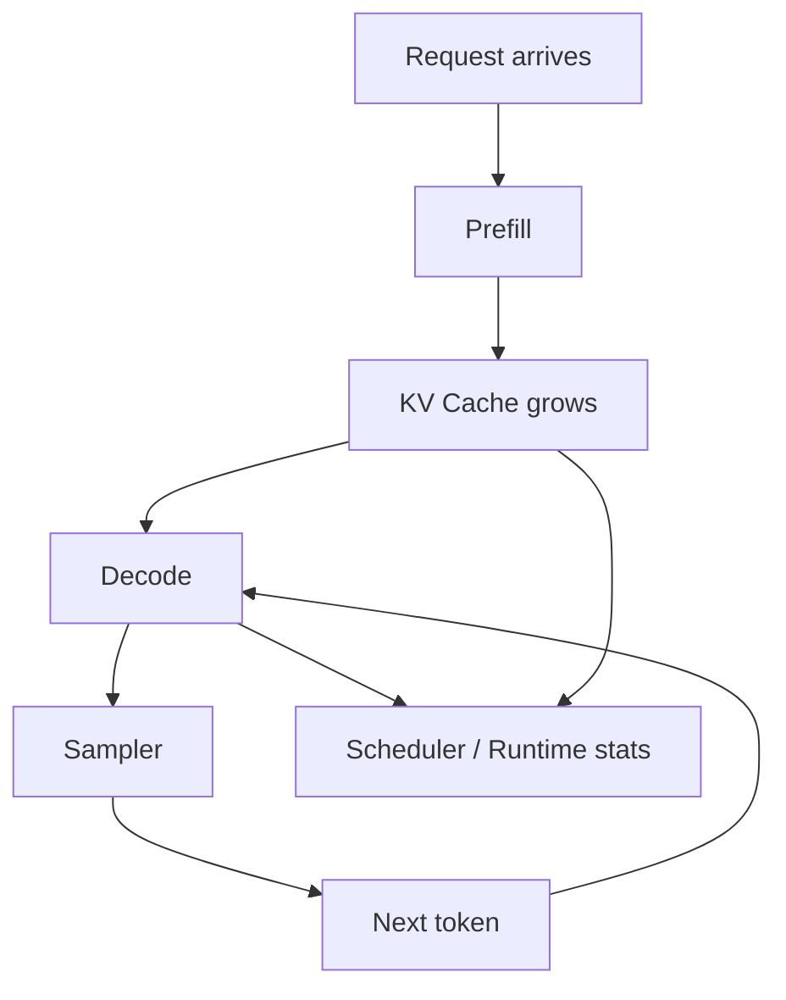

# 05.8 Chapter Wrap-up 本章解决了什么

这章回答的是：模型前向是否已经被组织成一条完整、可观察、可继续演进的生成链路？

如果实现正确，你应该已经拥有一条最小但完整的 generation runtime：

- 输入 prompt
- 经过 embedding 和位置编码
- 进入 N 层 Transformer
- 先用 naive generation 跑通基线
- 再用 KV Cache 支持增量推理
- 最后通过 sampler 和端到端测试完成闭环

如果把这条链路从头到尾讲一遍，你应该能回答的不只是“生成怎么做”，还包括“为什么它必须拆成这些步骤”。

## 1. 本章解决了什么

- `forward` 已经被组织成生成 runtime，而不是一次性前向调用
- `prefill / decode` 的状态机已经显式化
- `Request`、`KV Cache` 和 `Scheduler` 已经成为可观察边界

## 生态回看

学完这一章后，再回看 `llama.cpp`、`vLLM` 和 `SGLang`，你会更容易看懂“最小生成链路”与“真实 serving runtime”之间的差别。

- 先看 [05.7 vLLM 对照](/chapter05_generation/07_vllm_comparison)
- 先看 [生态对照总览](/reference/ecosystem/README)
- 对照 [llama.cpp](/reference/ecosystem/llama_cpp) 回看最小本地生成路径
- 对照 [vLLM](/reference/ecosystem/vllm) 回看高吞吐 runtime 的调度和 cache
- 对照 [SGLang](/reference/ecosystem/sglang) 回看更高层的应用编排

更直接地说，这一章把 decoder 从“能算出结果的结构”推进成了“能持续推进的运行时”。这是从模型结构走向系统行为的关键一步。

## 阅读入口

- 前置阅读：[`chapter05 导读`](/chapter05_generation/intro)、[`05.4 KV Cache`](/chapter05_generation/04_kv_cache)
- 源码直达：[`chapter05_generation 代码入口`](/code/chapter05_generation)
- 相关阅读：[`05.7 vLLM 对照`](/chapter05_generation/07_vllm_comparison)、[`chapter06_quantization`](/chapter06_quantization/intro)、[`chapter07_benchmark`](/chapter07_benchmark/intro)

## 2. 为什么它重要

- `chapter04` 给出的是 decoder 结构
- `chapter05` 把 decoder 结构变成可持续运行的生成流程
- `chapter06` 才能在这条稳定流程上替换权重表示和计算路径

## 3. 背景回顾

生成式模型和一次性前向计算最大的区别，不在于“有没有输出”，而在于“输出是不是一 token 一 token 地长出来”。  
只要进入生成场景，系统就会多出请求状态、缓存复用和调度推进这三个问题。

因此这一章真正要补的不是 token 本身，而是 token 背后的状态：每一次推进都对应一次状态变化，观察这些变化才知道 runtime 是否健康。

## 4. 中间推导回顾

从“怎样把 `forward` 变成 runtime”倒推，最自然的结果就是把生成拆成 `prefill / decode`，再把请求、cache 和调度边界显式化。  
这一章做的事情就是把这条状态机链路先立住。

如果没有这条链路，后面任何优化都只能停留在局部技巧；有了这条链路，优化才有地方落地，也有地方回归验证。

## 5. 目前这条 runtime 长什么样

- 请求状态是显式的
- `prefill` 和 `decode` 是分开的
- `KV Cache` 会随着 token 递推而增长
- sampler 会把 logits 变成下一步 token
- scheduler 会决定哪个请求先推进

这条 runtime 的可观察性通常通过三种手段建立：

1. 逐 token 回调，让每一步生成都能被外部观察
2. 状态查询，让 runtime 统计信息可以被读取
3. 日志输出，让 prefill / decode / cache 变化都能被记录

这三种手段分别对应“看结果”“看状态”“看过程”。只要这三层都能看见，runtime 的行为就不再是黑盒。

例如：

```cpp
using TokenCallback = std::function<void(int token)>;

void generate(const std::string& prompt, TokenCallback on_token) {
    // ...
    int token = sampler.sample(logits);
    on_token(token);
}
```



## 5. 你现在应该能做什么

- 独立跑通一条 token-by-token 生成链路
- 解释为什么需要 KV Cache 和 sampler
- 说明为什么最小 scheduler 可以先保持 round-robin
- 说明为什么 streaming callback 有助于观察生成过程
- 理解 scheduler stats 为什么能帮助判断多请求调度是否合理

如果你已经能把这些点说清楚，说明你已经把 generation 看成一个系统，而不只是一个循环。

## 6. 边界说明

这一章只建立最小可用的生成 runtime，不做完整 serving 系统。

这个边界是刻意的：先把 runtime 的主链路做稳，再谈更复杂的服务能力。否则会很容易把“生成逻辑”与“部署系统”混在一起，最后两个都没做清楚。

具体边界是：

- 保持请求状态显式
- 保持活跃请求队列简单
- 多请求调度先放在最小实现里观察，不在这里展开复杂策略
- `prefill` 和 `decode` 先保持概念分离

## 7. 下一步是什么

下一章进入 `chapter06_quantization`，把这条生成链路迁移到量化权重和反量化路径上。  
Chapter06 的起点不是重做 runtime，而是保留 `chapter05` 已经建立起来的请求 / cache / sampler / 生成循环结构，只替换权重表示和计算路径：

1. 权重从 FP32 / FP16 迁移到量化表示
2. 计算前增加反量化路径
3. 验证量化结果和基线结果的一致性
4. 测量量化带来的性能变化

如果后面还要继续加深，最自然的增量方向是：

- 连续批处理
- streaming callback 的细化
- 更明确的 backpressure 处理
- 更复杂的请求状态管理

## 9. 收口结论

如果你能把请求状态、cache 生命周期和调度边界讲清楚，这一章就完成了它作为 runtime 转折点的职责。

它的价值不是某个单独优化点，而是把生成链路变成一个可以继续演进的运行时底座。

## 10. 最小 runtime 和生产级 runtime

| 功能 | 最小 runtime（05 章） | 生产级 runtime（扩展） |
| --- | --- | --- |
| 请求管理 | 单请求 | 多请求并发 |
| Scheduler | Round-robin | 优先级 / 公平调度 |
| KV Cache | 单请求隔离 | 内存池管理 |
| 流式输出 | 回调支持 | WebSocket / SSE |
| Backpressure | 无 | 支持 |
| 监控 | 基础 stats | 完整 metrics |
| 容错 | 无 | 请求重试 / 超时 |

05 章建立的是核心路径，后续章节和扩展都在这条路径上叠加。
