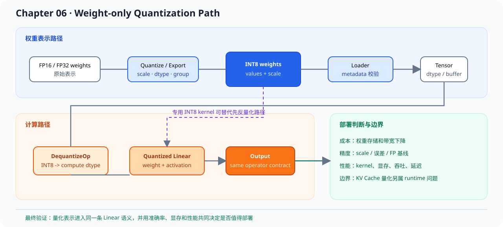

# 06.8 量化在 Serving Runtime 里的位置

前面几个小节已经把 INT8 权重、反量化和精度验证连起来。本节补充它在 vLLM / nano-vLLM serving runtime 中的实际落点：loader、模型配置、kernel 路径、KV cache 策略和 benchmark，而不只是一个 `DequantizeOp`。

**阅读入口**

- 前置阅读：[`06.5 Quantized Linear`](./05_linear_with_quant.md)、[`06.6 Accuracy Validation`](./06_accuracy_validation.md)
- 源码直达：<a href="../_code/chapter06_quantization/src/quantized_linear.cpp"><code>quantized_linear.cpp</code></a>、<a href="../_code/chapter06_quantization/src/dequantize_op.cpp"><code>dequantize_op.cpp</code></a>
- 相关阅读：[`06.7 TensorRT-LLM / Gemma / vLLM 对照`](./07_tensorrt_gemma_vllm_comparison.md)、[`vLLM 生态对照`](../reference/ecosystem/vllm.md)、[`推理性能分析`](../reference/profiling.md)

## 量化会落到哪些层

| 层次 | 量化带来的变化 | 读源码时看什么 |
| --- | --- | --- |
| 权重加载 | 文件里不再只有 FP16 权重，还会有 scale、group size 或量化类型 | loader 如何识别 dtype 和 metadata |
| 模型配置 | 不同层可能使用不同量化策略 | config 如何把量化方案传给 model runner |
| kernel 选择 | INT8 / INT4 / FP8 可能走不同计算 kernel | Linear 或 attention backend 如何分派实现 |
| KV cache | 有些系统会继续量化 KV cache，以降低长上下文显存压力 | cache dtype、block 大小和精度影响 |
| benchmark | 显存下降不等于吞吐一定提升 | latency、throughput、精度和显存要一起看 |

## 权重量化和 KV Cache 量化不是一回事

本章先做权重量化，因为它可以直接用 loader、Tensor 和 Linear 测试验证。它主要影响模型参数的存储和 Linear 计算路径。

KV Cache 量化则发生在 runtime 运行过程中，直接影响长上下文和多请求服务的显存压力。它通常还会牵涉 attention backend、cache block 管理和 decode 精度，所以不应该和权重量化混在同一个最小实现里。

## 为什么量化后不一定更快

量化首先明确降低的是存储和带宽成本，但速度收益取决于真实 kernel 和硬件路径：

- 如果量化权重每次都先反量化成 FP16 再计算，可能只是省了加载和存储，不一定省计算时间。
- 如果有专门 INT8 / INT4 kernel，吞吐才可能明显变化。
- 如果模型瓶颈在 KV cache、调度或采样，权重量化也未必改善端到端延迟。

所以本章只把量化链路做正确，是否值得部署要交给 `chapter07_benchmark` 继续验证。

## 对照 vLLM / nano-vLLM 时怎么读

读真实项目时，建议按下面顺序查：

1. 模型配置里如何声明量化方法。
2. 权重加载器如何读取量化权重和 scale。
3. Linear 或 attention backend 如何选择量化 kernel。
4. KV cache 是否支持单独 dtype 或量化策略。
5. benchmark 是否同时报告精度、显存、吞吐和延迟。

这条阅读路线能把本章的最小实现放回真实 serving runtime：本教程先讲清楚“量化权重怎么进入计算”，真实项目再继续处理“如何让这个选择在多请求、高吞吐场景下值得使用”。
