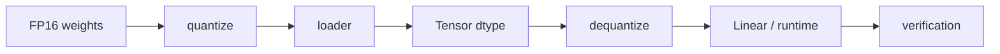

# 06.0 Reduce Memory and Bandwidth Cost 增加量化推理路径

这一章先回答一个部署问题：怎样用更低的内存和带宽成本跑同一条推理链路？

本章会支持 INT8 量化权重，并在推理路径中完成反量化计算。

这一章开始处理“如何让模型更轻、更省内存、更适合部署”的问题。它承接前面的生成 runtime，把权重表示迁移到量化版本。

这一章会碰到的 C++ 概念主要有三类：在现有数据结构上扩展 dtype、在算子路径里加入转换步骤，以及在接口不变的前提下替换底层表示。

量化不是简单地把数值变小，而是在可接受精度前提下换取更低的内存和带宽成本。它更像部署策略的一部分，而不是单纯的数据格式切换。

这一章接住的是 `chapter05` 已经稳定下来的生成 runtime。前一章解决“能不能生成”，这一章解决“在这条稳定 runtime 上，能不能用更省内存和带宽的方式继续生成”。

如果把这一章写深，重点不只是“让 INT8 能跑”，而是把量化放进一个完整的工程判断框架里：它省了什么，牺牲了什么，误差从哪里来，哪些地方可以融合，哪些地方必须保留独立转换步骤。

## 1. 本章概览

| 先看什么 | 这一章给什么 | 为什么重要 | 对应小节 |
| --- | --- | --- | --- |
| 为什么量化放在这里 | 稳定 runtime 上的表示变化 | 先有基线再谈压缩 | [`06.2`](#2-背景是什么) / [`06.4`](#4-中间推导是什么) |
| 量化先改什么 | 权重、Tensor dtype、Loader、算子路径 | 不是只改文件格式 | [`06.3`](#3-最小设计是什么) / [`06.5`](#5-本章会产出什么) |
| 怎么判断值不值得 | 精度对照和资源成本 | 部署判断必须可解释 | [`06.8`](#8-验证方式) / [`06.9`](#9-图示与表格建议) |
| 源码直达 | `chapter06_quantization` | 先看核心实现 | [`代码入口`](/code/chapter06_quantization) |
| 下一步接到哪里 | `chapter07_benchmark` | 正确性和性能收口 | [`06.11`](#11-下一步是什么) |

## 2. 阅读入口

- 前置阅读：[`chapter05_generation`](/chapter05_generation/intro)、[`chapter05 小结`](/chapter05_generation/summary)
- 源码直达：[`chapter06_quantization 代码入口`](/code/chapter06_quantization)
- 相关阅读：[`06.1 Quantization Basics`](/chapter06_quantization/01_quantization_basics)、[`06.3 Load Quantized Weights`](/chapter06_quantization/03_load_quantized_weights)、[`06.4 DequantizeOp`](/chapter06_quantization/04_dequantize_op)、[`06.6 Accuracy Validation`](/chapter06_quantization/06_accuracy_validation)

## 3. 背景是什么

当模型越来越大时，真正先撞到的往往不是算力，而是内存和带宽。  
权重越大，加载越慢；数据搬运越多，runtime 越容易被带宽限制住。对部署场景来说，这些问题通常比“能不能算对”更早暴露。

对初学者来说，量化最容易被误解成“把 float 变成 int8”。但在工程里，它实际上是在改变 runtime 的表示方式：  
同一条推理链路还在，只是权重、加载方式和部分算子路径变了。

这一章放在 `chapter05_generation` 之后，是因为要先有一条稳定 runtime，量化才有讨论价值。  
如果 runtime 本身还不稳定，量化后的误差和原始实现的错误会混在一起，根本分不清问题出在哪里。

## 4. 最小设计是什么

最小设计不是一开始就做全套低比特方案，而是先建立一条可解释的最小链路：

- 量化权重进入程序
- 必要时反量化回可计算表示
- 再进入 Linear 和后续算子

## 5. 中间推导是什么

如果从“怎样用更低成本继续跑同一条链路”倒推，会得到几个约束：

- 先要有一条稳定的 runtime，才能谈表示变化
- 量化最好先从权重开始，因为权重是最稳定、最直接的成本来源
- loader、Tensor dtype 和算子路径必须一起改，否则量化只停留在文件层
- 反量化路径必须可见，否则误差来源无法解释
- 精度验证必须和实现一起做，否则看不出到底是量化近似还是实现错误

把这些约束摆出来后，设计就会收敛成一条最小链路：量化权重进入程序，必要时反量化回可计算表示，再进入 Linear 和后续算子。  
这个推导的关键点不是“多加一个 dtype”，而是**让量化成为 runtime 的一部分，而不是文件格式的一次性转换**。

这也是为什么这一章要强调 calibration、scale 粒度和融合边界：  
它们决定的不是“能不能加载”，而是“这条链路值不值得部署”。

## 6. 本章会产出什么

- 扩展 `Tensor` 支持 INT8 dtype
- 让 `ModelLoader` 读取量化权重
- 实现 `DequantizeOp`
- 在 Linear 路径中集成 dequantize
- 比较量化模型与 FP16 模型的精度差异

## 7. 实现路径是什么

1. 量化基础
2. Tensor 扩展
3. 量化权重加载
4. DequantizeOp
5. 带量化的 Linear
6. 精度验证
7. 误差来源与部署判断
8. calibration 和融合边界

## 8. 你现在应该能做什么

- 解释为什么量化能省内存和带宽
- 说明 INT8 权重如何进入推理链路
- 判断量化后精度损失是否在可接受范围内

你也应该能解释量化误差大致来自哪些环节：

- scale 选择
- dtype 近似
- dequantize 的还原误差
- 与后续算子叠加后的误差放大

你也应该能说明哪些地方适合做融合，哪些地方适合保持分层：

- 权重加载和 dtype 识别通常要分清
- `DequantizeOp` 可以作为显式层保留，方便验证
- 只有在语义和误差边界都清楚后，才考虑把转换融合进 Linear 或相邻算子

## 9. 验证方式

- 先确认 INT8 权重能被正常加载
- 再确认反量化后的数值能进入 Linear 计算
- 最后对照 FP16 路径检查误差和输出一致性

如果验证结果只是“能跑”，但不能说明误差来源和成本收益，那么这一章就还不算真正完成。

## 10. 图示与表格建议

- 画一张 float -> int8 -> dequant 的数值映射图
- 画一张量化权重在 loader、Tensor、Linear 之间流转的架构图
- 画一张 FP16 路径和量化路径的对比流程图
- 用表格列出量化前后 dtype、scale、误差来源和验证指标
- 用表格对比“省了什么”和“损失了什么”
- 画一张“加载 -> calibration -> quantize -> dequantize -> 计算”的流程图

## 11. 本章解决了什么

这一章把量化从“格式转换”变成了一条可解释、可验证、可继续优化的部署路径。  
如果这个判断站不住，量化章节就只是一个数据格式练习。

## 12. 下一步是什么

进入 `chapter07_benchmark`，把正确性验证和性能测量体系补完整。
