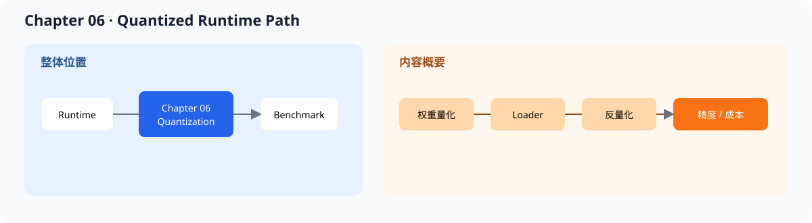
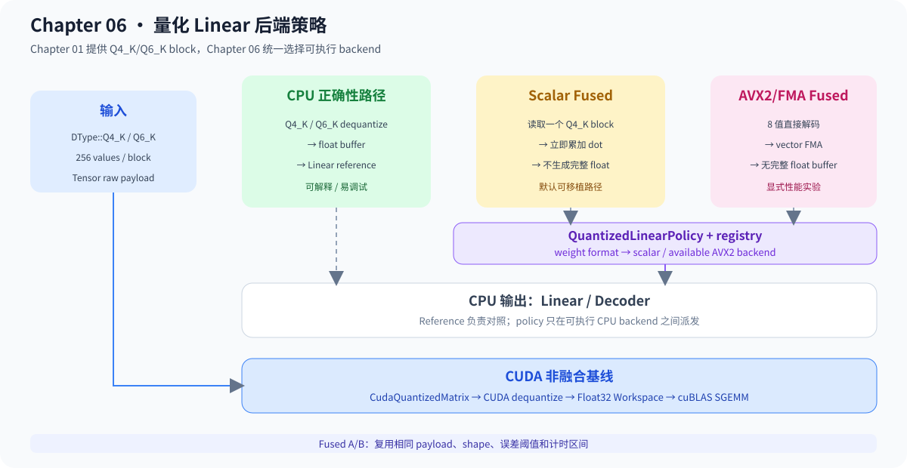

# 06.0 Reduce Memory and Bandwidth Cost 增加量化推理路径

## 1. 本章位置与成功标准

本章把量化权重接入推理路径，并用 CPU reference、fused path 和数值对照确认结果没有被做坏。

```bash
bash code/chapter06_quantization/scripts/run.sh
```

真实 TinyLlama Q4_K/Q6_K 检查需要 Chapter 00 下载的 GGUF 文件。两种格式都已完成 CPU block reference、Linear reference/scalar fused/AVX2 fused、统一 backend policy、Decoder 单变量 A/B 和组合服务回归；GPU 路径已完成 CUDA dequantize + Float32 Workspace + cuBLAS SGEMM 基线。SmolVLM 使用的 Q8_0 已进入 CPU reference、scalar fused、统一 policy 和真实 32 层 Decoder，SIMD/GPU 路径仍待建设。

本章接住 Chapter 05 的生成 runtime，只替换权重表示和 Linear 计算路径。



## 2. 内容地图

完成本章后，可以：

- 用 INT8 + scale 说明量化、反量化和误差来源
- 让 Tensor、loader 和 Linear 识别新的权重表示
- 读取 GGUF Q4_K/Q6_K/Q8_0 block，并比较不同 block size、scale 和 quant 布局
- 区分 scalar reference、fused reference 和 SIMD backend
- 用误差、延迟和 payload 大小判断量化路径是否值得保留

本章的 INT8、GGUF CPU 和 GGUF CUDA 路径遵循同一学习顺序：先读懂表示，再读解码，再测结果。量化权重和 KV Cache 量化不是同一件事；本章先完成前者，KV Cache 继续留在 runtime / serving 侧。

成熟框架会把量化格式、kernel 能力和模型兼容性一起纳入 backend 选择。本章先用真实 GGUF block 和 CPU A/B 固定判断方法，再用 GPU 非融合路径固定设备端 correctness 和测量口径。

| 对照项 | 内容 |
| --- | --- |
| 本章教学对象 | INT8、Q4_K/Q6_K/Q8_0、反量化、CPU fused Linear 和 GPU 非融合基线 |
| 主对照框架 | `llama.cpp` ggml quants、TensorRT-LLM quantized kernels、vLLM quantization |
| 成熟组件 | 校准、混合精度、GPU fused kernel、多格式调度和硬件能力探测 |
| 重点差异 | 先证明 block 解码、数值误差和非融合 GPU 路径，再决定是否融合 |
| 深入入口 | [`06.7 TensorRT-LLM / Gemma / vLLM 对照`](./07_tensorrt_gemma_vllm_comparison.md) |

| 路径 | 数据组织 | 先看什么 |
| --- | --- | --- |
| INT8 reference | 每元素 int8 + 标量 scale | `Tensor -> DequantizeOp -> QuantizedLinear` |
| GGUF Q4_K | 256 个值 / 144 字节 super-block | `GgufTensorLoader -> QuantizedLinearPolicy -> scalar/AVX2 backend` |
| GGUF Q6_K | 256 个值 / 210 字节 super-block | `GgufTensorLoader -> QuantizedLinearPolicy -> scalar/AVX2 backend` |
| GGUF Q8_0 | 32 个值 / 34 字节 block | `GgufTensorLoader -> QuantizedLinearPolicy -> scalar backend` |
| GGUF CUDA baseline | packed device payload + Float32 Workspace | `CudaQuantizedMatrix -> CUDA dequantize -> cuBLAS SGEMM` |


## 3. 阅读与源码顺序

| 顺序 | 页面 | 读完后应看到什么 |
| --- | --- | --- |
| 1 | [`06.1 Quantization Basics`](./01_quantization_basics.md)、[`06.2 Extend Tensor`](./02_extend_tensor.md) | dtype、scale、shape 和 buffer 约束 |
| 2 | [`06.3 Load Quantized Weights`](./03_load_quantized_weights.md)、[`06.4 DequantizeOp`](./04_dequantize_op.md) | 量化权重如何进入计算 |
| 3 | [`06.5 Quantized Linear`](./05_linear_with_quant.md) | 反量化 Linear、Q4_K 和 Q6_K fused 路径 |
| 4 | [`06.6 Accuracy Validation`](./06_accuracy_validation.md) | FP 基线、误差和通过标准 |
| 5 | [`06.7 TensorRT-LLM / Gemma / vLLM 对照`](./07_tensorrt_gemma_vllm_comparison.md)、[`06.8 量化在 Serving Runtime 中的位置`](./08_quantization_in_serving_runtime.md) | 量化在真实框架中的落点 |

Q4_K 和 Q6_K 都已有 CPU Linear reference/fused 路径和 GPU 非融合基线，且 Q6_K 已完成真实 TinyLlama tensor 对照。源码先看 <a href="../_code/chapter06_quantization/src/q4k_dequantize.cpp"><code>q4k_dequantize.cpp</code></a>、<a href="../_code/chapter06_quantization/src/q4k_kernel.cpp"><code>q4k_kernel.cpp</code></a>、<a href="../_code/cuda/src/quantized_dequantize_backend.cu"><code>quantized_dequantize_backend.cu</code></a> 和 <a href="../_code/core/include/cpp_llm_engine/core/quantization_contract.h"><code>quantization_contract.h</code></a>。前置阅读是 [`chapter05_generation`](../chapter05_generation/intro.md)，反量化、压缩率和误差口径见 [`F-QUANT-01/02`](../reference/formulas.md#f-quant-01)。



## 4. 验证

`Q4KLinearReference` 是 CPU 正确性基线，scalar fused 是默认 CPU 计算路径，AVX2 是可选 CPU 优化；GPU dequantize + SGEMM 是设备端正确性和性能测量基线。任何 fused CUDA 实现都必须复用相同 payload、输入和误差阈值做 A/B。

本章按以下顺序验证：

1. dtype、block size、payload byte 和 shape 检查正确
2. Q4_K reference 能还原 block 数值
3. 多 block fused 输出与 reference 输出在允许误差内一致
4. Q4_K/Q6_K/Q8_0 block、Linear 路径和统一 policy 测试通过，Q8_0 token-prefill 与 embedding-prefill logits 一致
5. GPU Q4_K/Q6_K 最终 Linear 与 CPU reference 一致，Workspace 在相同容量下复用
6. 两种真实 tensor 对照通过，Decoder 的三个 CPU 量化作用域通过单变量实验和组合后的 golden、计时闭合与双请求服务回归
7. benchmark 同时记录延迟、误差、shape、warmup、iterations 和执行路径

**下一章：**本章只改变权重表示和计算成本，不改变 Request、Scheduler 或输出语义；Chapter 07 将统一比较正确性、延迟、吞吐和资源成本。
