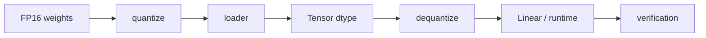

# 06.0 Reduce Memory and Bandwidth Cost 增加量化推理路径

这一章先回答一个部署问题：怎样用更低的内存和带宽成本跑同一条推理链路？

本章会支持 INT8 量化权重，并在推理路径中完成反量化计算。它接住的是 `chapter05` 已经稳定下来的生成 runtime，把权重表示迁移到量化版本。

## 本章和 vLLM / nano-vLLM 的联系

在 vLLM / nano-vLLM 这类 serving runtime 里，量化不只是一个离线转换脚本，而会影响权重加载、模型配置、kernel 选择、显存预算和 benchmark 判断。本章先实现可解释的 INT8 权重路径，再补一节说明它在真实 runtime 中通常落到哪些边界上。

## 本章概览

| 先看什么 | 这一节讲什么 | 为什么重要 | 对应小节 |
| --- | --- | --- | --- |
| 量化为什么有效 | scale、zero point、误差来源 | 先建立成本和精度直觉 | [`06.1 Quantization Basics`](./01_quantization_basics.md) |
| Tensor 怎么表达 INT8 | dtype、shape 和 buffer 约束 | 先让运行时看得懂新表示 | [`06.2 Extend Tensor`](./02_extend_tensor.md) |
| 权重怎么进入程序 | 量化权重、scale 和 loader | 先把文件表示接进 runtime | [`06.3 Load Quantized Weights`](./03_load_quantized_weights.md) |
| 反量化怎么计算 | INT8 到可计算表示的转换 | 先让误差边界可观察 | [`06.4 DequantizeOp`](./04_dequantize_op.md) |
| Linear 怎么接量化 | dequantize 与 Linear 路径组合 | 先让主干算子继续工作 | [`06.5 Quantized Linear`](./05_linear_with_quant.md) |
| 怎么判断能不能接受 | FP16 对照和误差验证 | 部署判断必须有基线 | [`06.6 Accuracy Validation`](./06_accuracy_validation.md) |
| 怎么看真实生态 | TensorRT-LLM、Gemma、vLLM 对照 | 先把量化链路放回工程坐标 | [`06.7 TensorRT-LLM / Gemma / vLLM 对照`](./07_tensorrt_gemma_vllm_comparison.md) |
| 量化如何进入 serving | loader、kernel、KV cache 和 benchmark 边界 | 先理解真实 runtime 里量化落在哪些层 | [`06.8 量化在 Serving Runtime 里的位置`](./08_quantization_in_serving_runtime.md) |
| 本章怎么收口 | 表示变化、精度边界和下一章入口 | 进入 benchmark 前先固定判断标准 | [`06.9 本章小结`](./summary.md) |

## 阅读入口

- 前置阅读：[`chapter05_generation`](../chapter05_generation/intro.md)、[`chapter05 小结`](../chapter05_generation/summary.md)
- 源码直达：<a href="../_code/chapter06_quantization/src/tensor.cpp"><code>tensor.cpp</code></a>、<a href="../_code/chapter06_quantization/src/dequantize_op.cpp"><code>dequantize_op.cpp</code></a>、<a href="../_code/chapter06_quantization/src/quantized_linear.cpp"><code>quantized_linear.cpp</code></a>
- 相关阅读：正文页按上面的 `本章概览` 顺序阅读；扩展工程视角见 [`TensorRT-LLM`](../reference/ecosystem/tensorrt_llm.md)、[`Gemma`](../reference/ecosystem/gemma.md)、[`vLLM`](../reference/ecosystem/vllm.md)

## 这章在解决什么

这一章把量化从“格式转换”变成一条可解释、可验证、可继续优化的部署路径。重点不是多加一个 dtype，而是让量化权重能够进入 loader、Tensor、DequantizeOp 和 Linear 路径，并且还能和 FP16 基线对照。

## 这章怎么做

最小设计先从权重量化开始：文件里保存 INT8 权重和 scale，loader 读回量化表示，Tensor 记录 dtype，计算前通过反量化回到可乘加表示，最后用精度验证确认误差是否可接受。

这一章不追求一次做完整低比特生态。它先固定三条边界：省了什么、误差从哪里来、这条链路是否值得进入后续 benchmark。

## 收口与下一步

到本章结束，应能完成一次 INT8 权重进入推理链路的验证，标出反量化在 runtime 中的位置，并用 FP16 基线完成结果对照。

下一步进入 `chapter07_benchmark`，把正确性验证和性能测量体系补完整。
