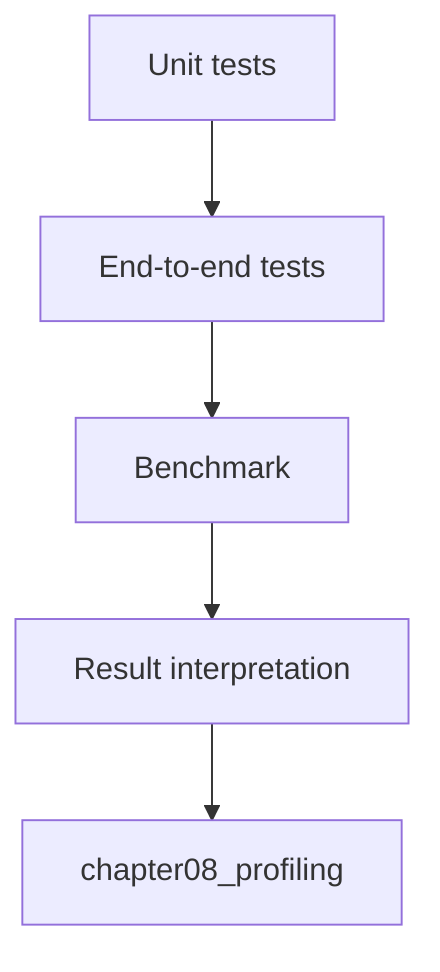

# 07.0 Prove It Works and It’s Fast 验证正确性并比较性能

这一章把前面的实现收口成一条可以重复验证、可以对照比较、可以追踪结论的工程链路。量化版或优化版接入 runtime 之后，首先要回答的是：有没有把系统做坏，快了多少。

## 本章和 vLLM / nano-vLLM 的联系

vLLM / nano-vLLM 的性能讨论不能只看“能不能生成”，还要看 latency、throughput、prefill / decode、KV cache 和调度开销。本章先把正确性、benchmark 和结果解读分开，后面才能把本教程的最小 runtime 放到真实 serving 系统里对照。

## 本章概览

| 先看什么 | 这一节讲什么 | 为什么重要 | 对应小节 |
| --- | --- | --- | --- |
| 测试入口怎么统一 | test harness 和测试边界 | 先让验证方式稳定 | [`07.1 Test Harness Basics`](./01_test_harness_setup.md) |
| 端到端正确性怎么证明 | golden logits 和完整链路对照 | 先确认系统没有被做坏 | [`07.2 End-to-End Correctness Testing`](./02_e2e_correctness.md) |
| 性能指标怎么定义 | latency、prefill、throughput | 先把比较条件固定下来 | [`07.3 Benchmark Metrics`](./03_benchmark_metrics.md) |
| benchmark 怎么脚本化 | 运行条件和结果记录 | 先让结果可复查 | [`07.4 Benchmark Script`](./04_benchmark_script.md) |
| 优化方向怎么判断 | CUDA Graph、memory pool、async copy | 先把优化放在测量之后 | [`07.5 Optimization Tips`](./05_optimization_tips.md) |
| 数字怎么变成结论 | baseline / optimized / reference | 先把结果翻译成工程决策 | [`07.6 Result Interpretation`](./06_result_interpretation.md) |
| 怎么对照真实框架 | vLLM、SGLang、TensorRT-LLM、Ollama | 先把 benchmark 放回真实服务场景 | [`07.7 主流对照`](./07_framework_comparison.md) |
| 本章怎么收口 | 正确性、性能和下一章入口 | 进入 profiling 前先固定证据链 | [`07.8 本章小结`](./summary.md) |

## 阅读入口

- 前置阅读：[`chapter06_quantization`](../chapter06_quantization/intro.md)、[`chapter06 小结`](../chapter06_quantization/summary.md)
- 如果测试习惯还不稳，先回看 [`foundation/04_debugging_testing_basics`](../foundation/04_debugging_testing_basics.md)
- 源码直达：<a href="../_code/chapter07_benchmark/src/benchmark.cpp"><code>benchmark.cpp</code></a>、<a href="../_code/chapter07_benchmark/src/test_helpers.cpp"><code>test_helpers.cpp</code></a>、<a href="../_code/chapter07_benchmark/tests/chapter07_benchmark_test.cpp"><code>chapter07_benchmark_test.cpp</code></a>
- 相关阅读：正文页按上面的 `本章概览` 顺序阅读；长期基线见 [`回归测试`](../reference/regression_testing.md)，扩展视角见 [`training vs inference frameworks`](../reference/framework_comparison.md)

## 这章在解决什么

这一章把“对不对”和“快不快”拆开。单元测试负责局部正确性，端到端测试负责完整链路，benchmark 负责固定条件下的性能比较。

如果这三层不分开，读者就很容易看到一个更快的数字后，误以为系统语义也没有问题。

## 这章怎么做

最小设计是四层证据链：先让局部测试证明模块没坏，再用端到端测试证明链路正确，用回归样例确认历史行为没有回来，最后用 benchmark 固定输入、硬件和运行参数比较性能。

这章不把 profiling 当成 benchmark 的一部分。benchmark 负责告诉你“发生了什么”，profiling 留到 `chapter08_profiling` 解释“为什么会这样”。

## 收口与下一步

到本章结束，应能形成一份改动评估记录：正确性是否通过、性能指标是否改善、结果是否可复查，以及这次改动应保留还是回滚。

下一步进入 `chapter08_profiling`，做 profiling 和 A/B 对比。
