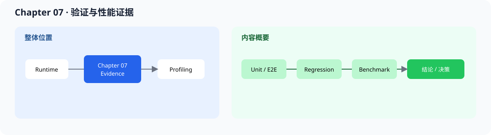

# 07.0 Prove It Works and It’s Fast 验证正确性并比较性能

## 1. 本章位置与成功标准

本章把“对不对”和“快不快”放进同一套可重复的测试和 benchmark 条件中。

```bash
bash code/chapter07_benchmark/scripts/run.sh
```

成功标准：测试通过，CPU runtime benchmark 能输出正确性标记、prefill / decode 阶段时间和吞吐，baseline demo 继续输出结构化 trace；可选真实 ServiceCore benchmark 还要记录 CPU、编译器、Model/Context 隔离和资源释放。比较优化版本前，先固定模型、输入、硬件、batch 和运行参数。



本章位于实现和 profiling 之间：先证明行为没有改变，再测量变化，最后把结果交给 Chapter 08 解释原因。

## 2. 内容地图

完成本章后，可以：

- 区分单元测试、端到端正确性测试、回归测试和 benchmark
- 固定 latency、throughput、prefill、decode、cache 和调度指标
- 写出可重复执行的 benchmark 脚本和结果记录
- 从 baseline / optimized / reference 的差异做出保留、回滚或继续实验的决定

成熟框架的 benchmark 对象不同，但都必须公开 workload、指标和运行条件。本章先建立可比较证据，再解释框架结果。

| 对照项 | 内容 |
| --- | --- |
| 本章教学对象 | correctness、latency、throughput、阶段时间和结果文件 |
| 主对照框架 | vLLM benchmarks、TensorRT-LLM benchmarks、`llama-bench` |
| 成熟组件 | 并发 workload、服务压测、分位延迟、GPU 指标和跨节点测量 |
| 重点差异 | 本章只比较同机同模型同输入条件，不横比来源不明的吞吐数字 |
| 深入入口 | [`07.7 主流框架 benchmark 对照`](./07_framework_comparison.md) |

## 3. 阅读与源码顺序

| 顺序 | 页面 | 读完后应看到什么 |
| --- | --- | --- |
| 1 | [`07.1 Test Harness Basics`](./01_test_harness_setup.md)、[`07.2 End-to-End Correctness Testing`](./02_e2e_correctness.md) | 测试入口和完整链路正确性 |
| 2 | [`07.3 Benchmark Metrics`](./03_benchmark_metrics.md)、[`07.4 Benchmark Script`](./04_benchmark_script.md) | 指标定义、固定条件和结果记录 |
| 3 | [`07.5 Optimization Tips`](./05_optimization_tips.md) | 优化方向必须建立在测量之后 |
| 4 | [`07.6 Result Interpretation`](./06_result_interpretation.md) | 数字如何转成工程决策 |
| 5 | [`07.7 主流对照`](./07_framework_comparison.md) | 将本地 benchmark 放回真实 serving 场景 |

源码先看 <a href="../_code/chapter07_benchmark/examples/runtime_benchmark.cpp"><code>runtime_benchmark.cpp</code></a>、<a href="../_code/chapter07_benchmark/src/benchmark.cpp"><code>benchmark.cpp</code></a> 和 <a href="../_code/chapter07_benchmark/tests/chapter07_benchmark_test.cpp"><code>chapter07_benchmark_test.cpp</code></a>。真实服务测量入口见 <a href="../_code/engine/examples/real_tinyllama_serving_benchmark.cpp"><code>real_tinyllama_serving_benchmark.cpp</code></a>；前置阅读是 [`chapter06_quantization`](../chapter06_quantization/intro.md)，TTFT、TPOT、吞吐和加速比见 [`F-PERF-01/02`](../reference/formulas.md#f-perf-01)，已有结果与复现脚本见[实验与验证资产索引](../reference/experiment_assets.md)，长期回归标准见 [`回归测试`](../reference/regression_testing.md)。

## 4. 验证

本章形成四层证据：

1. 单元测试证明局部接口和数值
2. 端到端测试证明完整链路仍能运行
3. 回归测试证明旧行为没有回来
4. benchmark 在固定条件下记录延迟、吞吐、阶段时间和 trace

性能改善只有在正确性先通过后才有意义。benchmark 回答“发生了什么”，下一章的 profiling 才回答“为什么会这样”。

**下一章：**本章产出可复查的输入条件、正确性状态、阶段耗时、吞吐和资源变化；Chapter 08 将根据这些结果拆分热点并用 profiling 和 A/B 实验决定优化。
