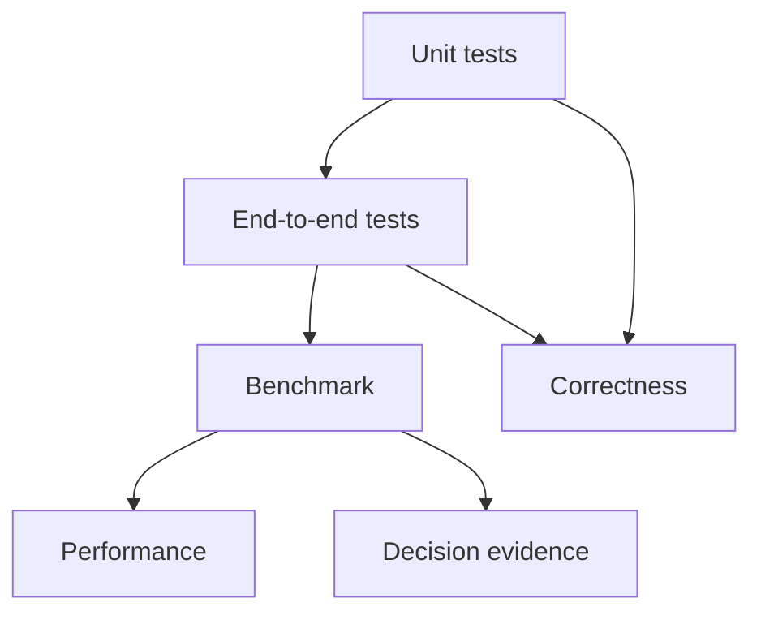
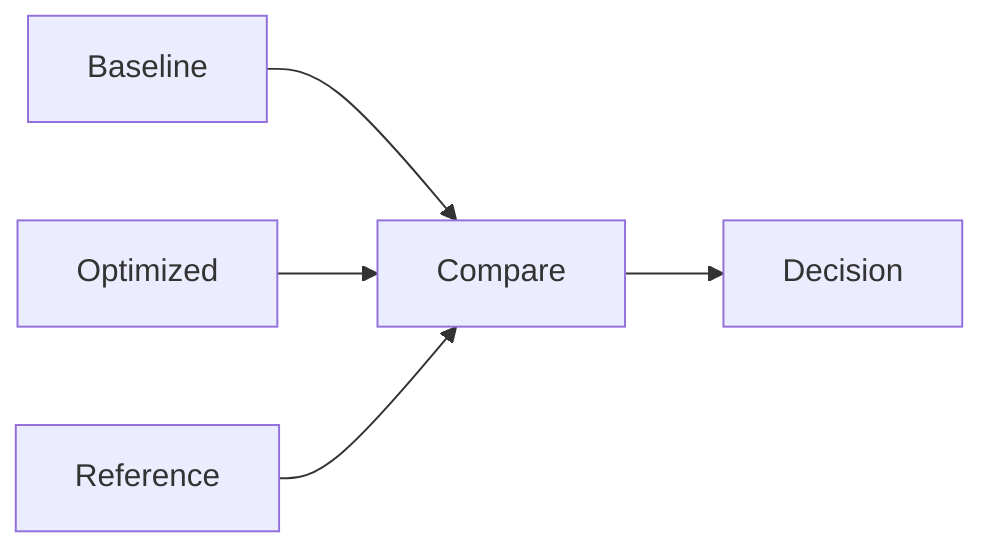

# 07.0 Prove It Works and It’s Fast 验证正确性并比较性能

这一章把前面的实现收口成一条可以重复验证、可以对照比较、可以追踪结论的工程链路。

## 1. 本章概览

| 先看什么 | 这一章给什么 | 为什么重要 | 对应小节 |
| --- | --- | --- | --- |
| 正确性怎么拆 | 单元测试和端到端测试 | 先确认链路可用 | [`07.2`](#2-本章要解决什么) / [`07.5`](#5-中间推导是什么) / [`07.8`](#8-怎么验证) |
| 性能怎么量 | latency、prefill、throughput 等指标 | 先把比较条件固定下来 | [`07.3`](#3-背景是什么) / [`07.4`](#4-最小设计是什么) / [`07.6`](#6-本章会产出什么) |
| 证据怎么收 | baseline / optimized / reference | 让结果可比较、可追踪 | [`07.4`](#4-最小设计是什么) / [`07.7`](#7-实现路径是什么) / [`07.10`](#10-本章解决了什么) |
| 源码直达 | `chapter07_benchmark` | 先看核心实现 | [`代码入口`](/code/chapter07_benchmark) |
| 下一步接到哪里 | profiling 和 A/B 对比 | benchmark 之后还要解释原因 | [`07.11`](#11-下一步是什么) / [`07.12`](#12-english-anchors) |

## 2. 阅读入口

- 前置阅读：[`chapter06_quantization`](/chapter06_quantization/intro)、[`chapter06 小结`](/chapter06_quantization/summary)
- 源码直达：[`chapter07_benchmark 代码入口`](/code/chapter07_benchmark)
- 相关阅读：[`07.1 Test Harness Basics`](/chapter07_benchmark/01_test_harness_setup)、[`07.2 End-to-End Correctness Testing`](/chapter07_benchmark/02_e2e_correctness)、[`07.3 Benchmark Metrics`](/chapter07_benchmark/03_benchmark_metrics)、[`07.6 Result Interpretation`](/chapter07_benchmark/06_result_interpretation)

## 3. 本章要解决什么

这一章回答的是：这套引擎是否已经可以被系统地验证和记录？

本章要把三件事分开：

- 单元测试负责局部正确性
- 端到端测试负责完整链路
- benchmark 负责固定条件下的性能比较

如果这三层不分开，读者就很容易把“对不对”和“快不快”混在一起，最后得到一堆数字，却没有结论。

## 4. 背景是什么

走到这里，系统已经不只是在回答“能不能跑”，而是在回答“改动有没有把系统做坏，收益有没有兑现，代价是否值得”。

对初学者来说，benchmark 很容易被误解成“最终跑分页”。但在工程里，它更像一份证据材料：它帮助你判断基线、优化后的变化，以及和参考实现的距离。

这一章放在最后，是因为它必须建立在一条已经稳定、已经可验证、已经误差可控的链路上。

## 5. 最小设计是什么

最小设计只有一条原则：先把验证分层，再把性能比较固定下来。

也就是说，我们先不把 benchmark 当成“展示数字”的工具，而是把它当成“决策证据”的工具。

这一层最小骨架只需要回答：

- 哪个实现是 baseline
- 哪个实现是 optimized
- 哪个实现是 reference
- 结果在相同条件下是否可复查

这张图把 chapter07 的职责分开了：单测和 e2e 负责正确性，benchmark 负责性能和证据链。

## 6. 中间推导是什么

如果从“怎么证明它对、证明它快”这个问题倒推，会得到几个必要约束：

- 先有正确性，再谈性能，否则快慢没有意义
- 先固定输入、硬件和运行方式，否则结果不可比
- 先分清 baseline、optimized 和 reference，否则结论会混在一起
- 先把测试和 benchmark 分开，否则“对不对”和“快不快”会互相污染

把这些约束摆出来之后，最自然的设计就是三层证据链：

- 单元测试负责局部正确性
- 端到端测试负责链路正确性
- benchmark 负责固定条件下的性能比较

## 7. 本章会产出什么

- 一组单元测试和端到端测试
- 一套 benchmark 脚本和统一 harness
- baseline / optimized / reference 的比较框架
- 可复查的运行条件和结果记录
- 一份结果解读与决策模板，帮助把数字翻译成结论

## 8. 实现路径是什么

1. 先把正确性和性能分开
2. 固定输入、硬件和运行参数
3. 统一 baseline、optimized 和 reference 的比较方式
4. 用脚本和 harness 收口结果
5. 再把结果交给后续优化判断

这条链路的核心是：先有 baseline，再有 optimized，再放上 reference，最后才形成决策。

## 9. 怎么验证

- 单元测试通过，说明局部正确性稳定
- 端到端测试通过，说明完整链路可用
- benchmark 在相同条件下可复查，说明性能结果可信

## 10. 常见问题是什么

- 把 benchmark 当成 correctness test
- 把 profiling 结论直接当成 benchmark 结论
- 不保留运行条件，导致结果不可复现
- 不区分 baseline / optimized / reference，最后没有结论
- 不记录输入、硬件和运行参数，导致后续无法复查 A/B 结果

## 11. 本章解决了什么

这一章把前面散落的验证方式收束起来：`chapter00` 负责 smoke test，`chapter01` 到 `chapter06` 负责局部正确性，`chapter07` 负责统一收口、A/B 对照和性能比较。

## 12. 下一步是什么

下一步进入 profiling 和 A/B 对比。  
benchmark 负责给出可比较的结果，profiling 负责解释这些结果从哪里来。

如果后面 benchmark 的测试复杂度继续上升，比如需要 fixture、参数化测试或更复杂的结果分组，那么最合理的升级节点就是把这里的 harness 迁到 Google Test。
