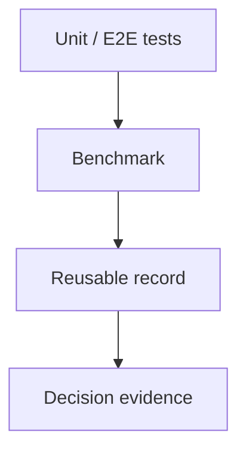

# 07.7 Chapter Wrap-up 本章解决了什么

这章回答的是：正确性和性能是否已经可以被系统地验证、对照和记录。

如果实现正确，你应该能够用统一流程完成三件事：

- 用单元测试验证局部正确性
- 用端到端测试验证完整链路
- 用 benchmark 脚本记录延迟、吞吐和运行特征

这更像一次验收：前面各章都已经把系统做出来了，这一章要确认它是不是还能在固定条件下被证明“对”和“快”。

你可以把这一步想成一次很朴素的复盘：先把老版本跑一遍，记录下它在同样输入下的耗时和输出；再把新版本跑一遍，看结果有没有偏、速度有没有变；最后才决定这次改动到底是留着、回滚，还是继续细化。

## 1. 本章解决了什么

- 正确性和性能已经被拆成两条线
- benchmark 已经不再承担正确性证明
- 结果可以按 baseline、optimized 和 reference 三层来拆

## 生态回看

学完这一章后，再回看 `vLLM`、`SGLang`、`TensorRT-LLM` 和 `Ollama`，你会更容易看懂 benchmark 结果在真实场景里分别说明了什么。

- 先看 [07.6 主流对照](/chapter07_benchmark/07_framework_comparison)
- 对照 [vLLM](/reference/ecosystem/vllm) 回看高吞吐 serving
- 对照 [SGLang](/reference/ecosystem/sglang) 回看应用编排
- 对照 [TensorRT-LLM](/reference/ecosystem/tensorrt_llm) 回看 engine 级优化
- 对照 [Ollama](/reference/ecosystem/ollama) 回看本地交付体验

这一点很重要，因为很多团队在这里会混淆：看到 benchmark 数字变好了，就默认功能也没问题。chapter07 要做的，就是把这种错觉拆开。

## 阅读入口

- 前置阅读：[`chapter06_quantization`](/chapter06_quantization/intro)、[`chapter06 小结`](/chapter06_quantization/summary)
- 源码直达：[`chapter07_benchmark 代码入口`](/code/chapter07_benchmark)
- 相关阅读：[`07.6 主流对照`](/chapter07_benchmark/07_framework_comparison)

现实里最容易出问题的地方，往往不是 benchmark 本身，而是“跑得快”被误当成“跑得对”。所以这一章要做的，就是把“结果更好看”和“链路真的没坏”分开确认。

## 2. 为什么它重要

这一章把整套教程的收口方式固定下来：`chapter00` 到 `chapter06` 负责把系统做出来，`chapter07` 负责把系统的行为和性能固定成可比较的证据。

换成更生活一点的说法就是：前面几章像是把车造出来，这一章像是把车开上测试路，再看它有没有真的跑直、跑稳、跑快。

如果测试路上发现方向偏了，你要先判断是车的问题，还是路的问题，还是这次改动本身就不值得保留。chapter07 的作用，就是把这三个判断拆开。

如果没有这一章，前面所有实现都只能算“看起来能跑”，还不能算“可验证、可比较、可优化”。

## 3. 背景回顾

走到这里，系统已经不只是在回答“能不能跑”，而是在回答“改动有没有把系统做坏，收益有没有兑现，代价是否值得”。

对初学者来说，benchmark 很容易被误解成“跑个数字”或“最终展示页”。但在工程里，它更像一份证据材料，帮助你判断基线、优化后的变化，以及和参考实现的距离。

## 4. 中间推导回顾

如果从“怎么证明它对、证明它快”这个问题倒推，会得到几个必要约束：

- 先有正确性，再谈性能，否则快慢没有意义
- 先固定输入、硬件和运行方式，否则结果不可比
- 先区分 baseline、optimized 和 reference，否则结论会混在一起
- 先把测试和 benchmark 分开，否则“对不对”和“快不快”会互相污染

只要你见过一次“测试都过了，但 benchmark 结果却完全说不通”的情况，就会知道这条分层有多必要。

很多时候，问题不在于 benchmark 数字本身，而在于输入、硬件或运行方式稍微变了却没人记录。等你回头看结果时，已经分不清到底是代码变了，还是条件变了。

把这些约束摆出来之后，最自然的设计就是三层证据链：

- 单元测试负责局部正确性
- 端到端测试负责链路正确性
- benchmark 负责固定条件下的性能比较

在本教程的具体实现中，单元测试对应 `tests/` 目录下的各模块测试，例如 `test_matmul.cpp`、`test_attention.cpp`；端到端测试对应 `tests/test_e2e.cpp`，与 PyTorch golden 对照；Benchmark 对应 `scripts/benchmark.sh`。三者相互独立，共同构成完整的验证体系。

这三类结果放在一起看，才能回答一个完整的问题：局部没坏、整链路没坏、性能变化也是真的。

这一步的关键转折点是：`benchmark` 不再是附属脚本，而是决策链的一部分。

## 5. 你现在应该能做什么

- 为后续修改建立可重复的检查流程
- 用测试和 benchmark 区分“能跑”和“跑得好”
- 读懂一次 benchmark 结果背后的工程含义
- 判断一次改动到底是收益、代价还是只是噪声
- 把 benchmark 数字翻译成保留 / 回滚 / 继续优化的决策

如果你已经能这样看结果，说明你已经不只是“跑 benchmark”，而是在做工程决策。

## 6. 边界说明

这一章不负责替你证明算法语义正确，也不负责替你解释所有性能波动。

它只负责把验证体系收口成一套稳定流程：

- 正确性由单元测试和端到端测试承担
- 性能由 benchmark 承担
- 结果解读由 `07.6` 的决策模板承担
- 原因分析可以借助 profiling，但 profiling 不等于 benchmark

这条边界很实用，因为它告诉你：benchmark 负责告诉你“发生了什么”，profiling 负责告诉你“为什么会这样”。

也正因为如此，benchmark 的角色不是替代分析，而是先把“有没有变化”这件事说清楚。只有这一步站稳了，profiling 才有意义。

如果输入、硬件或运行方式不一致，这些 benchmark 结果就不适合直接比较。

## 7. 下一步是什么

下一步进入 profiling 和 A/B 对比。  
benchmark 负责给出可比较的结果，profiling 负责解释这些结果从哪里来。

也就是说，chapter07 的收口不是“跑完了就结束”，而是把后面的优化拉回到一个能持续复查、持续对照的起点上。

如果希望继续优化，可在此基础上增加更多平台变体、A/B 对比模式，或者把内存使用和 kernel launch 开销单独记录出来。
