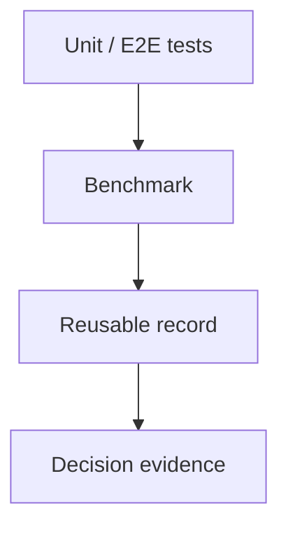

# 07.7 Chapter Wrap-up 本章解决了什么

这章回答的是：正确性和性能是否已经可以被系统地验证、对照和记录。到这里，测试、比较和结果解读已经收成一条可复查的证据链。

## 1. 本章解决了什么

- 正确性和性能已经被拆成两条线
- benchmark 已经不再承担正确性证明
- 结果可以按 baseline、optimized 和 reference 三层来拆

## 生态回看

回看 `vLLM`、`SGLang`、`TensorRT-LLM` 和 `Ollama` 时，有助于看懂 benchmark 结果在真实场景里分别说明了什么。

- 先看 [07.6 主流对照](/chapter07_benchmark/07_framework_comparison)
- 对照 [vLLM](/reference/ecosystem/vllm) 回看高吞吐 serving
- 对照 [SGLang](/reference/ecosystem/sglang) 回看应用编排
- 对照 [TensorRT-LLM](/reference/ecosystem/tensorrt_llm) 回看 engine 级优化
- 对照 [Ollama](/reference/ecosystem/ollama) 回看本地交付体验

这类混淆很常见：看到 benchmark 数字变好了，就默认功能也没问题。
`chapter07` 要做的，就是把“更快”和“更对”分开看。

## 阅读入口

- 前置阅读：[`chapter06_quantization`](/chapter06_quantization/intro)、[`chapter06 小结`](/chapter06_quantization/summary)
- 源码直达：[`chapter07_benchmark 代码入口`](/code/chapter07_benchmark)
- 相关阅读：[`07.6 主流对照`](/chapter07_benchmark/07_framework_comparison)

## 代码直达

- [`src/benchmark.cpp`](/code/chapter07_benchmark#benchmark-cpp)
- [`src/test_helpers.cpp`](/code/chapter07_benchmark#test-helpers-cpp)
- [`examples/main_benchmark.cpp`](/code/chapter07_benchmark#main-benchmark-cpp)
- [`tests/chapter07_benchmark_test.cpp`](/code/chapter07_benchmark#chapter07-benchmark-test-cpp)
- [`scripts/run.sh`](/code/chapter07_benchmark#run-sh)

现实里最容易出问题的地方，往往不是 benchmark 本身，而是“跑得快”被误当成“跑得对”。所以这一章要做的，就是把“结果更好看”和“链路真的没坏”分开确认。

## 2. 为什么它重要

这一章把整套教程的收口方式固定下来：前面章节负责把系统做出来，这一章负责把它变成可验证、可比较、可决策的证据。

## 3. 背景回顾

走到这里，系统已经不只是在回答“能不能跑”，而是在回答“改动有没有把系统做坏，收益有没有兑现，代价是否值得”。

## 4. 中间推导回顾

如果从“怎么证明它对、证明它快”这个问题倒推，最自然的结果就是三层证据链：单元测试负责局部正确性，端到端测试负责链路正确性，benchmark 负责固定条件下的性能比较。

## 5. 学习后应能做什么

- 为后续修改建立可重复的检查流程
- 用测试和 benchmark 区分“能跑”和“跑得好”
- 读懂一次 benchmark 结果背后的工程含义
- 判断一次改动到底是收益、代价还是只是噪声
- 把 benchmark 数字翻译成保留 / 回滚 / 继续优化的决策

## 6. 边界说明

这一章不负责替你证明算法语义正确，也不负责替你解释所有性能波动。它只负责把验证体系收口成一套稳定流程：

- 正确性由单元测试和端到端测试承担
- 性能由 benchmark 承担
- 结果解读由 `07.6` 的决策模板承担
- 原因分析可以借助 profiling，但 profiling 不等于 benchmark

benchmark 负责告诉你“发生了什么”，profiling 负责告诉你“为什么会这样”。如果输入、硬件或运行方式不一致，这些 benchmark 结果就不适合直接比较。

## 代码回看

- [`src/benchmark.cpp`](/code/chapter07_benchmark#benchmark-cpp)
- [`src/test_helpers.cpp`](/code/chapter07_benchmark#test-helpers-cpp)
- [`tests/chapter07_benchmark_test.cpp`](/code/chapter07_benchmark#chapter07-benchmark-test-cpp)

## 7. 下一步是什么

下一步进入 profiling 和 A/B 对比。benchmark 负责给出可比较的结果，profiling 负责解释这些结果从哪里来。`chapter07` 的收口是把后面的优化拉回到一个能持续复查、持续对照的起点上。
