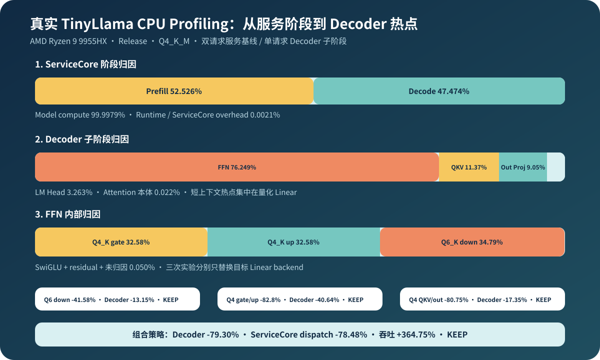

# 08.8 真实 TinyLlama 服务 Profiling

本节把 Chapter09 的真实双请求 benchmark 接回 Chapter08。证据分两步收敛：先用 ServiceCore JSON 判断时间属于模型计算还是服务编排，再在显式开启 profiling 的 `RealLlamaCpuContext` 中拆分 Decoder 子阶段。所有数据都先通过 golden token、Context/cache 隔离和 terminal release 正确性闸门。

## 服务阶段归因

归档基线来自 `AMD Ryzen 9 9955HX`、GCC 13.1.0、Release 和 TinyLlama Q4_K_M。Chapter08 的 `select_real_service_profile.mjs` 校验环境与正确性字段，再转换为统一 `ProfileRecord`。Model prefill 与 decode 合计占 dispatch 的 `99.9979%`，Runtime/ServiceCore overhead 仅占 `0.0021%`；双请求 TTFT 和完成时间分别相差约 `570ms`，与当前单线程 round-robin 顺序一致。



## Decoder 子阶段

当前采集环境的 `/proc/sys/kernel/perf_event_paranoid=4`，普通用户无法使用 `perf`。Decoder 因此提供默认关闭的分段计时，由 `real_tinyllama_decoder_profile` 显式开启。固定输入为 `Hello TinyLlama`、4 个生成 token 和三轮运行，每轮实际 forward 6 个 prompt token 和 3 个已采样 token。

```bash
bash code/engine/scripts/run_real_decoder_profile.sh
```

原始结果保存在 <a href="../_code/chapter08_profiling/results/tinyllama_decoder_phase_profile.txt"><code>tinyllama_decoder_phase_profile.txt</code></a>。顶层计时用于比较 Decoder 阶段，内层计时继续拆开 FFN 的 gate、up、SwiGLU、down 和 residual；测试要求内层计时和不超过 FFN 总计，并保留少量计时器与容器操作造成的未归因时间。QKV 与 attention output 也是量化 Linear。当前证据不支持“attention 本体是主要瓶颈”的判断。

| 子阶段 | 三轮平均 | 总时间占比 | 当前判断 |
| --- | ---: | ---: | --- |
| FFN | `3865.79 ms` | `76.2491%` | 第一优化范围，继续看内部构成 |
| QKV projection | `576.22 ms` | `11.3654%` | 第二优化范围，关注 fused Q4_K Linear |
| Attention output projection | `458.72 ms` | `9.0479%` | 与 QKV 共用量化 Linear 路径 |
| LM Head | `165.45 ms` | `3.2634%` | Q6_K 大词表投影，单独保留 |
| Attention 本体 | `1.11 ms` | `0.0219%` | 当前短 prompt 不是主瓶颈 |
| Norm / RoPE / Embedding / 未归因 | `2.65 ms` | `0.0523%` | 暂不优先优化 |

TinyLlama Q4_K_M 中，gate/up 使用 Q4_K 权重，down 使用 Q6_K 权重。三者耗时接近，但 down 单项最高；激活、残差和未归因合计只占 FFN 的约 `0.050%`，因此无需先融合 SwiGLU 或 residual。

| FFN 子项 | 三轮平均 | FFN 内占比 | 实验结论 |
| --- | ---: | ---: | --- |
| Q6_K down Linear | `1344.86 ms` | `34.7888%` | Q6_K 单变量优化对象 |
| Q4_K up Linear | `1259.60 ms` | `32.5832%` | 与 gate 共同做 Q4_K 对照 |
| Q4_K gate Linear | `1259.40 ms` | `32.5780%` | 与 up 耗时基本一致 |
| SwiGLU | `1.78 ms` | `0.0460%` | 当前无需优先融合 |
| Residual | `0.08 ms` | `0.0021%` | 当前无需优先优化 |
| 未归因 | `0.07 ms` | `0.0019%` | 子项闭合通过 |

## 从回归门到组合优化

实验按三步推进：先用服务回归确认结果可比较，再分别切换 Q6_K down、Q4_K FFN 和 Q4_K Attention，最后组合已经通过的 backend。每一步都保留 scalar 对照、正确性闸门和原始结果文件。

### 真实回归 A/B

`run_real_service_ab.sh` 用归档 JSON 作为 baseline，在当前工作树重新构建并采集 experiment。比较前必须匹配 workload、backend、模型、CPU、Release 构建、请求数和生成 token 数；它验证可重复性与回归门，不构成单变量优化实验。

```bash
bash code/chapter08_profiling/scripts/run_real_service_ab.sh
```

原始 experiment 与报告分别保存在 <a href="../_code/chapter08_profiling/results/tinyllama_service_repeatability_experiment.json"><code>tinyllama_service_repeatability_experiment.json</code></a> 和 <a href="../_code/chapter08_profiling/results/tinyllama_service_repeatability_ab.txt"><code>tinyllama_service_repeatability_ab.txt</code></a>。

| 指标 | Baseline | Experiment | Delta |
| --- | ---: | ---: | ---: |
| Correctness | PASS | PASS | 可比较 |
| Dispatch | `7229.15 ms` | `7523.16 ms` | `+4.0670%` |
| Prefill | `3797.11 ms` | `3940.22 ms` | `+3.7689%` |
| Decode | `3431.89 ms` | `3582.77 ms` | `+4.3965%` |
| Throughput | `1.1066 token/s` | `1.0636 token/s` | `-3.8865%` |
| 5% 回归门 | - | - | `KEEP` |

### Q6_K down 单变量实验

实验使用同一个 Release 可执行文件、TinyLlama Q4_K_M、`Hello TinyLlama`、9 次 forward 和三轮迭代，只把 FFN down 从 scalar fused 切换为 AVX2/FMA fused。Q4_K gate/up、LM Head、请求和采样路径均未改变；两组运行都通过 golden token、Decoder 顶层计时和 FFN 子项闭合检查。

```bash
bash code/chapter08_profiling/scripts/run_real_q6k_down_ab.sh
```

原始 scalar、AVX2 profile 和判定报告分别保存在 <a href="../_code/chapter08_profiling/results/tinyllama_q6k_down_scalar.txt"><code>tinyllama_q6k_down_scalar.txt</code></a>、<a href="../_code/chapter08_profiling/results/tinyllama_q6k_down_avx2.txt"><code>tinyllama_q6k_down_avx2.txt</code></a> 和 <a href="../_code/chapter08_profiling/results/tinyllama_q6k_down_ab.txt"><code>tinyllama_q6k_down_ab.txt</code></a>。

| 指标 | Scalar fused | AVX2/FMA fused | Delta |
| --- | ---: | ---: | ---: |
| Correctness / 计时闭合 | PASS | PASS | 可比较 |
| FFN down | `1355.83 ms` | `792.08 ms` | `-41.5797%` |
| FFN 总计 | `3890.50 ms` | `3255.13 ms` | `-16.3314%` |
| Decoder 总计 | `5104.69 ms` | `4433.33 ms` | `-13.1518%` |
| 判定 | - | - | `KEEP` |

这组数据证明当前机器和固定 workload 下的 Q6_K down 优化有效，不代表其他模型、CPU 或长度会得到相同比例。

### Q4_K gate/up 单变量实验

第二个实验使用相同模型、prompt、9 次 forward 和三轮迭代，只把 FFN gate/up 从 scalar fused 切换为 AVX2/FMA fused。Q6_K down、QKV、Attention output、LM Head、请求和采样均保持原路径。非均匀合成 block、golden token 和两级计时闭合均通过。

```bash
bash code/chapter08_profiling/scripts/run_real_q4k_ffn_ab.sh
```

原始 profile 和报告保存在 <a href="../_code/chapter08_profiling/results/tinyllama_q4k_ffn_scalar.txt"><code>tinyllama_q4k_ffn_scalar.txt</code></a>、<a href="../_code/chapter08_profiling/results/tinyllama_q4k_ffn_avx2.txt"><code>tinyllama_q4k_ffn_avx2.txt</code></a> 和 <a href="../_code/chapter08_profiling/results/tinyllama_q4k_ffn_ab.txt"><code>tinyllama_q4k_ffn_ab.txt</code></a>。

Q4_K 与 Q6_K FFN 实验各自使用同一次运行中的配对 scalar baseline；百分比可以说明各自改动收益，但两组绝对毫秒数不能交叉相减。Chapter06 已用 `QuantizedLinearPolicy` 和 registry 统一 backend 选择、错误与测试契约。

| 指标 | Scalar fused | AVX2/FMA fused | Delta |
| --- | ---: | ---: | ---: |
| Correctness / 计时闭合 | PASS | PASS | 可比较 |
| FFN gate | `1243.69 ms` | `212.87 ms` | `-82.8841%` |
| FFN up | `1242.09 ms` | `213.71 ms` | `-82.7943%` |
| FFN 总计 | `3814.69 ms` | `1768.43 ms` | `-53.6416%` |
| Decoder 总计 | `5004.27 ms` | `2970.35 ms` | `-40.6436%` |
| 判定 | - | - | `KEEP` |

### Q4_K QKV/out 单变量实验

第三个实验通过独立 Attention policy 同时切换 Q、K、V 和 output projection。FFN gate/up、FFN down、LM Head、请求和采样保持 scalar；比较器显式检查三个作用域的 backend 字段，以及 golden token、Decoder 顶层计时和 FFN 子项闭合。

```bash
bash code/chapter08_profiling/scripts/run_real_q4k_attention_ab.sh
```

原始 profile 和报告保存在 <a href="../_code/chapter08_profiling/results/tinyllama_q4k_attention_scalar.txt"><code>tinyllama_q4k_attention_scalar.txt</code></a>、<a href="../_code/chapter08_profiling/results/tinyllama_q4k_attention_avx2.txt"><code>tinyllama_q4k_attention_avx2.txt</code></a> 和 <a href="../_code/chapter08_profiling/results/tinyllama_q4k_attention_ab.txt"><code>tinyllama_q4k_attention_ab.txt</code></a>。结果证明当前机器与固定 workload 下值得保留该 backend，但不足以把 AVX2 设为所有 CPU 的隐式默认路径。

| 指标 | Scalar fused | AVX2/FMA fused | Delta |
| --- | ---: | ---: | ---: |
| Correctness / 计时闭合 | PASS | PASS | 可比较 |
| QKV projection | `587.50 ms` | `124.02 ms` | `-78.8902%` |
| Attention output projection | `466.30 ms` | `78.83 ms` | `-83.0952%` |
| Attention projection 合计 | `1053.80 ms` | `202.85 ms` | `-80.7509%` |
| Decoder 总计 | `5161.73 ms` | `4266.20 ms` | `-17.3494%` |
| 判定 | - | - | `KEEP` |

### 组合 optimized policy

三个单变量实验通过后，`run_real_optimized_policy_ab.sh` 在同一 Release 构建中生成 Decoder scalar/optimized profile 和双请求 ServiceCore scalar/optimized JSON。`optimized-avx2` 同时启用 Q4_K Attention、Q4_K FFN 与 Q6_K FFN backend，LM Head 保持 scalar；Factory 在模型加载时验证 AVX2/FMA 能力，并把同一模式应用到每个请求 Context。

```bash
bash code/chapter08_profiling/scripts/run_real_optimized_policy_ab.sh
```

原始 Decoder、服务 JSON 与判定报告保存在 <a href="../_code/chapter08_profiling/results/tinyllama_optimized_decoder_scalar.txt"><code>tinyllama_optimized_decoder_scalar.txt</code></a>、<a href="../_code/chapter08_profiling/results/tinyllama_optimized_decoder_avx2.txt"><code>tinyllama_optimized_decoder_avx2.txt</code></a>、<a href="../_code/chapter08_profiling/results/tinyllama_optimized_service_scalar.json"><code>tinyllama_optimized_service_scalar.json</code></a>、<a href="../_code/chapter08_profiling/results/tinyllama_optimized_service_avx2.json"><code>tinyllama_optimized_service_avx2.json</code></a> 和 <a href="../_code/chapter08_profiling/results/tinyllama_optimized_policy_ab.txt"><code>tinyllama_optimized_policy_ab.txt</code></a>。

| 指标 | Scalar | Optimized AVX2 | Delta |
| --- | ---: | ---: | ---: |
| Correctness / 计时闭合 / 资源释放 | PASS | PASS | 可比较 |
| Decoder 总耗时 | `5208.81 ms` | `1078.23 ms` | `-79.2998%` |
| ServiceCore dispatch | `7573.39 ms` | `1629.51 ms` | `-78.4838%` |
| ServiceCore prefill | `3977.48 ms` | `777.73 ms` | `-80.4467%` |
| ServiceCore decode | `3595.75 ms` | `851.62 ms` | `-76.3160%` |
| Throughput | `1.0564 token/s` | `4.9095 token/s` | `+364.7483%` |
| 判定 | - | - | `KEEP` |

## 复现实验

组合结果只证明三个 backend 可以在记录的 CPU 和固定 workload 下共同工作，不支持对所有 CPU 自动启用。教程因此保留 scalar 默认路径，把 `optimized-avx2` 作为显式实验模式。

复现时保持模型、prompt、token 数和服务 workload 不变，先检查 policy 单测与真实 golden，再比较 QKV、FFN、Decoder 总时间和 ServiceCore 指标。具备 `perf` 权限时，可在同一 workload 下补充符号采样，用 hotspot 排序解释阶段计时。
