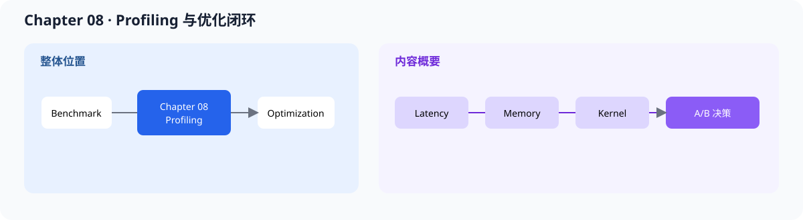

# 08.0 Explain Why It Is Slow 性能归因与优化闭环

## 1. 本章位置与成功标准

Chapter 07 已经告诉我们结果变快还是变慢；本章继续追问原因，并把一次优化写成可复查的实验。

```bash
bash code/chapter08_profiling/scripts/run.sh
```

成功标准：能从 Chapter 07 教学 JSON 和 Chapter09 真实服务 JSON 生成阶段报告，执行 correctness-first 的 A/B 判定，并把真实 Decoder 热点收敛到可实验的子阶段。本章不重新实现 runtime，也不把无权限采集的 `perf` 数据写成结论。

本章把 benchmark 结果转换成优化决策：先确认条件一致，再定位阶段和热点，最后决定保留、回滚或继续拆分。真实 TinyLlama 案例见 [`08.8 真实服务 Profiling`](./08_real_service_profile.md)。



## 2. 三种阅读深度

完成本章后，可以：

- 区分 benchmark 的结果描述和 profiling 的原因解释
- 拆分 prefill、decode、sampling、output、cache 和调度时间
- 判断瓶颈属于计算、内存、同步、调度还是输入开销
- 设计固定条件、单变量改动和明确回滚标准的 A/B 实验
- 把一次优化记录成可以复现和回归的报告

首轮只学习“怎样从数据形成一个可回滚的优化决定”。内存带宽、kernel launch 和 CUDA Graph 属于硬件深入；真实 TinyLlama 案例和成熟框架阅读用于复盘，不是理解 A/B 方法的前置条件。

| 深度 | 阅读范围 | 完成标志 |
| --- | --- | --- |
| 首轮必读 | Profiling Basics、Latency Breakdown、A/B Experiment、Optimization Loop | 能从固定 workload 得到 `KEEP/REJECT` 决定 |
| 第二轮进阶 | Memory/Bandwidth、Kernel Launch/CUDA Graph、真实 TinyLlama 服务案例 | 能把阶段耗时下钻到资源或 kernel 假设 |
| 按需选读 | vLLM / nano-vLLM Profiling 阅读桥 | 能在成熟框架中找到对应观测点 |

## 3. 阅读与源码顺序

首轮源码只看 <a href="../_code/chapter08_profiling/include/chapter08_profiling/profile_record.h"><code>profile_record.h</code></a> 和 <a href="../_code/chapter08_profiling/include/chapter08_profiling/ab_compare.h"><code>ab_compare.h</code></a>。真实案例再进入 JSON adapter 和 <a href="../_code/engine/examples/real_tinyllama_decoder_profile.cpp"><code>real_tinyllama_decoder_profile.cpp</code></a>。前置阅读是 [`Chapter07`](../chapter07_benchmark/intro.md)，原始结果、A/B 报告和复现入口统一从[实验与验证资产索引](../reference/experiment_assets.md)查询。

| 顺序 | 页面 | 读完后应看到什么 |
| --- | --- | --- |
| 1，必读 | [`08.1 Profiling Basics`](./01_profiling_basics.md)、[`08.2 Latency Breakdown`](./02_latency_breakdown.md) | benchmark 与 profiling 的分工、阶段拆分 |
| 2，必读 | [`08.5 A/B Experiment`](./05_ab_experiment.md)、[`08.6 Optimization Loop`](./06_optimization_loop.md) | hypothesis -> change -> measure -> decide |
| 3，进阶 | [`08.3 Memory and Bandwidth`](./03_memory_bandwidth.md)、[`08.4 Kernel Launch and CUDA Graph`](./04_kernel_launch_and_cuda_graph.md) | 内存、带宽、launch 和同步点 |
| 4，进阶 | [`08.8 真实 TinyLlama 服务 Profiling`](./08_real_service_profile.md) | 从 ServiceCore 阶段进入 Decoder 子阶段和真实回归 A/B |
| 5，选读 | [`08.7 vLLM / nano-vLLM Profiling 阅读桥`](./07_vllm_nano_vllm_profiling_bridge.md) | 将方法映射到成熟项目 |

## 4. 验证

一次有效的优化记录至少包含：

1. 硬件、模型、dtype、输入长度、输出长度和 batch
2. baseline 与 experiment 的 correctness 结果
3. prefill、decode、sampling、output 和 peak memory 指标
4. trace / hotspot 证据和只改变的变量
5. 保留、回滚或继续拆分的决定

不要用单个吞吐数字直接归因；先确认 workload 相同，再区分计算、内存、同步和调度开销。Chapter 08 工具只验证报告字段和 A/B 判定，不替代 Nsight 等硬件 profiler。

Q4_K gate/up、Q6_K down 与 Q4_K QKV/out 三组单变量 A/B 及组合后的 Decoder/ServiceCore 回归均判定 `KEEP`。`optimized-avx2` 已作为显式实验策略接入 Factory，默认服务仍使用 scalar；真实 Decoder 通过公共执行契约进入 Runtime。符号级 `perf` 采样属于环境允许时的补充证据，不是本章验收前提。
