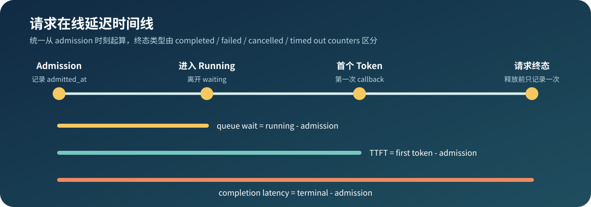

# 09.1 C++ Service Core

## 服务对象和状态

`ServingCore` 保存请求引用、请求 ID、Sampler、可选的 `RequestModelExecutor` 和队列位置。生成状态由 Chapter05 `Request` 保存，模型计算由 Runtime 调用 executor 完成；ServiceCore 不依赖 TinyLlama、GGUF 或具体 backend 类型。

| 事件 | Service Core 动作 | Request 结果 |
| --- | --- | --- |
| `admit` | 校验 ID、terminal 状态和容量，保存可选 executor，进入 waiting | `Initial` |
| `dispatch` | 按 `max_batch` 移到 running，连同 executor 交给 Scheduler | `Prefilled` -> `Finished` / `Failed` |
| `dispatch_step` | 补充 running，按 token/block budget 混合一次 prefill chunk/decode | 每请求最多前进一步 |
| `cancel` | waiting 直接移除，running 标记 terminal | `Cancelled` |
| `timeout` | waiting 直接移除，running 标记 terminal | `TimedOut` |
| `release_completed` | 清空 cache，移除 entry 并释放 executor/Context | terminal 且无请求资源 |

ServiceCore 测试同时覆盖两条路径：未提供 executor 时继续使用教学 Transformer；提供两个独立 executor 时，round-robin 分别调用各自的 prefill/decode，两个请求生成不同 token 且调用计数互不覆盖。真实模型沿用同一接口，不改变 ServiceCore 队列。

## 真实 Model 与请求 Context

`RealLlamaExecutorFactory` 位于 `code/engine`，只加载一次 `RealLlamaCpuModel`。每次 admission 前调用 `create_executor()`，得到一个持有独立 `RealLlamaCpuContext` 的执行器。ServiceCore 从 waiting 到 running 持有该执行器，terminal release 时一起释放；模型权重不随请求复制。

真实 smoke 同时提交 `Hello TinyLlama` 和 `Hi`，使用 3-token step budget 强制长 prompt 分段进入同一个 Context。两个请求的 position、22 层 K/V 和 token history 不共享；测试还检查原有 golden token、block token count，并用 `weak_ptr` 确认 release 后 Executor/Context 已销毁。

```bash
cmake -S code/engine -B /tmp/cpp-llm-engine-real-serving \
  -DCHAPTER01_ENABLE_LLAMA_CPP=ON \
  -DLLAMA_CPP_ROOT="$PWD/llama.cpp" \
  -DCHAPTER06_SOURCE_DIR="$PWD/code/chapter06_quantization" \
  -DCPP_LLM_ENGINE_REAL_MODEL="$PWD/llama.cpp/models/tinyllama-1.1b-chat-v1.0.Q4_K_M.gguf" \
  -DCMAKE_BUILD_TYPE=Release
cmake --build /tmp/cpp-llm-engine-real-serving \
  --target real_tinyllama_serving_smoke -j2
ctest --test-dir /tmp/cpp-llm-engine-real-serving \
  -R real_tinyllama_serving_test --output-on-failure
```

| 验证对象 | 固定结果 |
| --- | --- |
| 共享模型 | `model_layers: 22`，只加载一份 Model |
| 请求 A | `Hello TinyLlama` -> `29892 306 29915 29885` |
| 请求 B | `Hi` -> `839 744 29892 263` |
| 请求隔离 | `request_isolation_match: true`、`cache_isolated: true` |
| 分块追加 | `chunked_prefill_match: true`，中间 chunk 不采样且 golden 不变 |
| 终态回收 | `resources_released: true`、`metrics_match: true` |

## 服务指标

`ServingCore::metrics()` 返回累计快照。计数器描述请求结果，延迟字段使用 Prometheus `_sum/_count` 形式；平均值由 `sum / count` 计算，样本不足时不伪造 P50/P99。

| 指标 | 计数时机 |
| --- | --- |
| `accepted_total` | admission 成功 |
| `queue_full_total` | inflight 达到容量 |
| `duplicate_total` | request ID 已存在 |
| `cancelled_total` / `timed_out_total` | 对应终态动作成功 |
| `failed_total` | 模型 executor 失败的请求被回收 |
| `completed_total` / `released_total` | 完成请求被回收 |
| `generated_tokens_total` | Scheduler 产生 token |
| `peak_inflight` | inflight 历史最大值 |
| `queue_wait_seconds_sum/count` | admission 到请求离开 waiting、进入 running |
| `ttft_seconds_sum/count` | admission 到第一次 token callback |
| `completion_seconds_sum/count` | admission 到任一 terminal 状态，只记录一次 |

## 在线延迟时间线

三种延迟统一使用 `steady_clock`，不受系统时间校准影响。queue wait 只统计真正进入 running 的请求；TTFT 只统计产生首 token 的请求；completion 覆盖 finished、failed、cancelled 和 timed out，具体终态由对应 counter 区分。单元测试注入手动时钟，不依赖 `sleep` 或机器负载。



## 最小实现

```bash
bash code/chapter09_serving/scripts/run.sh
```

`ServingCore(3, 2)` 表示最多容纳 3 个 inflight request，每轮最多交给 Runtime 2 个请求。demo 会提交 3 个请求，第一轮完成 2 个，释放资源后第二轮处理剩余请求。

需要逐 step 推进时调用 `dispatch_step(runtime, max_batch_tokens)`。支持 chunk 的 executor 会按剩余 token budget 追加 prompt，prefill 请求按已提交进度从小到大选择；不支持 chunk 的 executor 保持完整 prompt 语义。如果构造 ServiceCore 时注入 `KvBlockPool`，scheduler 会在调用 executor 前预留 block；容量不足的请求计入 `deferred_requests`。配置 pool 后旧 `dispatch()` 会明确拒绝，防止绕过 block budget。

代码入口：<a href="/_code/chapter09_serving/include/chapter09_serving/serving_core.h"><code>serving_core.h</code></a>、<a href="/_code/chapter09_serving/src/serving_core.cpp"><code>serving_core.cpp</code></a>、<a href="/_code/chapter09_serving/tests/chapter09_serving_test.cpp"><code>chapter09_serving_test.cpp</code></a>。

## 服务化扩展顺序

当前已经完成 HTTP adapter、在线延迟指标、真实双请求 benchmark、chunked prefill、基础公平性、token/block-budget 单步调度和 CPU block ownership。后续按顺序增加：

1. GPU Cache Engine：把物理 block ID 绑定到分层 device K/V payload。
2. 并行 Batch Executor：把逻辑 candidate plan 转换为 backend batch 执行。
3. Beast/Asio transport：验证异步连接、背压和真实 deadline。
4. Python Gateway：只调用稳定的 C++ Service Core，不复制队列和 KV Cache 状态。

## HTTP 映射

`HttpAdapter` 先把协议边界固定下来，传输层可以后接 C++ 网络库：

| 请求 | 成功响应 | 错误响应 |
| --- | --- | --- |
| `GET /health` | `200` JSON 健康状态 | - |
| `GET /metrics` | `200` Prometheus text | - |
| `POST /v1/completions` | `200` token ID、completion 和 finish reason | `400` body、`404` route、`429` capacity、`500` executor |

当前 completion 已支持同步响应和通过 `ResponseWriter` 写出的 transport-neutral SSE 风格响应。Engine 应用层可注入真实 Factory，同步响应返回 `generated_token_ids`，SSE 逐个写出真实模型 token。Chapter 05 callback 产生 token event，客户端断开映射为 `499/client_disconnect`，deadline 映射为 `408/timeout`，最终事件必须带 `finish_reason`。
