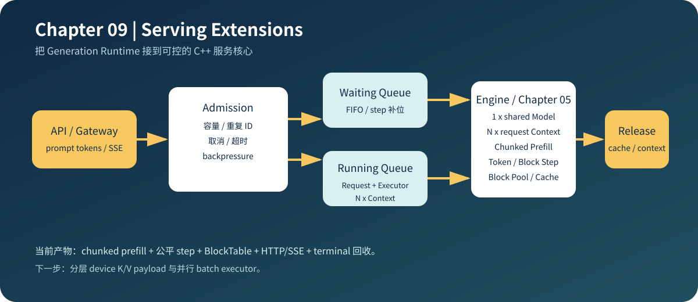

# 09.0 Serving Extensions 服务化扩展

## 1. 本章位置与成功标准

Chapter 05 已经能执行 Generation Runtime，Chapter 07/08 已经能测量和解释 CPU 行为。本章把同一个 `Request` 接到最小 C++ Service Core：先做 admission，再进入 waiting/running 队列，执行后释放 request-owned KV Cache。

```bash
bash code/chapter09_serving/scripts/run.sh
```

成功标准：容量满时明确拒绝；请求既可完整 dispatch，也可按 token/block budget 单步推进；block 不足时 executor 不运行，完成请求释放 block、cache 与 executor；transport-neutral HTTP 和可选 cpp-httplib loopback 可验证；真实模型 Factory 能接入同步与 SSE completion，并输出在线延迟和 benchmark JSON。



## 2. 内容地图

| 服务对象 | 本章实现 | 下一步扩展 |
| --- | --- | --- |
| Admission | 容量、重复 ID、terminal request 校验 | API 参数、token budget、优先级 |
| Waiting / Running | FIFO waiting、batch 上限、按 step 动态补位、最少 prefill 进度优先 | 抢占、业务优先级和 deadline |
| Cancel / Timeout | 标记 terminal，阻止再次调度 | Beast/Asio 下的异步 deadline 传播 |
| Resource release | 清空 Request cache、释放 Executor/Context 和物理 block ID | 分层 K/V payload、workspace pool、压力测试 |
| Model execution | Factory 共享 Model，每请求创建 Executor/Context | 线程池、并行 backend、模型资源池 |
| HTTP completion | 同步 token ID、SSE token event、Factory 错误映射 | 文本 API、请求参数和鉴权 |
| Runtime | 完整 round-robin；支持 chunked prefill 的 token/block-budget `dispatch_step()` | 并行 batch executor |
| Observability | 在线 queue wait、TTFT、completion `_sum/_count` | histogram、P50/P99 和 trace |
| Benchmark | 固定双请求阶段耗时、吞吐和正确性 | Chapter08 profiling 与 A/B 优化 |

成熟框架把生成运行时包装成持续服务，并进一步处理异步网络、背压、多进程和分布式资源。本章对照的是 transport 以内的服务核心。

| 对照项 | 内容 |
| --- | --- |
| 本章教学对象 | admission、队列、ServiceCore、metrics、HTTP/SSE 和资源回收 |
| 主对照框架 | vLLM EngineCore、SGLang scheduler、`llama.cpp` server |
| 成熟组件 | 异步 API、多进程 worker、分布式路由、鉴权、弹性和生产监控 |
| 重点差异 | 本章保持 C++ ServiceCore 与 transport 解耦，先验证服务语义和生命周期 |
| 深入入口 | [`09.5 Serving 框架对照`](./05_framework_service_comparison.md) |

## 3. 阅读与源码顺序

1. 阅读 [`Chapter 05 Serving Preview`](../chapter05_generation/part_b_serving_preview.md)，确认已有 Request、Runtime 和 Scheduler 契约。
2. 阅读 [`Service Core`](./01_service_core.md)，再看 <a href="/_code/chapter09_serving/include/chapter09_serving/serving_core.h"><code>serving_core.h</code></a>。
3. 阅读 [`真实模型 HTTP Completion`](./04_real_http_completion.md)，跟踪 Factory 如何进入同步和 SSE 请求。
4. 阅读 [`真实 ServiceCore Benchmark`](./03_real_service_benchmark.md)，区分模型计算、Runtime 开销和 transport 延迟。
5. 阅读 [`Transport 与 C++ 网络库`](./02_transport.md)，确认网络库不改变 ServiceCore、metrics 和 streaming contract。
6. 阅读 [`Serving 框架对照`](./05_framework_service_comparison.md)，定位成熟框架中的调度、缓存和 transport 边界。
7. 运行 demo、CTest 和可选真实 benchmark，观察 admission、dispatch、cache release 与结果 JSON。
8. 对照 [`推理引擎服务化基础`](../reference/service_basics.md)，把代码状态映射到服务语义。

## 4. 验证

本章只接受可观察结果：`QueueFull`、`DuplicateId`、`cancelled`、`timed_out`、部分 prefill 游标、在线延迟 `_sum/_count`、cache 是否为空、真实请求 golden token、Executor/Context 与 block 是否释放，以及固定环境下的 benchmark JSON；真实 transport 还要观察 HTTP status、SSE event 和 loopback 结果。物理 block ID 到分层 device K/V payload 的绑定以及并行 batch executor 属于 GPU 服务扩展，不作为本章 CPU 验收条件。
