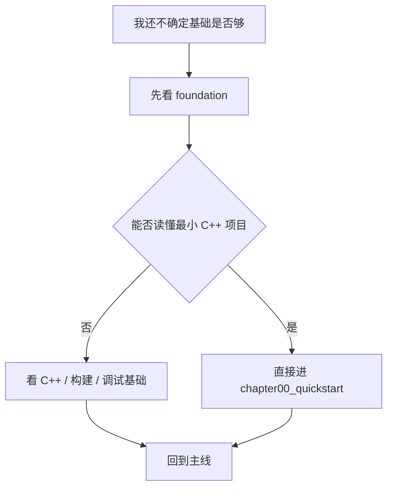
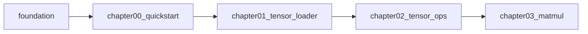

# F00 Foundation Basics 基础准备

这一部分只做一件事：补齐进入主线前最容易卡住的底层问题。

如果你已经能熟练处理 C++、CMake、CUDA 和基础调试，这里就按查缺补漏来读，补完后直接进入 `chapter00_quickstart`。

## 1. 这一部分要解决什么

`foundation` 负责的不是推理引擎本身，而是主线章节默认已经成立的前提：

- 看懂基础 C++ 代码时，不会卡在对象、生命周期和资源管理上
- 看懂构建系统时，不会卡在 target、include path 和 build dir 上
- 看懂 CUDA 相关内容时，不会混淆 driver、toolkit 和 runtime
- 看懂调试与测试时，知道问题该归到环境、构建还是代码逻辑

它的目标不是“把所有背景讲完”，而是让你在进入 `chapter00_quickstart` 之前，先具备继续往下读的最小门槛。

## 2. 阅读分层

这一部分不是平铺展开的知识清单，而是按用途分层：

- 必读：`01`、`02`、`03`、`04`、`09`
- 推荐：`05`、`06`
- 选读：`07`、`08`

判断标准很简单：

- 如果你还没准备进入主线，就先读“必读”
- 如果你想把主线看得更顺，就补“推荐”
- 如果你想扩展视野，再看“选读”

## 2.1 两条递进路径

`foundation` 其实可以看成两条递进链路：

### 语法到工程链路

- `F01`：语法层，先把 RAII、移动语义和智能指针这些基础语义打底
- `F05`：对象设计层，决定类怎么组织、怎么组合、怎么设接口
- `F06`：数据结构层，决定对象内部的数据怎么放、怎么查、怎么跑
- `F08`：桥接层，把 PyTorch 的心智模型翻译成这套 C++ 代码里的对象和数据结构
- 主线章节：把这些能力落到 `Tensor`、`ModelLoader`、`DecoderLayer` 等具体对象上

其中 `F05` 和 `F08` 形成了 foundation 里的“设计 + 迁移”双核心：

- `F05` 提供“类该怎么设计”的纯设计视角
- `F08` 提供“已有知识怎么迁移到 C++”的桥接视角

两者互补而不是重复。前者适合从零理解对象设计，后者适合带着 PyTorch 心智模型快速进入主线。

### 从认知到项目

- `F01` 到 `F08` 负责建立认知
- `F09` 负责把这些认知收口成第一个可工作的项目
- `F09` 不是附加例子，而是 foundation 的完成态，也是主线的物理起点
- 后续的 `chapterXX_*` 会以 `F09` 这种“可运行、可拆分、可扩展”的项目形态作为模板原型

### 环境到 GPU 链路

- `00.3`：环境层，判断 GPU 能不能用、runtime 能不能跑
- `00.7`：库层，判断 GPU 上的 matmul、launch overhead、通信分别该用什么库
- `chapter03` 以后：把这些库选择落到实际代码和性能比较里

这两条路径服务的是同一个目标：让读者顺利走通主线和 GPU 加速路径，只是解决的问题不同。

## 3. 读者决策树

如果你不确定该从哪一页开始，可以直接按下面的状态选入口：

| 你的状态 | 先看什么 | 目的 |
| --- | --- | --- |
| 还没写过一个小型 C++ 项目 | `F01`、`F02`、`F09` | 先把语言、构建和最小工程链路补齐 |
| 能写 C++，但对象边界和所有权不清楚 | `F01`、`F05`、`F04` | 先把对象设计、生命周期和验证习惯对齐 |
| 能读 C++，但对 CUDA 环境不稳 | `F03`、`F07` | 先分清 CUDA 环境和常用库地图 |
| 会 PyTorch，但切到 C++ 容易断层 | `F08`、`F01`、`F05` | 先做语义翻译，再补对象和所有权直觉 |
| 想直接进入主线 | `F01`、`F02`、`F03`、`F04`、`F09` | 先补最低门槛，再进 `chapter00_quickstart` |

## 4. 为什么要放在主线前面

主线章节默认读者已经能处理一条最小工程链路：

1. 能读懂基本 C++ 代码
2. 能构建一个小项目
3. 能区分 CPU 路径和 CUDA 路径
4. 能判断错误是环境、构建还是实现问题

如果这些前提没有先对齐，后面的 `Tensor`、`ModelLoader`、`MatMul`、`Attention` 和 `Generation` 会变成概念堆叠，而不是工程教程。

## 5. 你会补到什么

读完这一部分后，你应该能做到：

- 看懂本教程里的基础 C++ 类和资源管理写法
- 独立配置并构建一个小型 C++ 项目
- 判断一个问题更像是环境问题、构建问题还是代码问题
- 分清 CPU-first 学习路径和 CUDA 加速路径
- 顺利进入 `chapter00_quickstart`

## 6. 推荐阅读顺序

1. [F01 C++ basics](/foundation/01_cxx_basics)
2. [F02 CMake and compilation basics](/foundation/02_cmake_build_basics)
3. [F03 CUDA and environment basics](/foundation/03_cuda_environment_basics)
4. [F04 Debugging and testing basics](/foundation/04_debugging_testing_basics)
5. [F09 Build a minimal C++/CUDA project](/foundation/09_minimal_cpp_cuda_project)
6. [F05 OOP and design basics](/foundation/05_oop_and_design_basics)
7. [F06 Data structures and algorithm basics](/foundation/06_data_structure_algorithm_basics)
8. [F07 CUDA common libraries](/foundation/07_cuda_common_libraries)
9. [F08 PyTorch to C++ bridge](/foundation/08_pytorch_to_cpp_bridge)

## 7. 什么时候可以跳过

如果下面几项你已经很熟，就不用按顺序细读：

- 你已经能写和编译一个小型 C++ 项目
- 你已经熟悉 CMake 的 target 和 build 目录
- 你已经知道 CUDA 环境变量、编译器和运行时的差异
- 你已经能用断言、日志或调试器定位基础问题

这种情况下，foundation 只需要当作查阅层，不需要当作教程主线。

## 8. 每一页的最低要求

每个 foundation 页面都应该尽量满足：

- 一个明确目标
- 一个最小例子
- 一个可执行的验证步骤
- 一个你能马上拿回主线的结论

如果某一页写得太长，通常说明它已经超出了“基础准备”的职责。

## 9. 和主线的关系

`foundation` 不是第二条主线，而是主线前的预备区。  
准备够了就进主线，不够的地方就先补基础再回来。

如果你在找 CPU / GPU 的分界线，主线第一处真正进入 GPU backend 的位置是 `chapter03_matmul/04_cublas_implement`；CUDA 环境说明则集中在 `guides/setup_cuda`。

## 10. 这一部分的阅读策略

- 先补最缺的一项
- 不要把它当成完整独立教程
- 读完一页就判断：是否已经足够支撑主线
- 如果不够，就只补缺口，不要在基础区无限停留

## 11. 参考来源

如果后续要继续扩展 foundation，可以优先参考：

- `modern-cpp`：RAII、所有权、模板、STL、并发、CMake
- `data-structure`：复杂度分析和数据结构选择
- `cpu`：缓存、执行模型和性能直觉
- `parallel-computing`：同步和并发概念
- `toolchain`：构建和部署工具链背景
