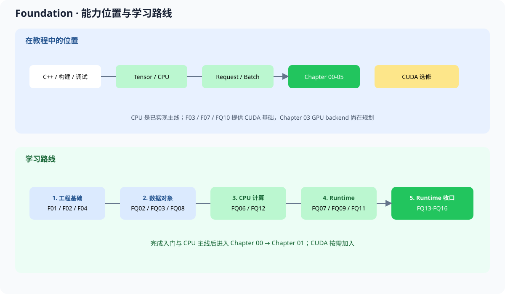

# F00 Foundation Basics 基础准备

Foundation 是主线前的按需准备区，补 C++、构建、调试、Tensor、CPU 和 Runtime 的最低前置能力；它不实现完整推理引擎。

CPU 是默认路线，CUDA 只在需要 GPU backend 时加入。下面的总图同时说明 Foundation 的系统位置和学习路线。



## 1. 先判断

已经能独立构建 C++17 项目、运行 CTest 并定位基础错误，可以直接进入 Chapter 00。不确定时，按第二行补基础。

| 你的目标 | 直接执行 |
| --- | --- |
| 只想先跑一次真实推理 | 进入 [`chapter00_quickstart`](../chapter00_quickstart/intro.md) |
| 想补基础后再学习 | 按第 2 节 CPU 主线阅读，并完成题库入门组 |
| 想学习 GPU backend | 先完成 CPU 主线，再选读 F03、F07、FQ10 |

## 2. CPU 主线

按下面顺序从工程基础走到 Tensor、CPU 算子和 Runtime。完成第 3 步后先进入 [`chapter00_quickstart`](../chapter00_quickstart/intro.md)，确认真实模型基线；再回到第 4、5 步进入 [`chapter01_tensor_loader`](../chapter01_tensor_loader/intro.md) 和后续 CPU 主线。第 6 步用于进入 Chapter 05 Runtime。每篇正文解释概念和设计理由；对应题目负责 starter、代码修改和验收。

| 顺序 | 内容 | 完成后能做什么 |
| --- | --- | --- |
| 1 | [F01 C++](./01_cxx_basics.md)、[F02 CMake](./02_cmake_build_basics.md)、[F04 调试测试](./04_debugging_testing_basics.md) | 构建项目、运行测试、定位基础错误 |
| 2 | [F09 最小项目](./09_minimal_cpp_cuda_project.md) 的 CPU 部分 | 组织 library、app 和 test |
| 3 | `FQ01`、`FQ02`、`FQ04`、`FQ05` | 把工程基础变成可验证代码 |
| 4 | [F05 对象设计](./05_oop_and_design_basics.md)、[F06 数据结构](./06_data_structure_algorithm_basics.md)、[F08 概念映射](./08_pytorch_to_cpp_bridge.md) | 理解 Tensor、buffer、view 和 PyTorch/C++ 对应关系 |
| 5 | `FQ03`、`FQ06`、`FQ08`、`FQ12`、`FQ17` | 进入 Chapter 01-03 的 Tensor 和 CPU 算子 |
| 6 | `FQ07`、`FQ09`、`FQ11`、`FQ13`-`FQ16` | 进入 Chapter 05 的 Request 和 Runtime |

## 3. 题库入口

正文与题目的对应关系见 [Foundation 正文与练习映射](./exercise_map.md)。题库入口是仓库中的 [`exercises/foundation/README.md`](../exercises/foundation/README.md)，负责题目清单、CPU/GPU 资产、做题顺序、编译命令和完成标准。

正文页面只保留概念验证，并用“对应练习”指向题库。不要在正文入口重复题目目录、starter 命令或完整验收细则。

## 4. 接到主线

Foundation 解决“能读、能构建、能验证”；Chapter 00 解决“真实模型能运行”；Chapter 01 以后开始实现教程自己的推理引擎对象。遇到所有权、构建、shape、测试或 CUDA 环境问题时，回到对应 Foundation 页面或题目。

```text
Foundation
  -> Chapter 00：真实模型和真实 tokenizer
  -> Chapter 01：Tensor、ModelLoader、metadata、tokenizer contract
  -> Chapter 02：reshape、slice、共享 storage
  -> Chapter 03：MatMul、CPU backend、CUDA backend
  -> Chapter 04：Attention、FFN、DecoderLayer
  -> Chapter 05：Request、Scheduler、KV Cache、Generation Runtime
```
