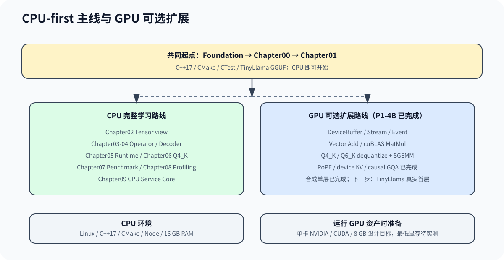

# 第一期学习计划：CPU 推理引擎闭环

第一期完成一条可运行、可解释、可验证的 CPU 纵向链路。六个必做任务从真实推理基线开始，经过输入、Tensor、算子、Decoder 和 Generation Runtime，最终落到最小推理服务；任务 7 提供可选 GPU 初探。

任务按可验证产物组织正文、代码和练习，每项任务对应一份可保存的学习记录。

每项任务指定一个主阅读入口和一条主验证命令；其他命令用于拆解和排错。每次结果按[学习验收记录模板](./learning_record_template.md)保存，记录 Git commit、环境、输入、关键输出和适用范围。

## 总体顺序

每个任务按需领取 Foundation 中的 C++、CMake、数据结构和调试练习；遇到知识缺口再回到对应正文。

| 顺序 | 任务 | 主要章节 | 完成后的可验证产物 | 运行条件 |
| --- | --- | --- | --- | --- |
| 1 | 建立真实 CPU 推理基线 | Foundation、Chapter00 | TinyLlama GGUF 能由 llama.cpp 在 CPU 上生成文本 | C++ 工具链、llama.cpp 和 GGUF |
| 2 | 打通输入、Tokenizer 与模型加载 | Chapter01 | 能检查 GGUF、真实 tokenizer、模型结构和权重映射 | 轻量测试只需 CPU；真实验证需要 GGUF |
| 3 | 建立 Tensor、View、Operator 与 MatMul 底座 | Chapter02、Chapter03 | 共享 Storage 的 view 与正确的 CPU MatMul backend | C++ 工具链 |
| 4 | 完成真实 Decoder CPU 前向 | Chapter04、Chapter06、Engine | TinyLlama 22 层 prefill/decode 与 llama.cpp golden 对齐 | GGUF；AVX2 实验需要 CPU 支持 |
| 5 | 完成 Generation Runtime | Chapter05 | Request、KV、chunked prefill、采样和多请求 step 可运行 | 默认路径只需 CPU；真实回归需要 GGUF |
| 6 | 完成最小 CPU 推理服务 | Chapter07、Chapter08、Chapter09 | ServiceCore、HTTP/SSE contract、metrics 和 benchmark 闭环 | CPU；真实模型路径需要 GGUF |
| 7 | GPU 初探，可选 | Foundation GPU、Chapter00、Chapter03、Chapter06 | CUDA 环境、llama.cpp GPU 基线和自研 CPU/CUDA backend 对照 | NVIDIA GPU、驱动和 CUDA Toolkit |

## 首轮与进阶范围

首轮只读形成当前任务产物所需的页面；框架对照、硬件优化和服务策略留到产物跑通后。编号对应各章正文编号，具体入口仍从章节导读进入。

| 章节 | 首轮必读 | 第二轮进阶 / 按需选读 |
| --- | --- | --- |
| Chapter00 | 00.1-00.4 环境、构建、模型、首次推理 | 00.5 排错按需；00.6 vLLM baseline 选读 |
| Chapter01 | 01.5-01.8 Loader、验证、Tokenizer、GGUF metadata | 01.1-01.4 教学格式深入；01.9 框架对照 |
| Chapter02 | 02.1-02.4 Storage、reshape、slice、测试 | 02.5 框架 Tensor/View 对照 |
| Chapter03 | 03.1-03.3 Operator、MatMul、CPU reference | 03.5-03.7 数值/复杂度/真实 backend；03.4 cuBLAS 留到 GPU 阶段 |
| Chapter04 | 04.1-04.5 Attention、Norm/FFN、Decoder、首层接线 | 04.6 成熟框架对照 |
| Chapter05 | 05.3-05.7 与 05.9 Generation Core | 05.10-05.11 Serving Preview；05.1-05.2 smoke model 和 05.8 框架对照按需 |
| Chapter06 | 06.1、06.4-06.6 原理、反量化、Linear、精度 | 06.2-06.3 dtype/loader 深入；06.7-06.8 框架与 serving 对照 |
| Chapter07 | 07.1-07.4、07.6 correctness、指标、脚本、解读 | 07.5 优化提示；07.7 框架 benchmark 对照 |
| Chapter08 | 08.1、08.2、08.5、08.6 归因、A/B、优化闭环 | 08.3-08.4 硬件深入；08.7-08.8 框架与真实案例 |
| Chapter09 | 09.1 Service Core、09.4 HTTP completion | 09.2 transport、09.3 benchmark、09.5 框架对照 |

## 任务 1：建立真实 CPU 推理基线

本任务固定后续自研引擎对照的模型、Tokenizer、prompt 和输出。先按需完成 Foundation 入门组，再运行 Chapter00 的仓库 smoke，最后使用 llama.cpp 运行 TinyLlama。

建议先做 `FQ01`、`FQ02`、`FQ04`、`FQ05`；如果 C++ 所有权和最小工程仍不熟，再做 `FQ12`、`FQ17`。主线阅读顺序是 [`Foundation 总览`](../foundation/README.md)、[`Chapter00 导读`](../chapter00_quickstart/intro.md)、环境、构建、模型下载和第一次推理。

| 任务卡 | 内容 |
| --- | --- |
| 主阅读入口 | [`Chapter00 导读`](../chapter00_quickstart/intro.md) |
| 主验证命令 | `llama.cpp/build/bin/llama-simple -m llama.cpp/models/tinyllama-1.1b-chat-v1.0.Q4_K_M.gguf -p "Hello TinyLlama" -n 16` |
| 学习记录 | `cpu-baseline.md`：模型、prompt、线程数和真实输出 |
| 基础练习 | Foundation 练习脚本通过，并能解释失败时先检查什么 |
| 仓库 smoke | `run.sh` 编译并正常退出 |
| 真实推理 | llama.cpp 加载 GGUF，真实 tokenizer 处理 prompt，并生成非空文本 |
| 记录验收 | 保存模型路径、prompt、线程数和一次真实输出；不能用 smoke 代替真实推理 |

## 任务 2：打通输入、Tokenizer 与模型加载

本任务处理“外部资产怎样变成稳定的程序对象”，先确认 token ID、metadata、Tensor 索引、shape、dtype 和权重 payload 能被可靠读取。完整 Decoder 数学从 Chapter04 开始。

阅读 [`Chapter01 导读`](../chapter01_tensor_loader/intro.md)，按“输入契约与 tokenizer → GGUF metadata → Tensor index/payload → ModelConfig/ModelBuilder”推进。练习选择 `FQ02`、`FQ08` 和 `FQ17`。

| 任务卡 | 内容 |
| --- | --- |
| 主阅读入口 | [`Chapter01 导读`](../chapter01_tensor_loader/intro.md) |
| 主验证命令 | `CPP_LLM_ENGINE_MODEL_PATH=... bash code/chapter01_tensor_loader/run_real_tokenizer.sh` |
| 学习记录 | `input-and-loader.md`：token ids、metadata、schema 和权重映射 |
| 轻量测试 | Chapter01 默认测试通过 |
| GGUF 检查 | `gguf_inspect --validate-schema` 输出合法 metadata、tensor index 和 payload offset |
| Tokenizer | 同一 prompt 的 token ID 落在词表范围内，并能说明 toy 与真实实现的差异 |
| Model 构建 | 能从 tensor 名称追踪到 layer mapping，并区分共享 Model 与请求 Context |

## 任务 3：建立 Tensor、View、Operator 与 MatMul 底座

先完成 Tensor 的 ownership 和 view 语义，再进入算子与 backend。学习重点是同一块 Storage 如何被不同 shape、stride 和 offset 解释，以及上层 Operator 如何在不改变数学语义的前提下替换执行 backend。

阅读 [`Chapter02 导读`](../chapter02_tensor_ops/intro.md) 和 [`Chapter03 导读`](../chapter03_matmul/intro.md)。练习按 `FQ03 → FQ06 → FQ08 → FQ12` 执行。

| 任务卡 | 内容 |
| --- | --- |
| 主阅读入口 | [`Chapter02 导读`](../chapter02_tensor_ops/intro.md)，随后进入 [`Chapter03`](../chapter03_matmul/intro.md) |
| 主验证命令 | `bash scripts/run_tensor_operator_learning.sh` |
| 学习记录 | `tensor-and-operator.md`：storage/view contract、错误输入和 MatMul 输出 |
| Tensor view | reshape、slice、共享 Storage、stride、offset 和越界测试通过 |
| 公共契约 | 能说明 `TensorContract`、`Status`、`Operator` 和 `Backend` 的调用关系 |
| CPU MatMul | reference kernel 数值正确，非法 shape 被明确拒绝 |
| 学习练习 | 完成 view、Mini Tensor、CPU MatMul 和 RAII Workspace 对应练习 |

## 任务 4：完成真实 Decoder CPU 前向

先用 Chapter04 理解 Attention、残差和 FFN 的结构，再用 Chapter06 理解 TinyLlama Q4_K/Q6_K 权重如何进入 Linear，最后通过 Engine/Chapter01 的真实 Model/Context 路径运行 22 层 Decoder。教学 Decoder 用 LayerNorm/ReLU 拆解结构，真实 TinyLlama 路径使用 RMSNorm、RoPE、GQA 和 SwiGLU，两者通过公共结构契约对照。

| 任务卡 | 内容 |
| --- | --- |
| 主阅读入口 | [`Chapter04 导读`](../chapter04_attention/intro.md)，量化细节按需进入 [`Chapter06`](../chapter06_quantization/intro.md) |
| 主验证命令 | `CPP_LLM_ENGINE_MODEL_PATH=... bash scripts/run_real_decoder_learning.sh` |
| 学习记录 | `real-decoder.md`：结构 contract、量化 backend、golden token 和能力边界 |
| Decoder 结构 | causal Attention、FFN、残差和 DecoderLayer CPU 测试通过 |
| TinyLlama 数学 | 能在真实 Context 中定位 RMSNorm、RoPE、GQA、SwiGLU、Final Norm 和 LM Head |
| 量化 Linear | Q4_K/Q6_K reference 与 fused 路径通过 correctness 对照 |
| 真实等价性 | 22 层 logits 指标、top-k 和 4-token greedy sequence 满足固定验收标准 |

## 任务 5：完成 Generation Runtime

本任务把模型前向变成持续生成系统。首轮学习 Generation Core 的 Naive Generation、KV Cache、Scheduler、Sampler、端到端测试和 Request 生命周期；第二轮再进入 chunked prefill、continuous batching 和 Block KV，HTTP API 由任务 6 接入。

练习按 `FQ07 → FQ09 → FQ11 → FQ13 → FQ14 → FQ15 → FQ16` 执行。正文从 [`Generation Core`](../chapter05_generation/part_a_generation_core.md) 进入，再读 [`Serving Preview`](../chapter05_generation/part_b_serving_preview.md)。

| 任务卡 | 内容 |
| --- | --- |
| 主阅读入口 | [`Generation Core`](../chapter05_generation/part_a_generation_core.md) |
| 主验证命令 | `bash code/chapter05_generation/scripts/run.sh` |
| 学习记录 | `generation-runtime.md`：状态迁移、step 计划、chunk 和 block 回滚 |
| 单请求生成 | prefill、decode、greedy sampling、EOS 和 token budget 测试通过 |
| 多请求状态 | executor、取消、超时、失败和资源状态不互相污染 |
| Chunked prefill | 中间 chunk 不采样，final chunk 产生 logits，失败时游标和 block 正确回滚 |
| 调度与内存 | 能解释 token/block budget、BlockTable、物理 block 释放和真实模型 K/V 的区别 |

## 任务 6：完成最小 CPU 推理服务

先用 Chapter09 把 Request 接到 admission、waiting/running、取消、超时和回收，再用 Chapter07 固定正确性与 benchmark 条件。Chapter08 首轮学习 Profiling Basics、Latency Breakdown、A/B Experiment 和 Optimization Loop；内存带宽、CUDA Graph、真实案例与框架桥按需深入。网络库承载 transport，并通过稳定接口调用 ServiceCore。

| 任务卡 | 内容 |
| --- | --- |
| 主阅读入口 | [`Chapter09 导读`](../chapter09_serving/intro.md) |
| 主验证命令 | `CPP_LLM_ENGINE_MODEL_PATH=... bash scripts/run_cpu_service_learning.sh` |
| 学习记录 | `cpu-service.md`：请求数、token budget、correctness、TTFT、吞吐和环境 |
| Service Core | admission、waiting/running、step dispatch、取消、超时和统一释放测试通过 |
| HTTP/SSE contract | 同步 completion、streaming、错误映射和 metrics 测试通过 |
| 真实 HTTP socket | 本地监听、同步 golden、SSE token 顺序与累计 metrics 通过 curl 检查 |
| 真实模型服务 | 双请求 golden、chunked prefill、Context 隔离和 block 释放检查通过 |
| Benchmark/Profiling | 保存固定环境的 JSON，完成一次 correctness-first 单变量 A/B 并解释结论 |

## 可选任务 7：GPU 初探

任务 7 建立 CPU/GPU 对照方法，并运行当前 GPU 基础层。先确认驱动和 Toolkit，用 llama.cpp 的 `GGML_CUDA=ON` 路径固定外部基线，再运行 `code/cuda` 的 DeviceBuffer、stream/event、Vector Add、cuBLAS MatMul、Q4_K/Q6_K 非融合 Quantized Linear、RoPE、连续 device KV Cache 和 causal GQA Attention。Chapter03 解释 MatMul backend 语义，Chapter04 解释 RoPE、KV 与 Attention，Chapter06 解释量化格式，设备实现集中在 `code/cuda`。

| 任务卡 | 内容 |
| --- | --- |
| 主阅读入口 | [`CUDA 环境基础`](../foundation/03_cuda_environment_basics.md) |
| 主验证命令 | `CUDA_HOME=/usr/local/cuda-12.8 bash code/cuda/scripts/run.sh` |
| 学习记录 | `gpu-baseline.md`：GPU、驱动、Toolkit、offload 参数、输出和耗时 |
| 环境 | `nvidia-smi` 和 `nvcc --version` 输出正常 |
| CUDA 小题 | FQ10 的 CPU reference 与 CUDA 结果在允许误差内一致 |
| 外部基线 | llama.cpp CUDA 路径加载同一 GGUF 并生成文本 |
| 自研 backend | Vector Add、cuBLAS MatMul、量化 Linear、RoPE、连续 device KV 与 GQA 通过真实 GPU 测试 |
| 下一里程碑 | 将现有 backend 组装为真实单层和完整 GPU Decoder |
