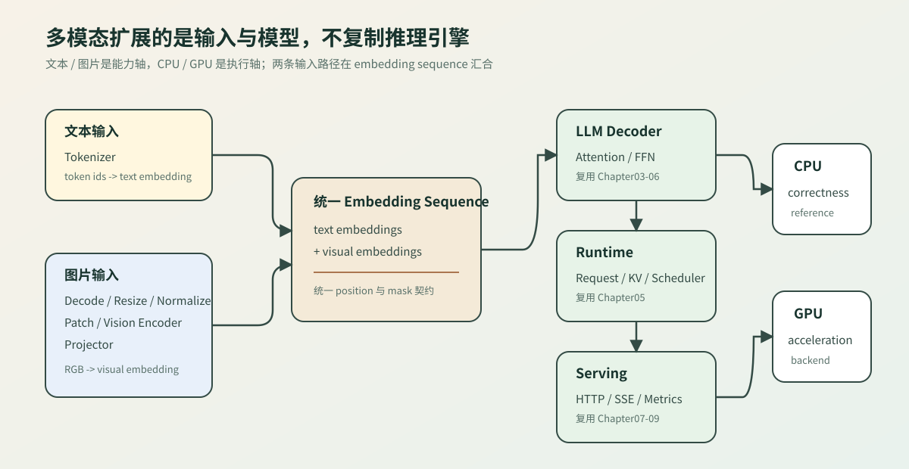

# 第三期多模态 CPU 建设计划

本文供教程维护使用。多模态不是一套平行推理引擎，而是给现有 LLM 引擎增加图片输入、视觉模型和 embedding 拼接；生成 Runtime、请求状态、benchmark、profiling 和 Serving 继续复用 Chapter05、07、08、09。

## 建设目标

首个模型固定为 SmolVLM 500M Instruct Q8_0，外部正确性基线使用 `llama.cpp` 的 `llama-mtmd-cli`。自研路径先在 CPU 上逐阶段核对数据布局和数值，再选择 Vision Encoder 热点接入已有 CUDA Backend。

| 复用资产 | 多模态新增内容 |
| --- | --- |
| Chapter01 GGUF index、metadata、量化 payload | mmproj metadata 和视觉权重 schema |
| Chapter02 Tensor、Storage、View | RGB、CHW、patch 和 visual embedding shape |
| Chapter03-04 Linear、Attention、Norm、FFN | SigLIP Vision Transformer 和 projector |
| Chapter05 Runtime 与模型执行接口 | 文本 token、图片占位符和 visual embedding 拼接 |
| Chapter06 Quantized Linear | Q8_0 视觉权重解码与执行策略 |
| Chapter07-09 correctness、profiling、Serving | 图片请求、图像 token 预算和视觉阶段指标 |

## 分阶段顺序

每一阶段先用小输入验证 shape、checksum 或 golden，再进入下一阶段。GPU 多模态从已通过的 CPU golden 出发，不同时改变模型语义和执行设备。

| 阶段 | 建设内容 | 可验证产物 | 当前状态 |
| --- | --- | --- | --- |
| MM-P0 | 固定模型、图片、prompt 和外部 CPU baseline | `Apollo 11.`；模型/mmproj/图片 hash；运行日志 | 已完成 |
| MM-P1 | RGB 解码、resize、normalize、单 tile patch | `3x512x512` CHW；`1024x768` patch tensor | 已完成 |
| MM-P2 | IDEFICS3 overview、动态网格和 tile 顺序 | 640x488 图片得到与基线一致的 grid/tile 数 | 已完成 |
| MM-P3 | mmproj metadata 与视觉 tensor schema | image/patch/hidden/block/projector 配置和 198 tensor 校验 | 已完成 |
| MM-P4A | F32 Patch/Position Embedding 与可注入单个 SigLIP Block | 合成逐项数值；真实首 patch `1x768` | 已完成 |
| MM-P4B | Q8_0 解码与真实首个 SigLIP Block | 中间 tensor shape、checksum 与外部 golden | 已完成 |
| MM-P5A | 12 层 Vision Encoder 与 post LayerNorm | 逐层 checksum、单层权重体积、外部 golden | 已完成 |
| MM-P5B | 4×4 spatial merge 与 IDEFICS3 Projector | visual embedding 数量、width 960 和数值对照 | 已完成 |
| MM-P6A | 图文 embedding 序列契约 | 占位展开、顺序、shape、来源与错误输入 | 已完成 |
| MM-P6B | 真实视觉与文本 embedding 接入 | 双模型 hash、width 960 和数值对照 | 已完成 |
| MM-P6C-1 | 统一 embedding 进入一层 SmolVLM Decoder | 独立 logits checksum 与 top-1 golden | 已完成 |
| MM-P6C-2A | 32 层 Decoder 最小图文序列 | 完整层数 logits 与 top-1 golden | 已完成 |
| MM-P6C-2B | 真实 chat template、tokenizer 与 overview-only chunk | `25x960` prompt logits/token golden | 已完成 |
| MM-P6C-3 | 单个完整 visual tile | 64 visual rows 的 logits/token golden | 已完成 |
| MM-P6D | 动态 tiles 与真实图片 prompt | `tiles + overview` 完整输入对照 | 已完成 |
| MM-P7A | 请求阶段指标与同步 Runtime 适配 | 七阶段耗时/内存；embedding prefill 进入 Chapter05 Runtime | 已完成 |
| MM-P7B-1 | 通用 embedding ServiceCore 与 SSE 接入 | 同步/SSE token 一致、失败终态、metrics 和 Context 释放 | 已完成 |
| MM-P7B-2 | 真实 SmolVLM 服务接入 | 图片管线产生每请求 Executor；真实同步/SSE golden | 已完成 |
| MM-P7C-1 | 生命周期与失败压力 | 32 次成功、8 次 prefill 失败、断开、超时和 Context 释放 | 已完成 |
| MM-P7C-2 | 真实重复 benchmark 与 profiling | 固定 workload 的多轮阶段报告和稳定性判定 | 已完成最小两轮闭环 |
| MM-GPU | 将视觉 Linear/Attention/Projector 接入 CUDA | CPU/GPU golden、显存、延迟和回收证据 | CPU 闭环后开始 |

## MM-P2 实现边界

自研预处理已对齐 token budget 到 pixel budget 的换算、512 倍数尺寸对齐、保持长宽比的居中黑色 padding、overview 优先和 tile row-major 顺序。640×488 基线得到 1536×1024 refined image、1343×1024 有效内容、水平 offset 96、3×2 grid 和 7 张视觉输入。

当前 resize 使用双线性算法，`llama.cpp` 的这条 IDEFICS3 分支使用 Pillow bicubic。MM-P2 验收只要求几何、padding 和顺序一致；逐像素对照应先增加 bicubic reference，再作为独立 correctness 项处理，不能把两个算法的 checksum 直接比较。

## MM-P3 实现结果

`code/multimodal` 直接复用 Chapter01 `GgufReader` 的格式读取能力，并新增视觉专用 `VisionModelConfig` 和 `VisionTensorLayout`。文本 Llama `ModelSchema` 保持原职责，不承担视觉模型命名判断。

严格 schema 校验 patch embedding、position embedding、12 个 SigLIP block、post norm 和 IDEFICS3 projector，共 `6 + 16 × 12 = 198` 个 tensor。默认 CTest 用合成 index 覆盖成功、metadata 错误、重复、缺失和 shape 错误；真实 SmolVLM mmproj 验收得到 `198/198` 和 `schema=valid`，不读取权重 payload。

## MM-P4A 实现结果

视觉数学接口已经覆盖 Patch/Position Embedding、LayerNorm、无 causal mask 的多头自注意力、tanh 近似 GELU、MLP 和两次 residual。默认测试使用小型确定性 Float32 权重，逐项检查中间结果，不依赖模型文件、Python、网络或 GPU。

真实 payload 路径按 offset 读取 `v.patch_embd.weight`、`v.patch_embd.bias` 和 `v.position_embd.weight` 三个 F32 tensor。固定图片的首个 patch 输出 `1x768` embedding、首值 `-0.0300182`、加权 checksum `-20679`。MM-P4B 在不改视觉数学接口的前提下接入 Q8_0 block 解码和独立参考 golden。

## MM-P4B 实现结果

Chapter01 loader 已增加 Q8_0 的 32 元素/34 字节 raw payload 契约，Chapter06 增加独立 CPU reference 解码；多模态 `vision_weights` 负责加载 F32 bias/norm、解码 Q8_0 matrix，并将 legacy raw `ffn_down` 装配为 MLP 输入投影、raw `ffn_up` 装配为输出投影。

默认 CTest 使用 hidden 32、intermediate 64 的合成 payload 验证 Q8_0 数值、Linear shape 和 FFN 映射。真实 mmproj 使用前 4 个无损 PPM patch 执行第 0 个 Block，C++ 最终 checksum 为 `5051.34963`、首值为 `0.02374182269`；独立 NumPy/gguf-py 参考分别为 `5051.34918` 和 `0.0237418152`。模型/input hash、全部中间值和容差保存在 `code/multimodal/results/siglip_block_q8_0_golden.json`。

## MM-P5A 实现结果

`run_siglip_encoder` 使用 provider 逐层取得权重，不构造 12 层常驻数组。每轮执行完只保留 `[patches, 768]` hidden states；当前 Block 权重和 trace 离开作用域，12 层结束后应用 `v.post_ln`。默认测试用两个合成 Block 对照手工串联结果，并覆盖 provider 中途失败。

真实 4-patch 路径执行 12 层，每层 decoded Float32 权重为 `28,351,488` bytes，进程最大 RSS 为 `46,600` KiB，post-norm checksum 为 `-1468.082907`、首值为 `0.1767231822`。独立 NumPy/gguf-py 结果为 `-1468.02584` 和 `0.176721156`；逐层结果、hash 与容差保存在 `siglip_encoder_q8_0_golden.json`。该内存结果只适用于 4-patch correctness，不外推完整 1024-token tile。

## MM-P5B 实现结果

`merge_spatial_patches` 按输出网格、`dy`、`dx`、`hidden` 的固定顺序重排视觉 hidden states，默认测试使用 `8x4` 非方形合成网格精确验证两个输出窗口。`run_idefics3_projector` 在重排后调用统一 Float32 Linear；加载器将真实 `mm.model.fc.weight` 的 Q8_0 payload 解码为 `960x12288` 权重。

真实 correctness 选择原始 `32x32` 网格左上角 `4x4` patch 并保留其 position id，完成 12 层 Encoder 后得到 `16x768 -> 1x12288 -> 1x960`。C++ 与独立 NumPy 的输出 checksum 分别为 `-12771.36878` 和 `-12771.3258`，首值分别为 `1.650054455` 和 `1.6500597`；hash、shape、空间位置和 47,185,920-byte 解码权重记录在 `idefics3_projector_q8_0_golden.json`。完整 1024-token tile 的性能优化留给 MM-P7 profiling，不阻塞 MM-P6 embedding 拼接。

## MM-P6A/B 实现结果

`compose_multimodal_embeddings` 将文本矩阵中的图片占位行替换为一行或多行 visual embedding，并为每个输出行保留文本位置或视觉输入/行号。默认测试覆盖两个乱序传入的视觉插入、无图片文本、width 不匹配、越界位置、重复位置和空输出，不依赖真实模型、Python 或 GPU。

真实路径读取 SmolVLM 文本 GGUF 的 metadata 与 Q8_0 `token_embd.weight`，确认语言模型是 `llama` 架构、hidden width 960。BOS `1`、真实 Projector `1x960`、EOS `49279` 组成 `3x960`；C++ 与独立 NumPy 的 sequence checksum 分别为 `-10984.81625` 和 `-10984.768`。语言模型、mmproj、输入 hash 和来源顺序保存在 `multimodal_input_q8_0_golden.json`。

共享 Core 新增 `[tokens, hidden]` 预计算 embedding contract，真实 CPU Context 将 token-prefill 和 embedding-prefill 汇合到同一个 hidden-state 前向。Chapter06 的 Q8_0 已从 block 解码扩展到 reference、scalar fused backend 和统一 policy；真实 SmolVLM 一层路径覆盖 token embedding、Attention、FFN 和 LM Head。

真实图文 `3x960` 输入经过一层 Decoder 得到 49,280 logits。C++/NumPy checksum 为 `-4338022.483/-4338021.33`，top-1 都是 token `269`，top-1 logit 为 `5.944906712/5.94491386`。

同一最小序列经过完整 32 层后，C++/NumPy logits checksum 为 `-7387918.387/-7387886.72`，top-1 都是 token `2`，top-1 logit 为 `11.18585682/11.1858902`。C++ Release 本次运行约 `1.30s`、最大 RSS `490260 KiB`；NumPy 镜像约 `5.99s`、最大 RSS `1105556 KiB`。这些数值只验证完整 Decoder 数值链，真实 chat template、tokenizer 和图片 chunk 留给 MM-P6C-2B。

MM-P6C-2B 复用 Chapter01 `RealTokenizer`，从 GGUF chat template 固定单轮问题。overview-only 输入包含 6 个前缀 token、一个 visual row 和 18 个后缀 token，共 `25x960`；完整 32 层的 C++/NumPy logits checksum 为 `-11088550.97/-11088536`，top-1 都是 token `378`，top-1 logit 为 `14.56045628/14.560441`。该结果证明真实模板、BPE、特殊 token、visual 替换和 Decoder 已接通，但不等于完整图片基线。

MM-P6C-3 增加显式可选的 CBLAS 执行策略，覆盖 Patch Linear、Q/K/V、Attention score/value、MLP 与 Projector；默认 API 和默认回归继续使用无外部依赖的标量 reference。完整单 tile 执行 `1024x768 -> 64x960 -> 88x960`，C++/NumPy logits checksum 为 `-12766193.7/-12766194.2`，top-1 都是 token `216`，top-1 logit 为 `13.17723656/13.177247`。Debian Netlib BLAS 下 C++ wall time 为 `55.35s`、最大 RSS 为 `521980 KiB`，仅作为当前机器的 correctness 性能观察，不代表优化后吞吐。

MM-P6D 复用单 tile 路径，按 row-major tiles、overview 的顺序执行 7 次视觉前向，并按真实 chunk 的 7 个占位位置展开 448 个 visual rows。C++ 与 NumPy 都得到 `2x3` grid、`486x960` Decoder 输入和 top-1 token `17600`；C++ OpenBLAS 运行约 `96.43s`、最大 RSS `553460 KiB`，NumPy reference 约 `208.03s`、最大 RSS `1137320 KiB`。

动态输入使用真实 JPEG。系统 libjpeg 与 Pillow 的解码差异经过 resize 和视觉模型后会放大，所以 `smolvlm_dynamic_tiles_q8_0_golden.json` 分别记录两套数值，跨实现只要求结构、prompt/token 顺序和 top-1 一致。无损 PPM 的单 tile golden 继续负责更严格的逐值对照。下一阶段 MM-P7 不再扩展视觉数学，转向请求生命周期、分阶段耗时、内存回收、同步/SSE 接口和多模态 benchmark。

## MM-P7A 实现结果

`MultimodalStageRecorder` 固定 Image Decode、Dynamic Tiling、Prompt Tokenization、Vision Encoder、Projector、Embedding Composition 和 Language Prefill 七个阶段。同一时刻只允许一个活动阶段；多个视觉输入的 Encoder/Projector 时间与调用次数累加。`peak_live_bytes` 是请求中间数据估算，不包含模型权重、allocator bookkeeping 或进程 RSS。

Engine 新增 `EmbeddingRequestExecutor`，把 Core `DecoderEmbeddingSequence` 和每请求 `DecoderExecutionContext` 适配为 Chapter05 `RequestModelExecutor`。合成 Runtime 测试验证 3 个 embedding position 经过一次 prefill、一次 decode 后生成 `[2,4]` 并以 EOS 结束；prefill 成功后 embedding storage 归零，position 数与 hidden width 不匹配均被拒绝。

真实单 tile 检查已输出七阶段指标：Vision Encoder 约 `2.31s`，Projector 约 `0.010s`，Language Prefill 约 `14.79s`，请求中间数据峰值 `15,728,640` bytes。该单次数据只用于确认计量闭环，并显示当前完整 Decoder 比视觉输入阶段更慢；可比较的重复基线留给 MM-P7C。

## MM-P7B-1 实现结果

Engine 默认集成构建现在链接 Chapter09 核心库，但 Chapter09 的单章 demo/test 只在其顶层构建中注册，避免 Engine 重复执行同一批单元测试。新增 `embedding_request_service_test` 通过 `HttpAdapter` 的 Executor Factory 为每个请求创建独立 embedding、Context 和 `EmbeddingRequestExecutor`。

同步 completion 与 `ResponseWriter` SSE 都生成 `[2,4]` 并以 EOS `4` 结束；服务累计 accepted/completed/released=`2`、generated tokens=`4`。合成 prefill 失败返回 HTTP 500，failed/released=`1`。三个 Context 都通过 `weak_ptr` 确认在 terminal release 后销毁。该结果证明 Chapter05/09 可以原样复用，但真实图片 body、视觉管线构建和 SmolVLM token golden 仍属于 MM-P7B-2。

## MM-P7B-2 实现结果

真实服务模式复用 MM-P6D 的 640×488 JPEG、`2x3` tiles + overview、448 visual rows 和 `486x960` 统一 embedding。输入管线只执行一次；同步 completion 与 `ResponseWriter` SSE 各创建独立 32 层 Decoder Context，并通过同一个 `EmbeddingRequestExecutor -> HttpAdapter -> ServiceCore -> Runtime` 路径生成一个 token。

两条请求都返回动态图片 golden token `17600`，ServiceCore 指标为 accepted/completed/released=`2`、generated tokens=`2`、inflight=`0`。本次 OpenBLAS 观察中，7 次 Vision Encoder 累计约 `16.62s`，两次语言 prefill 累计约 `169.36s`；数值只描述当前机器和 workload，MM-P7C 再负责重复测量与可比较报告。

### MM-P7C 生命周期压力与性能拆分

生命周期压力使用合成 embedding 保持测试快速、确定且不依赖模型。连续 32 个成功请求交替走同步与 `ResponseWriter` SSE，固定生成 `[2,4]`；随后执行 8 个 prefill 失败请求，并分别触发断开 `499` 与超时 `408`。每个请求都通过 `weak_ptr` 检查 Context 析构，并检查终态后 inflight 为 0。真实图片多轮 benchmark 保留为 MM-P7C-2，必须固定模型 hash、图片 hash、BLAS、线程数、warmup、迭代数和正确性字段后再记录波动与阶段耗时。

MM-P7C-2 使用多进程采集器固定模型、mmproj、JPEG、32 层、`2x3 + overview`、448 visual rows、`486x960` 和同步/SSE 各一个 token。每轮先检查 token `17600`、服务计数和 terminal release，再进入统计。AMD Ryzen 9 9955HX、Release、OpenBLAS library-default 线程设置的两轮结果为 wall mean `177.15s`，阶段总计 mean `176.98s`、CV `0.0177%`，Vision Encoder mean `16.35s`，Language Prefill mean `160.49s`。这是最小重复闭环；发布稳定性能范围前仍应固定线程数并增加样本。

服务模式不新增图片 HTTP 协议。图片和 prompt 先由多模态输入层转换为请求 Executor，Chapter09 继续只管理 admission、Runtime、SSE、metrics 和释放；multipart/base64、上传限制和图片缓存属于后续 transport/API 设计。

## 模型配置证据

当前 mmproj 为 `mmproj-SmolVLM-500M-Instruct-Q8_0.gguf`，GGUF metadata 已核对 `image_size=512`、`patch_size=16`、vision hidden `768`、vision block `12`、projector output `960`、projector type `idefics3`、mean/std 均为 `0.5`。模型和 mmproj 不提交仓库，默认回归不依赖下载。

外部 baseline 的固定输入是 `llama.cpp/tools/mtmd/test-1.jpeg`，prompt 为 `What historic event is shown? Answer in one short sentence.`，CPU 8 线程、temperature 0、seed 42、固定 256 image-token budget。运行入口为：

```bash
bash scripts/run_smolvlm_cpu_baseline.sh
```

## CPU、GPU 与多模态关系

CPU 和 GPU 是执行 backend 选择，文本和多模态是模型输入能力。图片经过视觉编码和 projector 后形成 visual embedding，与文本 embedding 组成统一序列，再进入已有 Decoder、Generation Runtime 和 ServiceCore；因此多模态建设不复制第二套 Scheduler、KV Cache 或 HTTP 服务。


