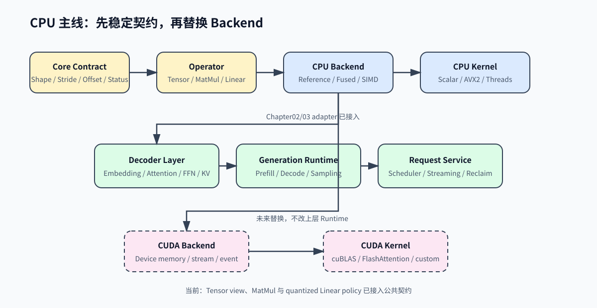

# CPU 主线与 GPU 扩展边界

CPU 后端架构参考页固定教程后续实现顺序：先完成 CPU reference 和 CPU optimized path，再在稳定契约上接入 CUDA。CPU 是负责正确性、调试和回归证据的完整 backend。



## 分层职责

| 层 | 当前职责 | CPU 阶段 | GPU 阶段 | 不负责 |
| --- | --- | --- | --- | --- |
| Core Contract | Shape、Status、ownership 与 Decoder 结构/执行语义 | 固定跨章接口 | 保持上层语义 | 不实现 kernel |
| Operator | Matmul、Linear、Attention 的输入输出契约 | 调用 CPU backend | 调用 CUDA backend | 不管理请求 |
| Backend | 选择具体执行路径 | reference、fused、SIMD、线程 | device memory、stream、CUDA kernel | 不定义模型结构 |
| Kernel | 完成局部数值计算 | scalar、AVX2、线程并行 | cuBLAS、FlashAttention、自定义 kernel | 不处理 tokenizer |
| Decoder | 组合 embedding、Attention、FFN、KV Cache | CPU 可运行 | 复用上层组合 | 不决定设备实现 |
| Runtime | Prefill、Decode、Sampling、Request | CPU First Success | 复用 Request/Runtime | 不直接解析 GGUF |

## CPU 实现顺序

| 阶段 | 对应章节 | 产物 | 验证门槛 |
| --- | --- | --- | --- |
| 输入和对象 | Chapter 01-02 | GGUF schema、Tensor view、共享 storage | 真实 TinyLlama index、view 边界测试 |
| 计算契约 | Chapter 03 | Operator、CPU Backend、Matmul、Linear | reference 输出和 shape 异常 |
| 量化路径 | Chapter 06 | Q4_K decode、fused Linear、SIMD 预留 | llama.cpp 交叉验证、真实多 tensor benchmark |
| 模型执行 | Chapter 04 | DecoderLayer、Attention、RoPE、KV Cache | 单层 golden tensor |
| 生成闭环 | Chapter 05 | Prefill、Decode、Sampling、Request | CPU First Success、取消和资源回收 |
| 证据闭环 | Chapter 07-08 | benchmark、profiling、回归基线 | 多轮统计和热点解释 |

## 代码接入规则

当前 `code/core` 只提供契约，不强行替换已有章节的 Tensor。后续每章按以下顺序迁移：

```text
先写 core contract test
  -> 再让章节实现适配 contract
  -> 再保留章节原有 correctness test
  -> 最后增加跨章 integration test
```

这样可以避免为了统一接口一次性重写 Chapter 01、Chapter 03、Chapter 06，并且让 GPU 后端只替换 Backend/Kernel 层。

## 当前实现进度

| 对象 | 公共契约 | 章节适配 | 状态 |
| --- | --- | --- | --- |
| Tensor view | shape、stride、storage offset、dtype、device、storage bytes | Chapter02 `Tensor::contract()` | 已接入并验证 offset slice |
| View 操作 | `Status` | Chapter02 `try_reshape()` / `try_slice()` | 已接入；便捷 API 保持兼容 |
| MatMul | `MatmulRequest`、`MatmulBackend`、`Status` | Chapter03 `Matrix::contract()` / `MatMulOp::try_compute()` | 已接入 CPU reference |
| Quantized Linear | `LinearRequest`、`LinearBackend`、`QuantizedLinearPolicy` | Chapter06 Q4_K/Q6_K scalar、AVX2 与统一 dispatcher | 已接入并验证缺失能力错误 |
| Decoder 结构 | `DecoderLayerContract` | Chapter04 教学层、Chapter01 真实 Model | 已接入；教学结构与 TinyLlama 结构分别校验 |
| Decoder 执行 | `DecoderExecutionContext` | Chapter01 `RealLlamaCpuContext`、Engine adapter | 已接入；prefill/decode、双 Context 与真实服务通过 |
| 量化执行策略 | Attention、FFN、LM Head policy 作用域 | Chapter01 Context + Chapter06 dispatcher | 组合 AVX2 A/B 通过；服务默认仍为 scalar |

## 当前验证入口

```bash
cmake -S code/core -B /tmp/cpp-llm-engine-core-build
cmake --build /tmp/cpp-llm-engine-core-build
ctest --test-dir /tmp/cpp-llm-engine-core-build --output-on-failure

bash scripts/run_regression_baseline.sh
```
