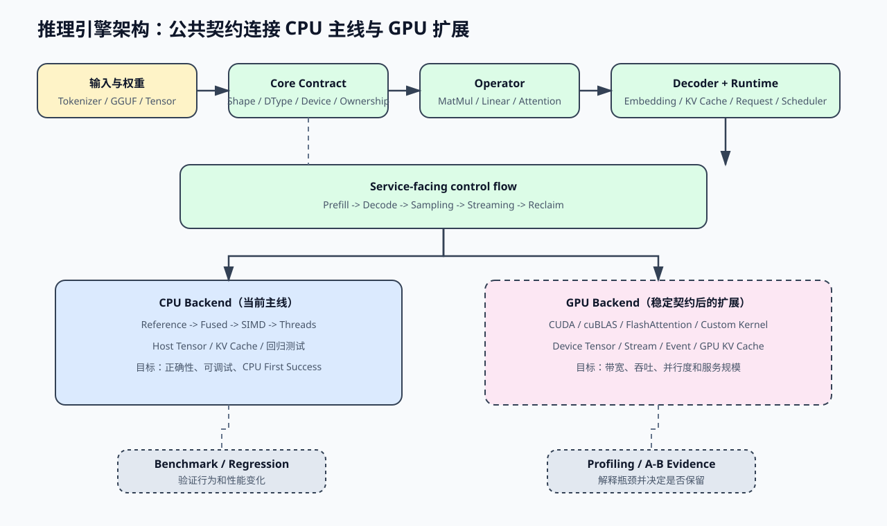

# CPU 主线与 GPU 扩展架构

教程先用 CPU 固定正确性和接口，再在同一套公共契约上接入 GPU。GPU 不是另一条 Runtime，而是替换 Backend、Kernel 和内存执行路径。

## 读图顺序

| 顺序 | 观察对象 | 学习问题 |
| --- | --- | --- |
| 1 | 输入与权重 | tokenizer、GGUF 和 Tensor 怎样进入引擎 |
| 2 | Core Contract | shape、dtype、device 和 ownership 怎样跨后端保持一致 |
| 3 | Operator / Decoder / Runtime | 算子、模型结构和请求推进怎样分工 |
| 4 | CPU / GPU Backend | 同一算子怎样选择不同计算实现 |
| 5 | Benchmark / Profiling | 怎样证明行为正确、性能变化真实且原因可解释 |

## 两条后端路径

当前 GPU 公共层已经包含资源 RAII、<a href="../_code/cuda/include/cpp_llm_engine/cuda/cuda_tensor.h"><code>CudaTensor</code></a>、可复用 Workspace、ExecutionContext、Vector Add、cuBLAS MatMul、Q4_K/Q6_K dequantize + SGEMM、RoPE、连续 device KV Cache 和 causal GQA Attention。ExecutionContext 接管 stream、handle 和临时显存，上层算子不直接调用 `cudaMalloc/cudaFree`。

| 层 | CPU 主线 | GPU 扩展 |
| --- | --- | --- |
| Backend | reference、fused、SIMD、线程并行 | CUDA、cuBLAS、量化 Linear、RoPE、三阶段 GQA；fused quant/Attention 待优化 |
| Memory / Execution | host Tensor、连续 KV Cache、workspace | `CudaTensor`、`CudaQuantizedMatrix`、`CudaWorkspace`、`CudaExecutionContext`、连续 `CudaKvCache` |
| 主要目标 | 正确性、调试、回归和 CPU First Success | 带宽、吞吐、并行度和服务规模 |
| 不改变的部分 | `Operator`、`Decoder`、`Request`、`Scheduler` 的上层语义 | 同左，除非设备异步语义要求显式状态 |

## 实现顺序

1. 先用 CPU reference 固定输入输出和错误行为。
2. 用 CPU fused / SIMD 优化，但保留 reference 作为数值基线。
3. 用 benchmark 固定 workload、正确性和阶段指标。
4. 再接 CUDA / cuBLAS，验证 GPU 结果与 CPU reference 一致。
5. 最后用 profiling 解释 kernel、带宽、同步和调度成本。

这条顺序避免同时改变算子契约、数据布局和设备执行模型。
