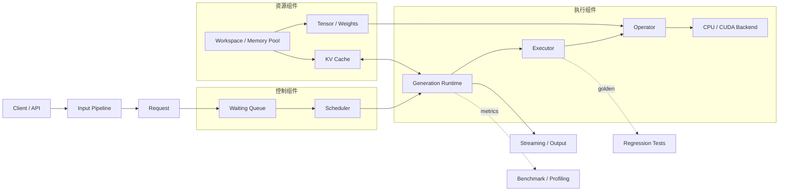

# 推理引擎系统组件图

一次推理请求会依次经过输入处理、调度、模型执行、状态更新和输出。下面的组件图把章节中分别实现的对象放回同一条请求路径，便于定位代码和排查问题。

## 1. 请求经过哪些阶段

| 阶段 | 主要对象 | 输入与输出 | 对应章节 |
| --- | --- | --- | --- |
| 输入处理 | Tokenizer、Prompt Template、ModelConfig | 文本和模型文件 → token、配置与权重 | Chapter00-01 |
| 数据与计算 | Tensor、Operator、Backend、Decoder | token 与权重 → hidden state、logits | Chapter02-04、06 |
| 生成运行时 | Request、Scheduler、KV Cache、Sampler | prompt token → 逐 token 输出 | Chapter05 |
| 验证与归因 | Golden、Benchmark、ProfileRecord | 执行结果 → 正确性和性能证据 | Chapter07-08 |
| 服务接入 | ServiceCore、HTTP Adapter、ResponseWriter | 外部请求 → 同步响应或 SSE | Chapter09 |

## 2. 五组系统组件

### 输入组件

输入组件把文本、图片和模型文件转换成执行路径能够消费的对象：

- tokenizer 和 prompt template 生成 token 序列
- GGUF reader、metadata adapter 和 model builder 生成模型对象
- 多模态 preprocessor、Vision Encoder 和 Projector 生成视觉 embedding

输入契约的详细字段见[推理引擎输入链路](./input_pipeline.md)。

### 控制组件

`Request` 保存输入、生成历史和终态，`Scheduler` 决定每个 step 推进哪些请求。服务入口负责 admission、取消和超时，终态路径负责通知输出并释放请求资源。

控制组件需要回答：

- 请求何时进入 waiting、running 和 terminal 状态
- prefill 与 decode 如何进入同一个调度循环
- 多请求如何共享执行资源并保持 Context 隔离
- 取消、超时和失败如何结束输出并归还资源

更完整的状态和调度说明见[推理引擎运行时](./runtime_systems.md)。

### 执行组件

`Runtime` 组织生成步骤，`Executor` 把一次执行交给模型，`Operator` 固定计算语义，`Backend` 选择 CPU、CUDA 或外部库实现。

```text
Runtime -> Executor -> Operator -> Backend -> Kernel
```

这条路径让 CPU reference 和 CUDA backend 使用相同输入输出契约。数值错误可以沿 shape、Operator、Backend、kernel 的顺序定位。

### 资源组件

权重与模型同生命周期，workspace 与执行上下文同生命周期，KV Cache 与请求同生命周期。资源组件统一管理：

- Tensor storage 与 view
- 模型权重和量化 payload
- CPU/CUDA workspace
- 请求级 KV Cache
- host/device staging buffer

所有权、复用和释放顺序见[推理引擎内存管理](./memory_management.md)。

### 证据与观测组件

正确性测试确认输出是否可信，benchmark 测量固定 workload，profiling 解释时间消耗，metrics 观察持续服务状态。

| 证据 | 回答的问题 | 典型产物 |
| --- | --- | --- |
| 单元测试 | 局部 shape、数值和状态是否正确 | CTest 结果 |
| Golden | 真实模型路径是否与独立 reference 一致 | token、logits、checksum |
| Benchmark | 固定条件下延迟和吞吐是多少 | JSON result |
| Profiling | 时间和内存主要消耗在哪里 | phase、trace、hotspot |
| Service metrics | 请求是否完成并释放资源 | accepted、completed、failed、inflight |

## 3. 系统结构



## 4. 从问题定位入口

| 观察到的问题 | 先检查 | 阅读入口 |
| --- | --- | --- |
| token 或模型配置错误 | tokenizer、metadata、tensor schema | Chapter01、[输入链路](./input_pipeline.md) |
| shape 或数值错误 | Tensor view、Operator、CPU reference | Chapter02-04 |
| 长上下文结果异常 | position、KV append、请求 Context | Chapter05、[内存管理](./memory_management.md) |
| 多请求卡住或资源未释放 | Request 终态、Scheduler、ServiceCore | Chapter05、Chapter09 |
| 量化输出偏差 | block layout、scale、Linear backend | Chapter06 |
| 性能下降 | workload、阶段计时、hotspot | Chapter07-08、[Profiling](./profiling.md) |
| HTTP/SSE 行为异常 | adapter、ResponseWriter、terminal callback | Chapter09、[服务化基础](./service_basics.md) |
