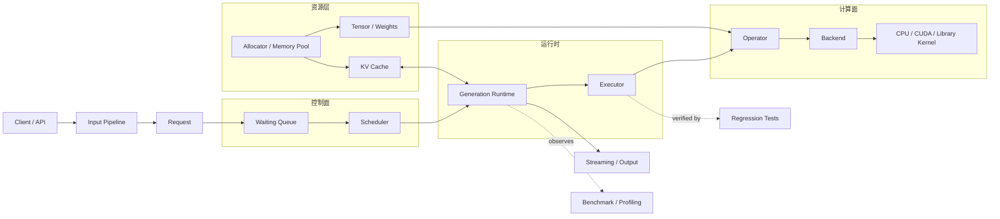

# 推理引擎系统补强图

这一页不是主线正文，而是把“当前教程已经覆盖到哪里、还缺哪些推理引擎系统能力”集中写清楚。  
主线已经把 `Tensor`、算子、decoder、生成 runtime、量化和 benchmark 立住了，但如果目标是完整的推理引擎教程，还需要把运行时、内存、profiling、输入链路和服务化这些系统层补齐。

## 1. 这一页要解决什么

这一页只回答一个问题：主线现有章节之外，还缺哪几块系统能力，应该按什么顺序补。

把这个问题说清楚有两个作用：

- 读者不会把“教程已经写完主线”误解成“推理引擎系统已经完整”
- 后续补章或补节时，可以沿着同一条系统分层继续推进，而不是到处散着补

## 2. 运行时系统层

最像“推理引擎”和“普通 forward 代码”的分界线，不在算子本身，而在请求是怎么被持续推进的。

最小生成 runtime 解决的是“能逐 token 输出”，但真实引擎还需要这些能力：

- 请求生命周期管理
- 并发请求管理
- continuous batching
- backpressure
- 请求取消
- 超时处理
- 流式输出
- 优先级队列

这些能力决定的是系统行为，不是单个算子行为。  
如果它们不显式化，教程就很容易停留在“单请求能跑”的层面，而不是“多请求能持续服务”的层面。

### 建议的理解顺序

1. 先看请求如何进入系统
2. 再看请求如何进入 `prefill` 和 `decode`
3. 再看调度器如何决定推进谁
4. 再看并发请求如何共享同一套 runtime 资源
5. 最后再看取消、超时和流式输出如何接入

## 3. 内存管理体系

引擎里最容易被低估的部分，往往不是模型结构，而是内存。

现有主线已经讲了 `Tensor`、view 语义和 `KV Cache`，但一个更完整的引擎还要回答这些问题：

- allocator 怎么设计
- memory pool 怎么复用
- workspace 怎么分配
- 碎片怎么控制
- host / device staging 怎么做
- stream 同步和对象生命周期怎么对齐

如果没有这一层，系统会出现两个典型问题：

- 功能能跑，但内存不断抖动，性能和稳定性都不稳
- 代码里每个模块都各自申请和释放，最后没人知道资源边界在哪里

### 和现有主线的关系

- `chapter02` 已经说明了 view 和共享存储
- `chapter05` 已经引入 `KV Cache`
- 但“共享什么、复用什么、什么时候释放、怎么避免碎片”还没有系统讲完

这部分更像是推理引擎的基础设施层，不是单章算子层。

## 4. 请求输入链路

推理引擎不只接收权重，也接收用户请求。  
这一层已经单独展开成 [推理引擎输入链路](./input_pipeline.md)。

这里先保留最重要的判断：如果只讲模型权重如何进入程序，还不算完整输入链路。  
tokenizer、prompt template、special tokens、stop criteria、max length、pad / truncation 都会影响后面的 runtime 行为。

## 5. Profiling

`chapter07` 已经把 benchmark 和正确性测试分开了，但 benchmark 只能回答“快不快”，不能回答“为什么快或慢”。

profiling 要补的是解释层，重点看这些东西：

- 热点落在哪个阶段
- 是 kernel 慢，还是内存慢
- 是调度开销高，还是数据搬运高
- 是单次执行慢，还是请求并发时被放大

### benchmark 和 profiling 的区别

| 问题 | benchmark | profiling |
| --- | --- | --- |
| 结论 | 快多少 | 为什么快 / 慢 |
| 关注点 | 稳定对照 | 热点和瓶颈 |
| 输入要求 | 固定条件可复查 | 固定条件下定位原因 |
| 输出形态 | 数字和对照表 | 热点、耗时分布、调用路径 |

这两者必须分开。  
benchmark 用来做决策，profiling 用来解释决策。

## 6. 服务化基础

如果目标是“推理引擎”，那系统最后总会走向服务化。  
这一层已经单独展开成 [推理引擎服务化基础](./service_basics.md)。

最基础的服务化能力包括限流、SLA、请求取消、健康检查、日志和指标。  
这些能力决定了系统是不是“只给单个本地进程用”，还是“可以作为一个持续服务运行”。

## 7. 当前主线和补强点

| 现有章节 | 已经覆盖的内容 | 还缺的系统面 |
| --- | --- | --- |
| `chapter01` | 权重加载、`Tensor`、`ModelLoader` | 请求输入链路、tokenizer 约定 |
| `chapter02` | view、共享存储 | 内存复用、workspace、碎片控制 |
| `chapter03` | 算子边界、后端切换 | 更显式的 backend / executor / runtime 边界，见 [算子、Backend、Executor 与 Runtime](./execution_layers.md) |
| `chapter05` | 最小 generation runtime | 并发请求、continuous batching、backpressure、服务化 |
| `chapter07` | 正确性和 benchmark 收口 | profiling 和可复查的瓶颈解释 |
| `chapter08` | profiling、A/B 对比、优化闭环 | 更完整的内存、调度和服务化优化体系 |

这张表的目的不是推翻主线，而是标出下一步应该补的系统层。

## 8. 后续补强顺序

架构总图已经补齐，后续按系统缺口推进：

1. 运行时系统层
2. 内存管理体系
3. profiling 的工具化和真实数据接入
4. 请求输入链路
5. 服务化基础

这个顺序不是随意排的。  
系统总图已经固定，后续重点是把请求怎么流转、资源怎么分配、为什么慢，以及输入和服务规则补完整。

## 9. 最小推理引擎架构图



这张图把系统分成四条边界：

- **控制面**：`Request`、队列和 `Scheduler` 决定哪些请求在当前 step 推进
- **运行时**：`Runtime` 保存生成状态，`Executor` 负责组织一次具体执行
- **计算面**：`Operator` 定义计算语义，`Backend` 选择实现，kernel 或库完成实际计算
- **资源层**：`Tensor`、权重、`KV Cache` 和内存管理共同决定数据在哪里、如何复用和何时释放

主执行链是：

```text
Request -> Scheduler -> Runtime -> Executor -> Operator -> Backend -> Kernel
```

这不是严格的调用栈。`Runtime` 会同时读写 `KV Cache`，`Executor` 会消费 `Tensor` 和权重，`Benchmark / Profiling` 与回归测试则从旁观察和验证这条链路。

## 10. 这页和主线怎么接

- `chapter05` 负责把 decoder 变成最小 runtime
- `chapter07` 负责把正确性和性能收口成证据链
- `chapter08` 负责解释性能证据并形成优化闭环
- 这一页负责把“最小 runtime”往“完整引擎系统”方向补齐

如果要继续补中文主线，这一页可以作为系统层的总索引，后面新增内容也尽量沿着这些小节继续展开。
