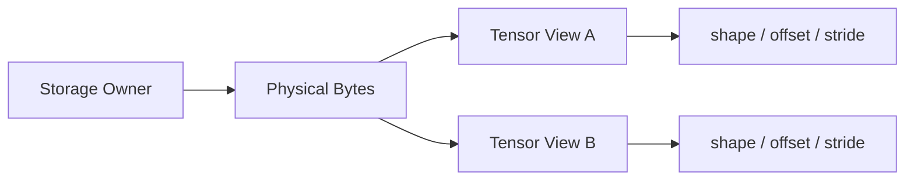
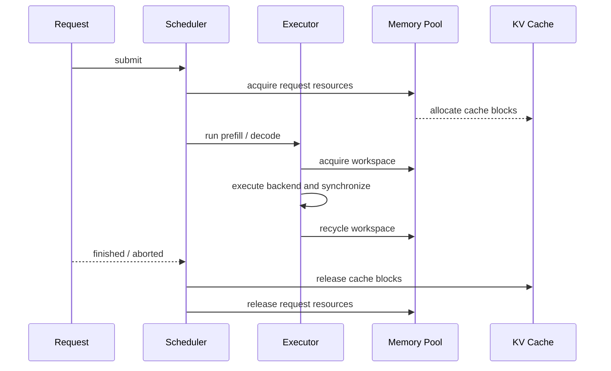

# 推理引擎内存管理

内存管理参考页把 `Tensor`、view、KV Cache 和执行临时空间放到同一个资源生命周期里，明确谁拥有内存、谁只观察内存、谁负责复用、谁负责释放。

## 1. 资源生命周期解决什么

推理引擎的内存问题通常不是“有没有分配成功”，而是以下边界是否清楚：

- 权重应该长期持有，还是可以按请求释放
- view 是否拥有底层 storage
- workspace 是否能跨 step 复用
- KV Cache 何时增长、回收和归还
- host/device staging buffer 由哪一层同步和释放

如果这些边界没有统一，系统可能功能正确，但出现重复拷贝、内存抖动、碎片增长或请求结束后资源仍被占用。

## 2. 四类内存对象

| 对象 | 生命周期 | 典型所有者 | 主要风险 |
| --- | --- | --- | --- |
| 权重 storage | 模型生命周期 | `ModelLoader` / `Tensor` | 重复加载、错误迁移 |
| Tensor view | 计算或调用链生命周期 | shared storage handle | 悬空引用、误释放 |
| workspace | 单次执行或 step | `Executor` / backend | 反复分配、大小不匹配 |
| KV Cache | 请求生命周期 | `Request` / cache manager | 泄漏、碎片、请求间污染 |

host/device staging buffer 是跨设备搬运的临时对象，生命周期应覆盖异步拷贝和使用它的 kernel，不能只覆盖发起拷贝的函数调用。

## 3. 所有权和观察权

主线中的 `Tensor` view 语义可以先用下面的关系表示：



view 保存的是 shape、offset、stride 和 storage handle，不应该单独释放底层字节。只有最后一个 owner 消失时，storage 才能释放。

这条规则直接连接两个主线章节：

- `chapter01` 定义权重和 Tensor 的 storage 入口
- `chapter02` 定义 view、reshape、slice 和共享存储
- `chapter05` 将相同的生命周期思想扩展到 Request token history、模型 Context 和 block ownership

## 4. 请求级历史状态

生成历史不能放在全局临时数组中。需要分别管理 Request token history、每层 K/V 数值和逻辑 token 的物理位置：

```text
Request -> token history
        -> Model Context -> Layer 0..N K/V
        -> BlockTable -> physical block IDs
```

最小实现可以按请求分配连续 cache。随着 continuous batching 和 block KV cache 引入，cache manager 需要进一步负责：

- block 分配和归还
- 逻辑 token 到物理 block 的映射
- 请求结束后的回收
- 不同请求之间的隔离
- 长上下文下的容量上限

教程中的 `Request` 直接持有 token history；真实 K/V 由请求级 Model Context 持有；`BlockTable` 只负责逻辑位置和物理 block ownership。生产 cache engine 可以进一步把 BlockTable 绑定到真实 device K/V allocation。

## 5. workspace 和 staging

workspace 与权重、KV Cache 不同，它通常只服务于一次算子执行或一个 runtime step：

```text
Executor.begin_step()
  -> acquire workspace
  -> launch backend / kernel
  -> synchronize when required
  -> release or recycle workspace
```

优化顺序应保持克制：

1. 先确认 workspace 的大小和使用范围
2. 再确认 kernel 或异步拷贝结束前不会释放
3. 再考虑 pool 复用，减少频繁申请和释放
4. 最后才讨论跨请求共享和碎片整理

host/device staging 需要额外记录：

- 数据当前位于 host 还是 device
- 拷贝是否同步完成
- 哪个 stream 使用这块数据
- 释放前需要等待哪个事件

## 6. 一条资源生命周期



结束路径必须覆盖正常完成、取消、超时和异常失败。只在正常完成路径释放资源，会让 serving 场景中的泄漏很难复现。

## 7. 验证清单

按下面四层验证，不要一开始只看 RSS：

1. **所有权**：复制 view 不复制 storage；owner 销毁顺序不会产生悬空访问。
2. **容量**：shape、cache length、block 数和 workspace 大小与输入一致。
3. **同步**：异步拷贝或 kernel 完成前，相关 buffer 不被复用或释放。
4. **回收**：请求完成、取消和异常路径都能归还 cache 和 workspace。

对应验证入口：

- `chapter02`：共享 storage、reshape、slice 测试
- `chapter05`：KV Cache、Request、scheduler 和 streaming 测试
- `chapter07`：benchmark 中的内存分配、释放和阶段计时
- `chapter08`：内存热点、带宽和 A/B 归因
- Foundation：`FQ01`、`FQ03`、`FQ05`、`FQ08`

## 8. 和主线的关系

这页不替代具体实现页，而是提供资源层总览：

- `chapter01` 先建立权重 storage
- `chapter02` 再建立 view 和共享存储
- `chapter05` 把生命周期扩展到请求和 KV Cache
- `chapter07` 验证分配与释放是否影响结果和性能
- `chapter08` 解释内存和带宽是否成为瓶颈

如果后续实现 allocator、memory pool 或 block manager，接口设计应先回到内存管理参考页检查所有权、复用和释放规则。
