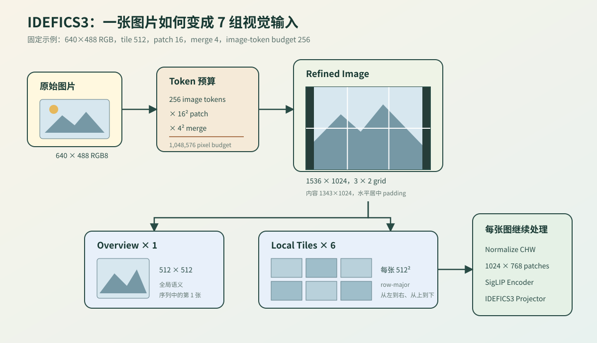
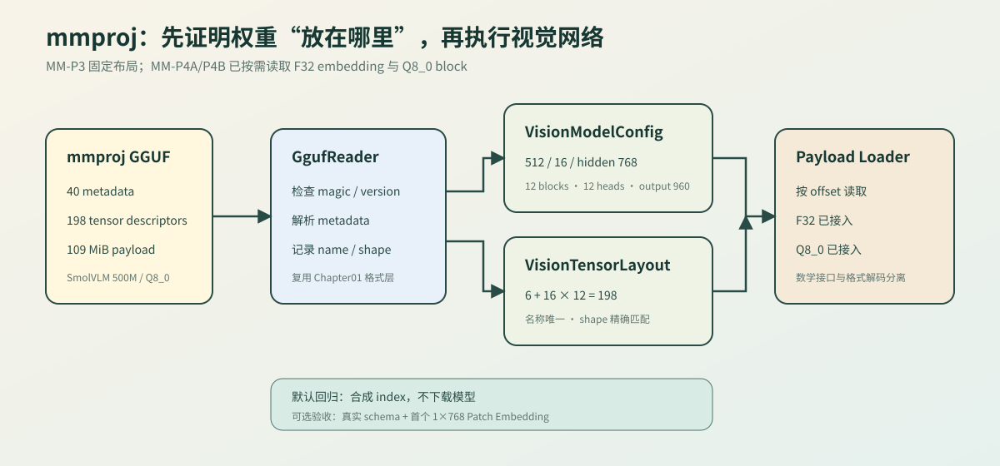
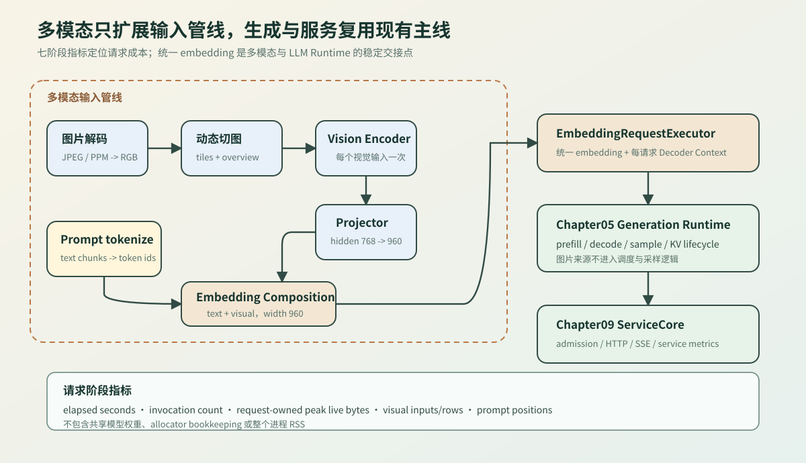
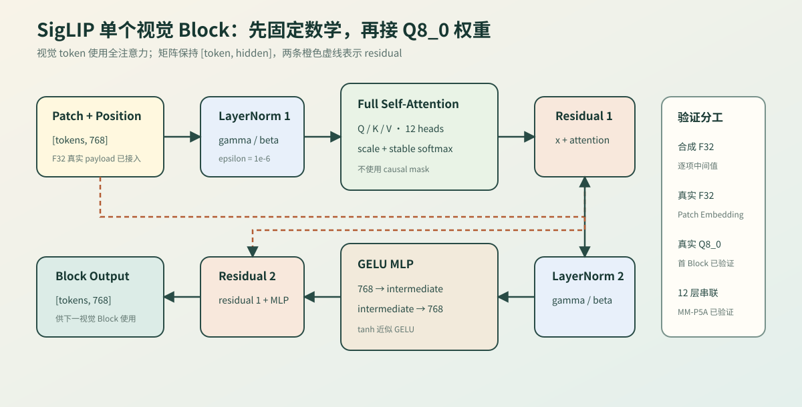
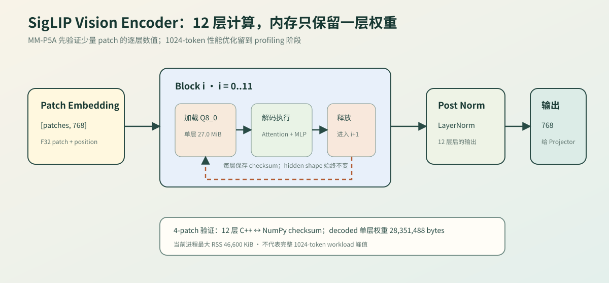
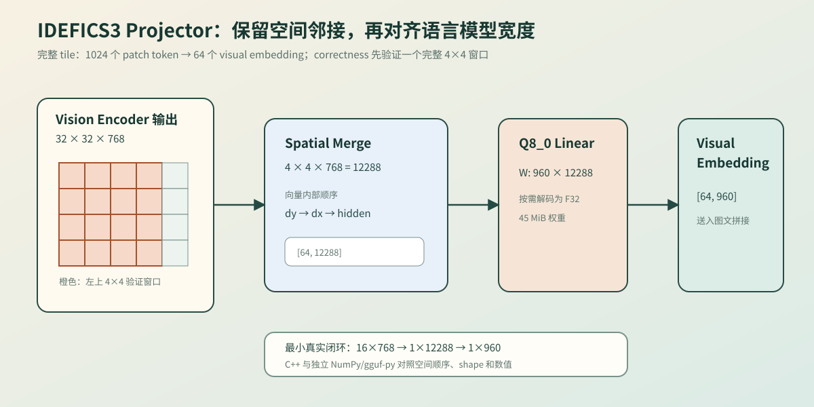
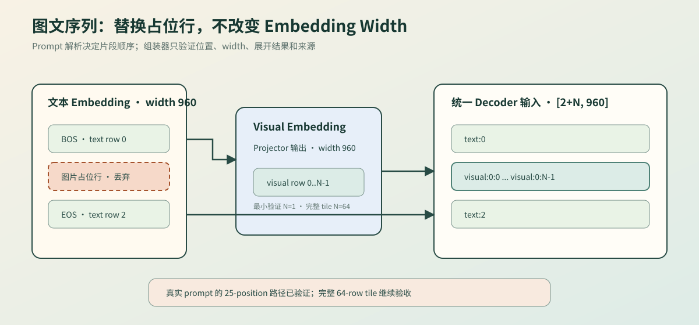
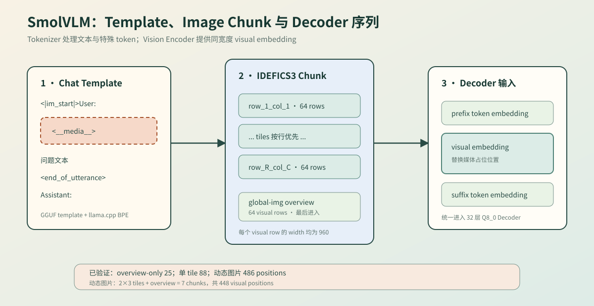

# 多模态推理输入链路

多模态推理在文本输入旁增加图片路径。图片经过解码、动态切图、Vision Encoder 和 Projector 后形成 visual embedding，再与文本 embedding 组成统一序列；后续继续使用已有 LLM Decoder、Generation Runtime 和 Serving。

SmolVLM 500M 的 IDEFICS3 图片路径用于说明图片进入模型前发生的变化。可运行代码和验证命令位于 `code/multimodal`。



## 为什么选择 SmolVLM 和固定图片

SmolVLM 500M Instruct 的规模允许在单机 CPU 上逐阶段执行，IDEFICS3 又把多模态输入的关键结构显式分开：动态 tiles 与 overview、SigLIP Vision Encoder、空间合并 Projector，以及与语言模型同宽的 visual embedding。语言侧仍是 Llama 风格 Decoder，因此图片进入统一 embedding sequence 后可以复用 Chapter05 Runtime 和 Chapter09 ServiceCore。

当前选择 Q8_0 是为了让视觉权重保持量化表示，同时使用规则明确的 `FP16 scale + 32×int8` block 建立第一条解码和 Linear golden。`llama.cpp` 的 mtmd 路径能够加载同一语言模型、mmproj、图片和 prompt，提供独立外部答案与切图数量。

固定 640×488 Apollo 11 JPEG 用于真实解码、动态切图和完整回答；仓库内 2×2 PPM 与合成小 Tensor 用于无模型默认测试和精确数值定位。它们都是带固定输入或 hash 的 fixture，不是训练数据集，也不用于衡量视觉问答准确率。未来若评估模型质量，应另建包含样本清单、标注、指标和版本的数据集流程。

| 选择条件 | 当前资产提供的价值 |
| --- | --- |
| 单机可执行 | 500M 模型允许 CPU correctness 路径逐阶段运行 |
| 输入链路完整 | IDEFICS3 同时覆盖 resize、padding、overview、tile、patch 和 visual token |
| Runtime 可复用 | Projector 输出 width 960，可与文本 embedding 组成统一 Decoder 输入 |
| 量化可解释 | Q8_0 block 适合先固定视觉权重解码和跨实现 golden |
| 外部可对照 | `llama.cpp` mtmd 提供相同模型与图片的独立 CPU baseline |
| 错误可定位 | 真实 JPEG 负责系统闭环；无损 PPM和合成 Tensor 负责局部精确回归 |

## mmproj 怎样变成视觉模型契约

mmproj 是独立于语言模型 GGUF 的视觉权重文件。Chapter01 的 `GgufReader` 先读取 metadata 和 tensor index；多模态 `MmprojSchema` 再把通用文件信息收敛为 IDEFICS3 配置和确定的 tensor 布局。完成 schema 校验后，权重加载器才可以按 offset 读取 payload。

| 阶段 | 主要检查 | 产生的结果 |
| --- | --- | --- |
| GGUF index | magic、版本、metadata、tensor descriptor | 不含 payload 的文件索引 |
| `VisionModelConfig` | image/patch、hidden/head、12 blocks、projector | 视觉网络超参数 |
| `VisionTensorLayout` | 名称唯一、198 个 tensor、每类 shape | patch、block、post norm、projector 映射 |
| F32 payload | tensor type、offset、元素数 | 已可执行 Patch/Position Embedding |
| Q8_0 payload | block layout、FP16 scale、32 个 int8 | 已可执行单个 SigLIP Block |



## 从图片预算到切图网格

模型配置给出 tile size、patch size 和 merge size，运行参数给出图片 token 预算。预处理器先把 token 预算换算为像素预算，再把目标宽高对齐到 tile size；原图按长宽比缩放后居中放入 refined image，剩余区域填黑。

当前固定基线使用 640×488 JPEG、512×512 tile、16×16 patch、每边 merge 4，以及 256 个 image token。`patch_area = 16 × 16 × 4 × 4 = 4096`，因此像素预算为 `256 × 4096 = 1,048,576`；统一定义见 [`F-MM-01`](./formulas.md#f-mm-01)。

| 数据 | 结果 | 含义 |
| --- | --- | --- |
| 原图 | 640×488 | 解码后的 RGB8 输入 |
| refined image | 1536×1024 | 宽高向 512 的倍数对齐 |
| 有效内容 | 1343×1024 | 保持原始长宽比后的图像区域 |
| padding | 左右各约 96 像素 | 内容居中，空白区域填黑 |
| grid | 3×2 | refined image 切成 6 张 512×512 tile |
| visual images | 1 overview + 6 tiles | Vision Encoder 实际处理 7 张图 |

## Overview 和 Tile

overview 将原图直接缩放为一张 512×512 全局图，保留整体关系；tile 来自 refined image，保留局部细节。输入顺序固定为 overview 在前，随后按 `row=0..grid_y-1`、`column=0..grid_x-1` 排列 tile。

| 图像类型 | 数量 | 主要作用 | 坐标约定 |
| --- | --- | --- | --- |
| overview | 1 | 提供整张图片的全局语义 | `row=-1, column=-1` |
| local tile | `grid_x × grid_y` | 提供局部高分辨率信息 | 从左到右、从上到下 |

## Tile 怎样变成 Visual Embedding

每张 512×512 RGB tile 先归一化为 Float32 CHW。16×16 patch 会得到 `32×32=1024` 个原始 patch，每个 patch 展平为 `3×16×16=768` 个输入值；SigLIP Vision Encoder 处理这些 patch，IDEFICS3 Projector 再进行空间合并并映射到语言模型 embedding width，数量关系见 [`F-MM-02`](./formulas.md#f-mm-02)。

| 阶段 | 形状或数量 | 当前建设状态 |
| --- | --- | --- |
| RGB tile | `[512, 512, 3]` HWC RGB8 | 已实现 |
| normalize | `[3, 512, 512]` CHW Float32 | 已实现 |
| patch tensor | `[1024, 768]` | 已实现 |
| mmproj schema | 12 blocks、198 tensors | 已实现 |
| Patch/Position Embedding | `[1024, 768]` | F32 payload 已实现；真实首 patch 已验证 |
| 单个 SigLIP Block | hidden width 768 | Q8_0 真实第 0 Block 已验证 |
| 12 层 SigLIP + post norm | hidden width 768 | 逐层 Q8_0 加载与小 patch golden 已验证 |
| IDEFICS3 Projector | `[1024,768] -> [64,12288] -> [64,960]` | 合并顺序、Q8_0 Linear 与 golden 已验证 |
| LLM embedding sequence | text + visual embedding，width 960 | 占位替换、来源映射与真实 Q8_0 输入已验证 |

## 与现有教程主线的关系

多模态新增的是图片输入、Vision Encoder、Projector 和 embedding 拼接。Tensor、Linear、Attention、量化、LLM Decoder、Request、Scheduler、KV Cache、benchmark、profiling 和 HTTP/SSE 服务继续复用原有章节。

| 学习位置 | 在多模态路径中的作用 |
| --- | --- |
| Chapter01 | 读取 mmproj metadata 和视觉权重索引 |
| Chapter02 | 表达 RGB、CHW、patch 和 visual embedding tensor |
| Chapter03-04 | 实现 Vision Linear、Attention、Norm 和 FFN |
| Chapter05 | 接收统一 embedding sequence 并推进生成 |
| Chapter06 | 执行量化视觉权重和 Projector Linear |
| Chapter07-09 | 验证视觉正确性、阶段耗时、服务输入和资源释放 |

## 一个图文请求怎样进入现有 Runtime

图片输入管线在统一 embedding sequence 处结束。Engine 的 `EmbeddingRequestExecutor` 持有该序列和独立 Decoder Context，并实现 Chapter05 已有的 `RequestModelExecutor`：prefill 消费整段 embedding，decode 消费上一步 token。Chapter05 继续负责 Request 状态、采样、KV 生命周期和调度，Chapter09 继续负责 admission、HTTP/SSE 与服务指标。

阶段指标把一次请求拆成图片解码、动态切图、prompt tokenize、Vision Encoder、Projector、embedding 组装和 LLM prefill。重复处理多个 tile 时，Vision Encoder 与 Projector 记录累计耗时和调用次数。内存指标只统计请求持有的中间数据估算，不等同于进程 RSS，也不包含共享模型权重。

默认服务集成测试使用合成 embedding 和 Decoder Context，验证同一个 `EmbeddingRequestExecutor` 可以同时进入同步 completion 与 `ResponseWriter` SSE。生命周期压力段覆盖 32 个成功请求、8 个 prefill 失败请求、客户端断开和 deadline 超时；每个终态都要求 Context 释放且 inflight 归零。可选真实服务模式进一步使用固定 JPEG、真实 BPE、7 个视觉输入和 `486x960` 序列；同步与 SSE 分别创建 Context，均生成 token `17600`，终态指标为 accepted/completed/released=`2`、inflight=`0`。真实图片的多轮性能稳定性仍需独立 benchmark，不能由合成压力测试推导。

真实重复 benchmark 使用独立进程重复同一动态图片请求，wall time 包含完整进程成本，阶段计时不含权重加载。当前两轮 OpenBLAS 结果的阶段总计 mean 为 `176.98s`、CV 为 `0.0177%`；Vision Encoder mean 为 `16.35s`，同步/SSE 两次语言 prefill 合计 mean 为 `160.49s`。结果说明当前 workload 的主要时间位于语言 Decoder，但两轮样本只用于确认可重复采集闭环，不代表跨机器性能结论。

图片和 prompt 在进入 HttpAdapter 前由多模态输入层转换为 Executor，因此该验证不等于已经定义图片上传协议。Chapter09 仍只负责服务状态和输出；multipart/base64、上传限制与图片缓存应作为 transport/API 设计单独建设。

| 交接点 | 输入 | 输出 | 所有者 |
| --- | --- | --- | --- |
| 图片管线 | 图片、prompt、模型配置 | text/visual embedding | 多模态输入处理器 |
| Engine 适配 | `DecoderEmbeddingSequence`、Context | `RequestModelExecutor` | 单个请求 |
| Chapter05 Runtime | position 数量、Executor | generated token、Request 终态 | Runtime / Request |
| Chapter09 ServiceCore | 服务请求、Executor factory | 同步结果或 SSE event | 服务核心；合成 embedding 已验证 |



## 单个 SigLIP Block 怎样计算

视觉 Attention 允许每个 patch 查看同一 tile 中的全部 patch，因此不使用语言模型的 causal mask。数学接口只处理 Float32；Chapter06 将每个 34-byte Q8_0 block 解码为 32 个值，多模态适配器再按视觉 tensor 语义装配权重。这样量化格式不会进入 Attention 和 MLP 的控制逻辑。

| 顺序 | 输入到输出 | 验证重点 |
| --- | --- | --- |
| Patch + Position | `[tokens, patch_values] -> [tokens, hidden]` | GGUF Linear 权重按 `[output, input]` 解释 |
| LayerNorm 1 | hidden -> normalized hidden | epsilon、gamma、beta |
| Full Attention | Q/K/V -> context -> output projection | 多头切分、scale、稳定 softmax、无 causal mask |
| Residual 1 | input + attention output | shape 不变 |
| LayerNorm 2 + MLP | hidden -> intermediate -> hidden | tanh 近似 GELU |
| Residual 2 | residual 1 + MLP output | 单 Block 最终输出 |



## 12 层为什么逐层加载

单层 Q8_0 权重解码成 Float32 后约为 27.0 MiB；一次保留 12 层会把教学 reference 的权重内存放大到约 324 MiB。Encoder 因此通过 weight provider 逐层执行：加载第 `i` 层、完成 Block、保留 hidden states、释放权重，再进入第 `i+1` 层。最终 `v.post_ln` 的输出交给 IDEFICS3 Projector。

| 验证项 | 4-patch 结果 | 说明 |
| --- | --- | --- |
| 执行层数 | 12 | 每层保存 checksum 与首值 |
| decoded 单层权重 | 28,351,488 bytes | runner 统计的 Float32 vector 体积 |
| 进程最大 RSS | 46,600 KiB | `/usr/bin/time -v` 当前运行证据 |
| C++ post-norm checksum | `-1468.082907` | 自研逐层执行 |
| NumPy post-norm checksum | `-1468.02584` | gguf-py 独立 Q8_0 解码 |



## Projector 怎样减少视觉 Token

Vision Encoder 不改变 patch 数量。IDEFICS3 Projector 把空间相邻的 `4x4` hidden states 拼成一个 `12288` 维向量，再通过 `mm.model.fc.weight` 映射到语言模型 width 960。合并向量依次存放 `dy`、`dx`、`hidden`，因此位置关系不会退化为任意 16 个 token 的拼接。

左上角 `4x4` 窗口保留原始 position id，用标量路径快速验证 12 层 Encoder、spatial merge 和 Projector。完整 tile 使用可选 CBLAS backend 执行全部 1024 个 patch，经过同一 12 层数学链后产生 64 个 visual embedding；默认回归仍不依赖 BLAS。

| 验证项 | C++ | NumPy/gguf-py |
| --- | --- | --- |
| 输入位置 | `0..3, 32..35, 64..67, 96..99` | 相同 |
| Encoder 输出 | `16x768` | `16x768` |
| spatial merge | `1x12288` | `1x12288` |
| Projector 输出 | `1x960` | `1x960` |
| 输出 checksum | `-12771.36878` | `-12771.3258` |
| 输出首值 | `1.650054455` | `1.6500597` |



## 图片放在文本序列的什么位置

Prompt 解析先产生文本片段和图片片段。文本 token 经过 `token_embd.weight` 得到连续向量，图片片段经过 Vision Encoder 和 Projector 得到同宽度向量；组装器用 visual embedding 替换图片占位行，图片前后的特殊 token 仍按普通文本 embedding 处理。

输出来源映射用于检查顺序和后续定位错误。最小真实路径在占位位置展开一行，完整单 tile 路径展开 64 行；Decoder 接收的都是 width 960 的连续向量，不需要知道某一行最初来自 token id 还是图片。

真实 SmolVLM 模板先生成媒体 marker，IDEFICS3 再按行优先插入 tiles，并把 overview 放在最后。当前 correctness 固定模板和 token IDs，但只插入一个 visual row；640×488 外部基线会产生 `2x3` tiles 与 overview，共 448 个 visual positions、486 个总位置。

| 验证项 | 当前结果 | 说明 |
| --- | --- | --- |
| 文本模型 | SmolVLM 500M Q8_0 | `llama` 架构、hidden 960 |
| 文本边界 | BOS `1`、EOS `49279` | 从真实 `token_embd.weight` 解码 |
| visual embedding | `1x960` | 来自真实 12 层 Encoder 与 Projector |
| 统一序列 | `3x960` | `text:0 -> visual:0:0 -> text:2` |
| C++ / NumPy checksum | `-10984.81625 / -10984.768` | 双模型 hash 固定的独立对照 |
| 一层 Decoder logits | 49,280，top-1 token `269` | Q8_0 Attention、FFN、LM Head 双实现一致 |
| 32 层 Decoder logits | 49,280，top-1 token `2` | 最小 `3x960` 序列，C++/NumPy 双实现一致 |
| 真实 prompt overview-only | `25x960`，top-1 token `378` | 真实模板/BPE，单个 visual row 的 correctness |
| 真实 prompt 单 tile | `88x960`，top-1 token `216` | 1024 patch、64 visual rows、32 层 Decoder |
| 真实动态图片 | `486x960`，top-1 token `17600` | `2x3` tiles + overview，共 448 visual rows |




## 当前验证入口

默认命令验证几何、tile 顺序、normalize 和 patch shape，不依赖模型、网络或 GPU。真实基线命令使用本地 SmolVLM 和 `llama.cpp`，记录模型、mmproj、图片 hash 和完整日志。

```bash
bash code/multimodal/scripts/run.sh
bash scripts/run_smolvlm_cpu_baseline.sh
```

本机已有 mmproj 时可追加真实索引验收：

```bash
MMPROJ_PATH=llama.cpp/models/smolvlm-500m/mmproj-SmolVLM-500M-Instruct-Q8_0.gguf \
  bash code/multimodal/scripts/run.sh
```

同时传入真实图片后，命令输出首个 `1x768` embedding，执行真实第 0 个 Block、12 层 Encoder，并验证左上 `4x4` patch 的 Projector：

```bash
MMPROJ_PATH=llama.cpp/models/smolvlm-500m/mmproj-SmolVLM-500M-Instruct-Q8_0.gguf \
MULTIMODAL_IMAGE_PATH=llama.cpp/tools/mtmd/test-1.jpeg \
  bash code/multimodal/scripts/run.sh
```

逐值对照使用仓库内无损 PPM 和独立 NumPy/gguf-py 解码。4-patch C++ 与 NumPy 的最终 checksum 分别为 `5051.34963` 和 `5051.34918`，首值分别为 `0.02374182269` 和 `0.0237418152`；模型、输入 hash 和各阶段结果记录在 `code/multimodal/results/siglip_block_q8_0_golden.json`。
